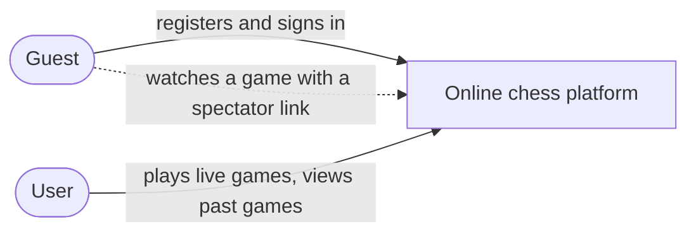
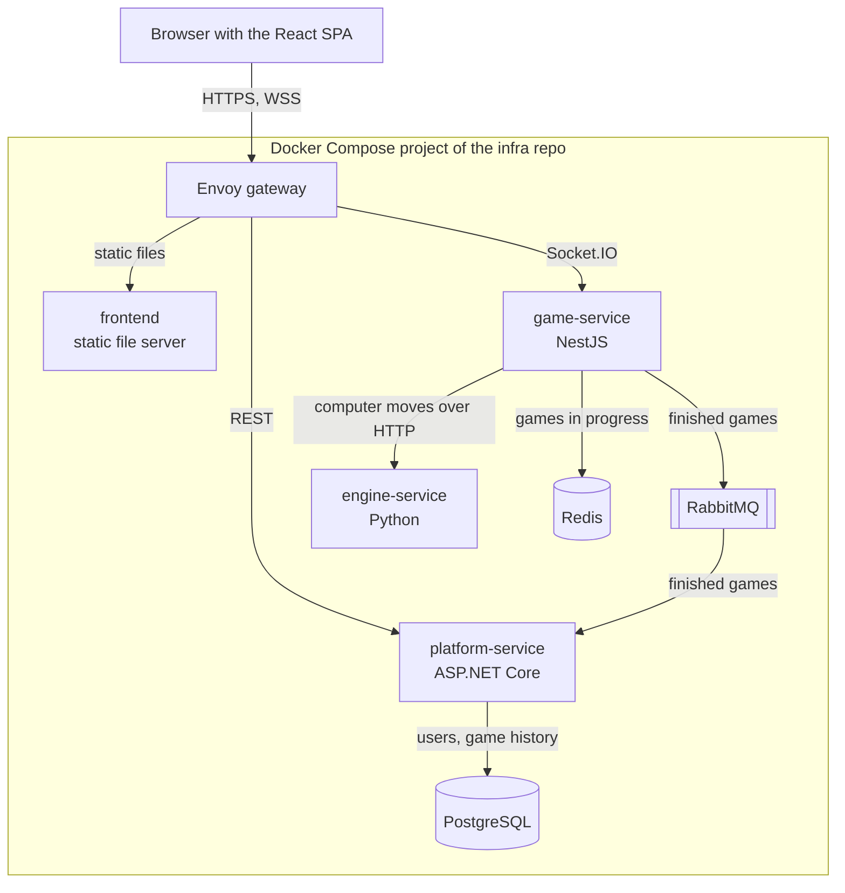
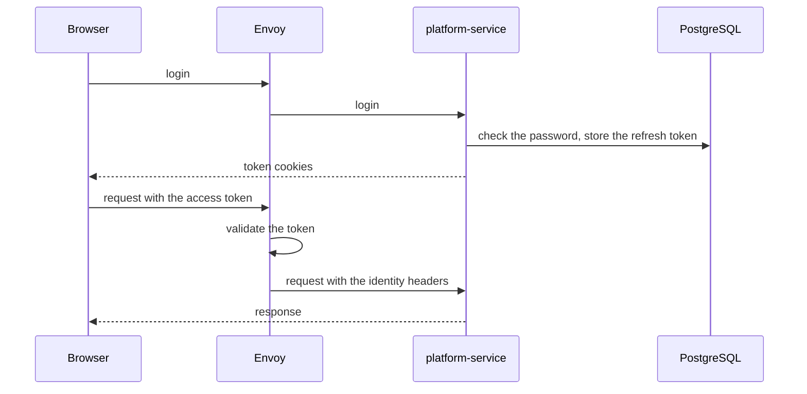
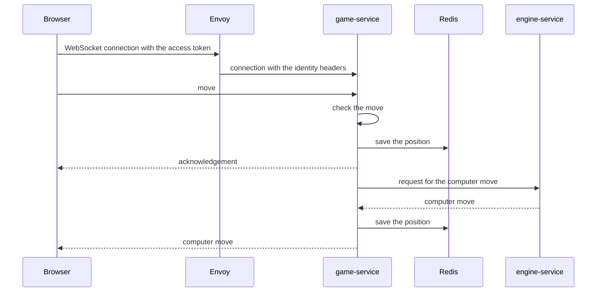
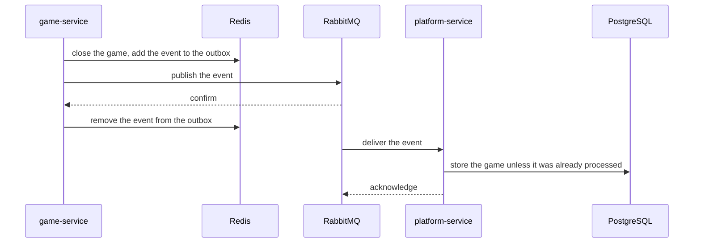

# Architecture

The diagrams of the system at the context and container levels of the C4 model, and the main flows between the services. The diagrams inside a service are in the `docs/architecture.md` of its repo.

## System context

The actors and their use cases are in [spec.md](spec.md). The platform depends on no external system at runtime.

## Containers

[ADR-1](adr/microservices.md) decides the containers, [ADR-3](adr/api-gateway.md) the gateway, [ADR-5](adr/database.md) the database and [ADR-6](adr/service-communication.md) the calls between the services.

## Flows

### Sign-in and an authenticated request

[ADR-4](adr/authentication.md) decides the tokens, the cookies and the identity headers. The responses travel back through Envoy too.

### Live game against the AI

[ADR-3](adr/api-gateway.md) decides the connection, [ADR-6](adr/service-communication.md) the request for the computer move and [ADR-10](adr/live-game.md) which connections get the moves. Once the connection is open, the events travel on it through Envoy. Against a person, the game-service sends the move to every connection of the opponent instead.

### Handover of a finished game

[ADR-6](adr/service-communication.md) decides the event, the outbox and the queue.
