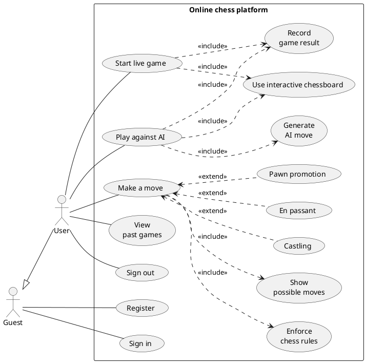
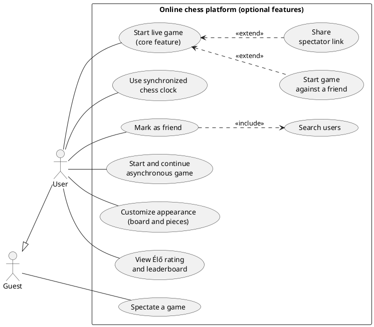

# Requirements specification: online chess platform

Other documents refer to the requirements by their IDs, so an ID never changes, and the ID of a deleted requirement is not used again.

## Goal

The goal is a web application that lets users play chess games online and in real time, against both human and AI opponents.

## Functional requirements

### Core features

The application must provide these core features to its users.

- **F-1** Users can create user accounts by registering, sign in to their account and sign out of it.
- **F-2** A user can start a live chess game, choosing whether to be paired with a random online user who has also started a game, or to play against an AI opponent.
- **F-3** During the game the following special chess moves can be made according to the rules: en passant, pawn promotion, castling.
- **F-4** Every event of the game follows the rules of chess.
- **F-5** During the game users move their pieces on the board shown on screen according to the rules, using the cursor. When a piece is selected, the board highlights the legal moves that it can make.
- **F-6** Users can view their past games and their move history.

### Extra features

These extra features may be implemented.

- **X-1** During a live game an accurate chess clock measures the time, in sync for both users.
- **X-2** Users can search for other users by user name and mark other users as friends.
- **X-3** Users can start games against their friends.
- **X-4** Users can play asynchronous games.
- **X-5** The user interface offers several display styles for the chessboard and the pieces.
- **X-6** Élő rating system: after every live game between two users the system updates the Élő ratings of the players, which users can also view on the leaderboard. The opponent is not drawn at random but by the Élő rating.
- **X-7** A user can request a spectator link for the current live game, with which anyone can view the position of that game.

## Non-functional requirements

### Functionality

**NF-1 Security:** The system must store the passwords of the users hashed in the database. The system must validate user input on both the client and the server side, protect the database operations against SQL injection with parameterized queries, and communicate over HTTPS and WSS.

### Usability

**NF-2** The software must have an intuitive and clear user interface, on which the features are placed logically and the moves of the game are easy to make.

### Reliability

**NF-3** The result and the move history of every finished game must be saved automatically. The system must be able to store the last 100 games of each user.

### Performance

**NF-4 Response time:** The system must answer general requests, for example viewing a profile or querying the history, within at most 1.5 seconds under normal load.

**NF-5 Real-time latency:** The moves made during a live game are synchronized to the interface of the opponent over a WebSocket connection within at most 500 ms under normal network conditions.

**NF-6 Scalability:** The architecture of the system must make it possible to serve at least 1,000 registered users and at least 100 active games in parallel.

### Supportability

**NF-7 Platform dependence:** The web client must work with full functionality in the latest desktop version of Google Chrome, and it must also work satisfactorily in the other widespread modern desktop browsers, Mozilla Firefox and Microsoft Edge.

**NF-8 Extensibility:** The system must be extensible with new game modes, for example Chess960, with minimal changes.

**NF-9 Portability:** The server components must be runnable and configurable in a containerized environment (Docker). This ensures a uniform runtime environment and the deployability of the system on different platforms.

## Glossary

- **AI opponent:** A virtual player controlled by the system, which generates chess moves with algorithms and serves as an opponent instead of a human player.
- **Asynchronous game:** A chess game in which the players are not present in the system at the same time and can make their moves at different times. The state of the game is saved after every move, so the other player can continue the game later.
- **Castling:** A special chess move in which the king and one of the rooks move at the same time. Its purpose is to bring the king to safety and to activate the rook.
- **Chessboard (board):** The playing field of 8×8 squares that shows the chess game, on which the user makes the moves by moving the pieces.
- **Élő rating:** A value that estimates the skill level of a player and increases or decreases with the results of the games.
- **En passant:** A special pawn move that allows capturing a pawn of the opponent directly after its two-square first move.
- **Game (chess game):** A chess match between two parties, which lasts from the starting position to the end and contains every move made and the final result.
- **Game history:** All the matches that a user played before, together with their data.
- **Guest:** A person who uses the system without signing in, who can register, sign in and watch a game through a spectator link.
- **Leaderboard:** A list that shows the ranking of the players and orders the users by various metrics, for example the Élő rating or the number of wins.
- **Live game:** A chess game in which the players make their moves in real time, and the moves appear immediately for the other party.
- **Move:** Moving a piece from one square to another according to the rules of chess.
- **Move history:** The list of the moves made during a given game, stored in chronological order.
- **Pawn promotion:** The rule by which a pawn that reaches the back rank of the opponent can be turned into a piece of higher value, a queen, a rook, a bishop or a knight.
- **Piece:** A game element of chess, which can move on the board according to its type: king, queen, rook, bishop, knight or pawn.
- **Spectator (observer):** Anyone, a signed-in user or a guest, who watches a game in progress through the spectator link but cannot influence its course.
- **Spectator link:** A unique link with which a player can share the ongoing game with anyone for viewing.
- **User:** A person who interacts with the software, creates a user account and uses the services of the system.
- **User account:** The identifier of a user in the system and all the data that belong to it, for example the user name, the password, statistics and the game history.

## Use case diagrams

### Use cases of the core features

### Use cases of the extra features

