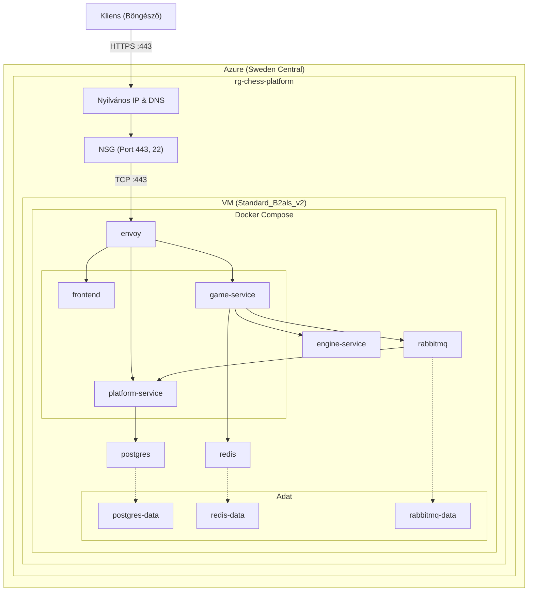

# Online sakkplatform – Rendszerterv (dokumentációváz)

> Ez a fájl a dokumentáció váza. A `> Kifejtendő:` blokkok azt jelzik, mit kell az adott pontba írni,
> a `> Forrás:` blokkok azt, honnan vehető át a tartalom (a repók ADR-jei és architektúra-leírásai angolul vannak,
> ezeket kell magyarra átültetni). A **[ÚJ]** jelölésű pontok a második körben kerültek be,
> az **[AZURE]** jelölésűek a tervezett Azure-telepítés miatt.
> A végleges dokumentumból ezek a blokkok és jelölések törlendők.
>
> **Felelősök:** minden fejezet alatt egy `> **Felelős:`** sor jelzi, ki írja. Az `infra` az `infra` repó
> (Envoy, Docker Compose, adattárolók) gazdáját jelenti; ha nincs ilyen, ki kell jelölni valakit.
> A `közös` fejezeteket egy ember szerkeszti, a többiek a saját részükkel adnak hozzá.
>
> | Felelős | Önálló fejezetek | Rész a közös fejezetekből |
> |---|---|---|
> | frontend | 2.2.2, 2.9 | 2.5, 2.6, 2.10–2.13, 2.15, 4 |
> | platform-service | 2.2.3, 2.8.1, 2.8.2 | 2.3, 2.5, 2.6, 2.10–2.13, 2.15, 4 |
> | game-service | 2.2.4, 2.7, 2.8.3 | 2.3, 2.6, 2.10–2.13, 2.15, 4 |
> | engine-service | 2.2.5 | 2.3, 2.6, 2.10–2.13, 2.15, 4 |
> | infra | 2.2.1, 2.2.6–2.2.8, 2.4 (benne az Azure-környezet), 3 | 2.5, 2.12, 2.13, 4 |
> | közös | 1, 2.1, 2.14, 5–7 | – |

---

## Címlap - anna

- Rendszerterv
- Online sakkplatform fejlesztése
- Szoftverarchitektúrák tárgy házi feladat
- Készítették: Borsik Balázs, Fehér Anna, Sipos Bence, Személyi Balázs András
- Dátum

---

## Tartalom

1. [Követelményspecifikáció (kész)](#0-követelményspecifikáció-kész)
2. [A rendszer célja és funkciói](#1-a-rendszer-célja-és-funkciói)
   1. Feladatkiírás
   2. A rendszer által biztosítandó tipikus funkciók
3. [Megvalósítás](#2-megvalósítás)
   1. Architektúra
   2. Komponensek
   3. Szolgáltatások közötti kommunikáció és interfészek
   4. Telepítési diagram **[ÚJ]**
      1. Helyi futtatás (Docker Compose)
      2. Éles környezet (Azure) **[AZURE]**
   5. Hitelesítés és biztonság
   6. Fő folyamatok
   7. A játszma állapotai **[ÚJ]**
   8. Adat- és adatbázisterv
   9. GUI-terv
   10. Hibakezelés és hibatűrés **[ÚJ]**
   11. Skálázhatóság **[ÚJ]**
   12. Naplózás és monitorozás **[ÚJ]**
   13. A nem funkcionális követelmények teljesítése
   14. Tesztelés
4. [Telepítési leírás](#3-telepítési-leírás)
   1. Helyi futtatás
   2. Telepítés Azure-ba **[AZURE]**
5. [A program készítése során felhasznált eszközök](#4-a-program-készítése-során-felhasznált-eszközök)
6. [Összefoglalás](#5-összefoglalás)
7. [Továbbfejlesztési lehetőségek](#6-továbbfejlesztési-lehetőségek)
8. [Hivatkozások](#7-hivatkozások)

---

## 0. Követelményspecifikáció - (kész, nem tesszük bele)

A `Szoft Arch Sakkplatform Specifikáció.pdf` tartalma, változatlanul:

- Feladatkiírás (alapfunkciók, extra funkciók)
- A fejlesztő csapat
- Részletes feladatleírás
- Funkcionális követelmények (alapfunkciók, extra funkciók)
- Nem funkcionális követelmények (funkcionalitás, használhatóság, megbízhatóság, teljesítmény, támogathatóság)
- Technikai paraméterek
- Szótár
- Use-case-ek (alapfunkciók, extra funkciók)

---

## 1. A rendszer célja és funkciói

### 1.1 Feladatkiírás - becopyzni a kiírást (anna)

> **Felelős:** közös

> Kifejtendő: a feladatkiírás rövid megismétlése (1–2 bekezdés): webes sakkplatform élő és AI ellenfél elleni
> játszmákkal, játszmaelőzményekkel. Hivatkozás a követelményspecifikációra.

### 1.2 A rendszer által biztosítandó funkciók (anna)

> **Felelős:** közös

> Kifejtendő: a ténylegesen megvalósított funkciók listája (a mintában ez a dokumentum-életciklus).
> Javasolt bontás a felhasználó útja szerint:
>
> - fiókkezelés: regisztráció, bejelentkezés, kijelentkezés, munkamenet frissítése
> - játszma indítása: párosítás véletlen ellenféllel (várósor), játék AI ellen
> - játszma lebonyolítása: interaktív tábla, szabályos lépések kiemelése, speciális lépések
> (sáncolás, en passant, gyalogátváltoztatás), sakkóra, játszma vége (matt, patt, feladás, idő stb.)
> - játszmaelőzmények: lapozható lista, játszma visszajátszása lépésenként
> - a megvalósított extra funkciók megjelölése (pl. sakkóra), a meg nem valósítottak a 6. fejezetbe kerülnek

---

## 2. Megvalósítás

### 2.1 Architektúra - Sz.B.

> **Felelős:** közös

> Kifejtendő:
>
> - a választott architektúra: mikroszolgáltatások + API gateway, polyrepo
> - indoklás: a valós idejű játék és a nagy gépigényű motor leválasztása, külön skálázhatóság
> - **ábra:** C4 rendszerkörnyezet-diagram (szereplők: Vendég, Felhasználó, Néző); futás közben nincs
> külső rendszerfüggőség (a sakkszabályok és a motor könyvtárként vannak beépítve)
> - **ábra:** C4 konténerdiagram (böngésző → Envoy → frontend / platform-service / game-service;
> game-service → engine-service, Redis, RabbitMQ → platform-service → PostgreSQL)
> - az ábra után egy-egy mondat minden konténerről, részletesen a 2.2-ban
> - elvetett alternatívák röviden (pl. monolit)
>
> Forrás: `infra/docs/architecture.md` (System context, Containers), `infra/docs/adr/microservices.md`, `infra/docs/adr/polyrepo.md`

### 2.2 Komponensek - S.B. 

> **Felelős:** lásd az alfejezeteket

> Minden komponensnél a mintához hasonló szerkezet: **Célja**, **Felelősségei**, **Technológia és indoklás**,
> **Belső felépítése** (ha van), **ábra** (ha van).

#### 2.2.1 API gateway (Envoy) - Sz.B

> **Felelős:** infra

> Kifejtendő: egyetlen belépési pont, útvonalak szerinti továbbítás (statikus fájlok, REST, Socket.IO),
> TLS lezárás, access token ellenőrzése és identitásfejlécek továbbítása, bejelentkezési kísérletek korlátozása.
>
> Forrás: `infra/docs/adr/api-gateway.md`, `infra/envoy/`

#### 2.2.2 Webes kliens (frontend) - Anna

> **Felelős:** frontend

> Kifejtendő:
>
> - React + TypeScript + Vite SPA, nginx szolgálja ki
> - mappaszerkezet / modulok (auth, lobby, game, api, routing, theme)
> - állapotkezelés (TanStack Query a szerveradatokhoz, élő játszma állapota)
> - sakktábla-komponens és lépésellenőrzés a kliensen
> - útvonalak és oldalak (részletesen a 2.9-ben)
> - kommunikáció: REST a platform-service felé, Socket.IO a game-service felé
>
> Forrás: `frontend/docs/adr/` (stack, state-management, chessboard, pages-and-routing, styling, gateway-access)

#### 2.2.3 platform-service (ASP.NET Core) - Sz.B.

> **Felelős:** platform-service

> Kifejtendő:
>
> - felelősség: felhasználókezelés, tokenek és munkamenetek, játszmaelőzmények tárolása és lekérdezése
> - **rétegek (Clean Architecture)**, a mintában az N-rétegű bontás megfelelője, ábrával:
>   - Domain: entitások, domain szabályok
>   - Application: use case-ek, portok
>   - Infrastructure: EF Core, Identity, access tokenek, a befejezett játszmák fogyasztója
>   - API: HTTP végpontok, middleware-ek, request pipeline
> - validáció, hibakezelés, konfiguráció
>
> Forrás: `platform-service/docs/architecture.md`, `platform-service/docs/adr/`

#### 2.2.4 game-service (NestJS) - B.B.

- **Célja:**  
  A `game-service` a platform valós idejű játékszervező mikroszolgáltatása. Feladata a folyamatban lévő mérkőzések teljes életciklusának kezelése: párosítás, lépésfogadás, szabályellenőrzés, sakkórák mérése, partik lezárása és az események aszinkron továbbítása.

- **Felelősségei:**
  - **Párosítás:** Valós idejű, FIFO elvű várósor kezelése két játékos véletlenszerű összekapcsolására.
  - **Valós idejű kommunikáció:** Alacsony késleltetésű kétirányú WebSocket kapcsolatok biztosítása Socket.IO segítségével (`/ws/game`).
  - **Munkamenet-kezelés:** Felhasználói szobák (`user:<userId>`) révén több fül/eszköz egyidejű szinkronizálása; felhasználónként szigorúan legfeljebb egy aktív mérkőzés vagy várakozás engedélyezett.
  - **Szabályellenőrzés:** Hivatalos FIDE sakkszabályok érvényesítése a `chess.js` könyvtárral (szabályos lépések, sáncolás, en passant, gyalogátváltoztatás, sakk, matt, döntetlenek).
  - **Sakkóra:** 10 perces gondolkodási idő játékosonként; valós idejű óraszámítás és határidő-ellenőrzés.
  - **AI mérkőzések:** Játszmák kiszolgálása a gép ellen az `engine-service` (Stockfish) szinkron REST hívásával.
  - **Eseményátadás:** Befejezett játszmák továbbítása RabbitMQ-n keresztül (Transactional Outbox mintával) a tartós tárolásért felelős `platform-service` felé.

- **Technológia és indoklás:**
  - **NestJS (TypeScript):** Moduláris, típusos keretrendszer beépített függőséginjektálással, kifejezetten alkalmas nagy egyidejűségű I/O műveletekre.
  - **Socket.IO:** Kizárólagos WebSocket transzport a minimális hálózati késleltetésért (az Envoy mögött a HTTP polling fallback le van tiltva).
  - **chess.js (1.4.0):** Megbízható, determinisztikus sakkmag; a frontenddel azonos logikát garantál.
  - **@redis/client:** Nagy sebességű natív kliens atomi Lua szkriptvégrehajtáshoz.

- **Belső felépítése:**
  - `src/game/`: A WebSocket gateway (`GameGateway`) és az üzleti folyamatok vezérlése (`joinQueue`, `leaveQueue`, `startBotGame`, `makeMove`, `resign`, `getState`).
  - `src/domain/`: Sakkszabályok, táblaállapot (FEN), lépések (UCI) és típusdefiníciók.
  - `src/redis/`: `RedisService`, a játékállapotok, státuszok, határidők és az outbox atomi Lua kezelése.
  - `src/engine/`: `EngineClient`, HTTP REST kliens az `engine-service` felé (15s timeout, 1 újrapróbálkozás).
  - `src/clock/`: `ClockService`, másodpercenként futó háttérfolyamat a lejárt sakkórák lezárására.
  - `src/outbox/`: `OutboxPublisher`, 1,5 másodpercenként továbbítja a befejezett meccseket a RabbitMQ felé.
  - `src/config/`: Környezeti változók típusos konfigurációja és validációja.

#### 2.2.5 engine-service (Python) S.B.

> **Felelős:** engine-service

> Kifejtendő:
>
> - felelősség: gépi lépés számítása egy adott állásra
> - a választott sakkmotor és indoklása, nehézségi szint(ek)
> - webes keretrendszer, HTTP API
> - állapotmentesség → külön skálázható
>
> Forrás: `engine-service/docs/architecture.md`, `engine-service/docs/integration.md`, `engine-service/docs/adr/`

#### 2.2.6 PostgreSQL (relációs adatbázis) - Sz.B.

> **Felelős:** infra (+ platform-service)

> Kifejtendő:
>
> - célja: a hosszú távú adatok tárolása (felhasználók, munkamenetek, befejezett játszmák)
> - ki használja: csak a platform-service, más szolgáltatás nem éri el
> - miért ezt választottuk, elvetett alternatívák (pl. más SQL vagy NoSQL adatbázis)
> - konfiguráció: verzió, tartós tár (kötet), migrációk futtatása, hozzáférési adatok
> - **[AZURE]** éles környezetben: Azure Database for PostgreSQL vagy konténer (lásd 2.4.2)
> - a séma részletei a 2.8.1–2.8.2-ben
>
> Forrás: `infra/docs/adr/database.md`, `infra/postgres/`, `platform-service/docs/adr/persistence.md`

#### 2.2.7 Redis (a futó játszmák tárolója) - B.B.

- **Célja:**  
  A platform ultra-alacsony késleltetésű, memóriában futó kulcs-érték adattára a futó mérkőzések, sakkóra-határidők, játékos-státuszok, párosítási várósor és a tranzakciós outbox események tárolására.

- **Felelősségei:**
  - **Gyors állapotkiszolgálás:** Valós idejű játékmenet támogatása mikroszekundumos válaszidővel.
  - **Állapotmentesség biztosítása:** A `game-service` processzei állapotmentesek maradnak, bármely példány hozzáférhet bármely játszmához.
  - **Atomi műveletvégrehajtás:** Összetett állapotátmenetek (lépés, óralevonás, zárás, outboxba írás) végrehajtása zárolásmentes Lua szkriptekkel.
  - **Outbox puffer:** Befejezett partik átmeneti tárolása a megerősített RabbitMQ feladásig.

- **Ki használja:**  
  Kizárólag a `game-service` éri el a dedikált belső `redis` Docker hálózaton keresztül.

- **Miért ezt választottuk és elvetett alternatívák:**
  - **Redis:** Memóriában tárol, támogatja a Lua tranzakciókat és a komplex adatstruktúrákat (Sorted Set órahatáridőkhöz), garantálva a <500 ms-os válaszidőt.
  - *Elvetett alternatíva – Node.js belső memória:* Ellehetetlenítené a horizontális skálázást, és konténer-újrainduláskor az összes futó parti elveszne.
  - *Elvetett alternatíva – PostgreSQL:* A folyamatos másodpercenkénti óra- és lépésfrissítések lemezre írása és sorzárolása túlterhelné a relációs adatbázist.

- **Konfiguráció és megbízhatóság:**
  - **Kép:** `redis:8.8-alpine`.
  - **Tartósság:** AOF (`appendonly yes`) perzisztencia dedikált köteten (`redis-data:/data`), így újrainduláskor a partik és az outbox események helyreállnak.
  - **Biztonság (ACL):** A jelszó nélküli `default` felhasználó tiltva (`--user default off`); a `game-service` felhasználó nem ér el adminisztratív parancsokat (`+@all -@admin`).
  - **Éles környezet:** Konténerként fut a közös Azure VM-en, elkerülve a drága menedzselt felhős szolgáltatásokat.

- **Megjelenés a kódban:**  
  A `game-service/src/redis/redis.service.ts` (`RedisService`) kezeli a kapcsolatot a `@redis/client` csomagon keresztül. Integrációs tesztjei valós konténer ellen futnak (Testcontainers).

#### 2.2.8 RabbitMQ (üzenetközvetítő) - B.B.

- **Célja:**  
  A mikroszolgáltatások közötti megbízható, aszinkron üzenetbróker. Célja a befejezett játszmák laza csatolású, garantált átadása a `game-service` és a perzisztenciát végző `platform-service` között.

- **Felelősségei:**
  - **Szétcsatolás (Decoupling):** A `game-service` azonnal lezárhatja a partit, függetlenül attól, hogy a `platform-service` épp elérhető-e.
  - **Kézbesítési garancia (At-Least-Once):** Garantálja, hogy egyetlen befejezett parti sem vész el hálózati kiesés vagy újraindulás esetén sem.
  - **Útválasztás (Routing):** Rugalmas topic exchange alapú eseményelosztás.

- **Ki használja:**  
  A `game-service` publikálja a partikat, a `platform-service` fogyasztja őket a belső `rabbitmq` hálózaton.

- **Miért ezt választottuk és elvetett alternatívák:**
  - **RabbitMQ:** Kiforrott üzenetsor beépített menedzsment felülettel és replikált naplózású Quorum Queue mechanizmussal.
  - *Elvetett alternatíva – Szinkron REST hívás:* Szoros csatolást hozna létre; a `platform-service` hibája vagy lassulása blokkolná a játszma lezárását.
  - *Elvetett alternatíva – Apache Kafka:* Feleslegesen komplex és erőforrásigényes; visszajátszható eseménystreamek helyett csak megbízható feladatra van szükség.
  - *Elvetett alternatíva – Redis Streams:* A holtverseny-kezelést (DLQ) és konfirmációkat manuálisan kellene fejleszteni, és sértené az adatbázis-per-szolgáltatás elvet.

- **Sorok és kézbesítési mechanizmus:**
  - **Exchange & Sor:** `game.events` (tartós topic exchange, `game.finished` kulcs) ➔ `platform.game-finished` (tartós Quorum Queue).
  - **Kézbesítési garanciák:**
    - *Feladó:* *Publisher Confirms* és `mandatory` flag; az esemény csak a bróker sikeres lemezre mentése után törlődik az outboxból.
    - *Fogyasztó:* Manuális nyugtázás (*manual ack*), kizárólag a sikeres PostgreSQL tranzakció (commit) után.
    - *Idempotencia:* Az esemény UUID-ja alapján a fogyasztó kiszűri az újrapróbálkozásokból adódó duplikátumokat.
    - *Hibakezelés (Dead-Letter):* 20 sikertelen próbálkozás után a policy automatikusan a `platform.game-finished.dlx` dead-letter exchange-re irányítja az üzenetet.

- **Konfiguráció és jogosultságok:**
  - **Kép és portok:** `rabbitmq:4.4-management-alpine` (belső AMQP: 5672, menedzsment: 15672).
  - **Jogosultságok:** Névtér-szeparáció: `game-service` csak `game.*` erőforrásokat, a `platform-service` csak `platform.*` erőforrásokat és a `game.events` olvasását éri el.
  - **Éles környezet:** Konténerként fut a virtuális gépen, perzisztens kötettel (`rabbitmq-data:/var/lib/rabbitmq`).

- **Megjelenés a kódban:**  
  Feladói oldalon az `OutboxPublisher` (`amqplib`), fogadói oldalon a `platform-service` háttér-fogyasztója (`GameFinishedConsumer`) valósítja meg. Konfiguráció: `infra/rabbitmq/rabbitmq.conf` és `definitions.json`.

### 2.3 Szolgáltatások közötti kommunikáció és interfészek - Anna

> **Felelős:** közös (áttekintő táblázat, konvenciók) + a saját interfészét minden szolgáltatás: platform-service (REST végpontok), game-service (Socket.IO események, „befejezett játszma” esemény), engine-service (HTTP API)

> Kifejtendő:
>
> - kommunikációs módok táblázatban: ki kivel, milyen protokollon, szinkron/aszinkron
> (REST, Socket.IO/WSS, HTTP az engine felé, AMQP). A dokumentumban csak itt szerepel ez a táblázat,
> a 2.4 telepítési diagramjai erre hivatkoznak.
> - szerződésalapú fejlesztés: OpenAPI és AsyncAPI leírások az `infra/contracts` mappában, konvenciók
> - a fő REST végpontok rövid táblázata (útvonal, metódus, leírás)
> - a fő Socket.IO események táblázata
> - a „befejezett játszma” esemény szerkezete
>
> Forrás: `infra/contracts/*.yaml`, `infra/docs/adr/contracts.md`, `infra/docs/adr/contract-conventions.md`,
> `infra/docs/conventions.md`

### 2.4 Telepítési diagram **[ÚJ] - Sz.B.**

> **Felelős:** lásd az alfejezeteket

> A fizikai nézet: hol fut az egyes komponens, és mi mit ér el hálózati szinten. A diagramok nyilai
> csak az elérhetőséget mutatják; a protokollokat és az üzenetek tartalmát a 2.3 írja le, itt nem ismételjük.

#### 2.4.1 Helyi futtatás (Docker Compose) Sz.B

> **Felelős:** infra

> Kifejtendő:
>
> - **ábra:** UML telepítési diagram vagy Compose-topológia: a konténerek, a Docker hálózatok
> (melyik szolgáltatás melyik hálózaton lát melyik adattárolót), a kívülről elérhető portok
> (csak az Envoy), a kötetek (PostgreSQL, Redis, RabbitMQ adatai, tanúsítvány)
> - health checkek és az indulási sorrend (`depends_on`), adatbázis-migráció indításkor
> - a fejlesztői változatok eltérései röviden (melyik szolgáltatás fut a gépen a konténer helyett)
>
> Forrás: `infra/compose.yaml`, `infra/compose.*.yaml`, `infra/envoy/`, `infra/README.md`

#### 2.4.2 Éles környezet (Azure) - B.B.

A rendszer éles környezete a Microsoft Azure felhőben (*Sweden Central* régió) üzemel egyetlen dedikált `Standard_B2als_v2` Linux virtuális gépen. A kialakítás fő szempontja az **egyszerű, gyors és költséghatékony** megvalósítás volt a 100 USD-s *Azure for Students* hallgatói keretből, biztosítva a 100%-os fejlesztői és éles paritást.

Nyilvános végpont: `https://chess7ed.swedencentral.cloudapp.azure.com`

##### Telepítési topológia

A telepítési diagram bemutatja az Azure felhőben kialakított erőforráscsoportot, a virtuális gép hálózati elérését és a belső konténereket:



##### Architekturális döntések

1. **Futtatókörnyezet (Azure VM + Docker Compose):**
   - **Választás:** Egyetlen `Standard_B2als_v2` Linux VM Docker Compose-zal.
   - **Indoklás:** A menedzselt konténerplatformok (AKS, Container Apps) csomóponti díjai és külső SMB tárai gyorsan felemésztenék a 100 dolláros keretet; a B-sorozatú VM-en viszont a lokális `compose.yaml` módosítás nélkül, zéró többletköltséggel fut.

2. **Konténerkép-nyilvántartás (Registry):**
   - **Választás:** GitHub Container Registry (`ghcr.io/szoftarch-chess-platform/*:1.0.0`).
   - **Indoklás:** Nyilvános csomagok esetén ingyenes, a meglévő GitHub környezethez kapcsolódik, elkerülve az Azure Container Registry (ACR) havi fix díját és jogosultságkezelését.

3. **Adattárolók és üzenetsor (Helyi konténerek):**
   - **Választás:** Konténerizált PostgreSQL, Redis és RabbitMQ helyi SSD kötetekkel (`postgres-data`, `redis-data`, `rabbitmq-data`).
   - **Indoklás:** A menedzselt Azure PaaS adatbázisok havi 15-25 dolláros tételei napok alatt kimerítenék a keretet; a helyi konténerek zéró többletköltséggel, minimális késleltetéssel futnak.

4. **API Gateway és Ingress:**
   - **Választás:** Envoy Proxy konténerként a 443-as porton.
   - **Indoklás:** Kiváltja a költséges Azure Application Gateway-t; közvetlenül támogatja a projekt egyedi WebSocket és JWT konfigurációját.

5. **Frontend kiszolgálás:**
   - **Választás:** Statikus React bundle Nginx konténerből az Envoy mögött.
   - **Indoklás:** Azonos domain alatt fut az API-val, így elkerülhetők a külön szolgáltatások (pl. Static Web Apps) és a bonyolult cross-origin (CORS/cookie) konfigurációk.

### 2.5 Hitelesítés és biztonság - S.B.

> **Felelős:** platform-service (tokenek, jelszavak, validáció) + infra (Envoy: tokenellenőrzés, rate limiting) + frontend (cookie-k, frissítés, kliensoldali validáció)

> Kifejtendő:
>
> - access és refresh token, tárolás cookie-ban, frissítés, kijelentkezés
> - a tokenek ellenőrzése a gatewayben, identitásfejlécek a szolgáltatások felé
> - jelszavak hashelése (ASP.NET Identity)
> - bemenetek validálása kliens- és szerveroldalon, paraméterezett lekérdezések (EF Core)
> - HTTPS/WSS, rate limiting
> - **[AZURE]** az éles környezet biztonsága: titkok tárolása (Key Vault), az adattárolók csak belső
> hálózatról érhetők el, nyilvános tanúsítvány, a gateway helye az Azure-ban (lásd 2.4.2)
> - kapcsolat a specifikáció „Biztonság” követelményével
>
> Forrás: `infra/docs/adr/authentication.md`, `platform-service/docs/adr/tokens-and-sessions.md`,
> `platform-service/docs/adr/gateway-authentication.md`, `platform-service/docs/adr/accounts.md`

### 2.6 Fő folyamatok - Anna

> **Felelős:** folyamatonként, lásd a listát

> Kifejtendő: szekvenciadiagramok és rövid magyarázat az alábbiakhoz:
>
> 1. Regisztráció és bejelentkezés, hitelesített kérés – *platform-service* (+ infra, frontend)
> 2. Párosítás és élő játszma két játékos között – *game-service* (+ frontend)
> 3. Élő játszma AI ellen – *game-service* + *engine-service*
> 4. Befejezett játszma átadása és mentése (outbox, sor, idempotens feldolgozás) – *game-service* + *platform-service*
> 5. Játszmaelőzmények lekérdezése és visszajátszás – *platform-service* + *frontend*
>
> Forrás: `infra/docs/architecture.md` (Flows), `platform-service/docs/architecture.md`
>
> `id emég be lehetne rakni egy usecase-t?`

### 2.7 A játszma állapotai **[ÚJ] - Sipos Bence**

> **Felelős:** game-service

> Kifejtendő:
>
> - **ábra:** UML állapotgép-diagram egy játszma (és a felhasználó) életciklusáról, pl.:
> nincs játszma → várósorban → folyamatban → befejezve → átadva a platform-service-nek
> - az átmenetek eseményei (párosítás, AI-játszma indítása, lépés, feladás, kilépés a sorból)
> - a befejezés okai: matt, patt, döntetlen szabályok (anyaghiány, háromszori ismétlés, 50 lépés), feladás,
> lejárt idő, kapcsolat elvesztése (ha van ilyen szabály)
> - a sakkóra működése: mikor indul, mikor áll, ki méri (a szerver)
>
> Forrás: `game-service/src`, `infra/docs/adr/live-game.md`, `infra/docs/adr/chess-rules.md`,
> `infra/contracts/game-service.asyncapi.yaml`

### 2.8 Adat- és adatbázisterv - Sz. B.

> **Felelős:** lásd az alfejezeteket

#### 2.8.1 Az adatbázis entitás-relációs diagramja - Sz. B.

> **Felelős:** platform-service

> Kifejtendő: ER-diagram a PostgreSQL sémáról (felhasználó, refresh token, játszma, lépések,
> feldolgozott üzenetek stb.), az ORM (EF Core) és a migrációk rövid bemutatása.
>
> Forrás: `platform-service/src/PlatformService.Domain`, `PlatformService.Infrastructure` (EF konfiguráció, migrációk),
> `platform-service/docs/adr/persistence.md`, `game-history.md`

#### 2.8.2 Entitások Sz.B.

> **Felelős:** platform-service

> Minden entitásnál a mintához hasonlóan: **Célja**, **Leképzése a kódban** (osztály),
> **Leképzése az adatbázisban** (tábla), **Tulajdonságai** (mezők listája rövid leírással).

- Felhasználó entitás
- Refresh token / munkamenet entitás
- Játszma entitás
- Lépés / lépéstörténet (ha külön tábla, különben a Játszma része)
- Egyéb technikai entitások (pl. feldolgozott üzenetek)

#### 2.8.3 A futó játszmák adatmodellje (Redis) - B.B.

A `game-service` a folyamatban lévő játszmák, a játékosok foglaltsági állapotának, a párosítási várósornak és az outbox eseményeknek a tárolására egy dedikált Redis adatbázist használ.

##### Miért nem relációs adatbázis?
1. **Sebesség:** A memóriában történő tárolás mikroszekundumos válaszidőt nyújt, garantálva a specifikációban előírt <500 ms-os valós idejű késleltetést.
2. **Aggregátum alapú modell:** A futó mérkőzés önálló egység; a teljes állapot egyetlen JSON struktúrában olvasható és írható JOIN műveletek nélkül.
3. **Zárolásmentes egyidejűség (Lua):** Pesszimista SQL zárolások helyett a Redis egyszálú Lua szkriptjeivel valósítunk meg atomi Compare-And-Swap (CAS) állapotátmeneteket holtpontok (deadlock) nélkül.

##### A Redis kulcsok szerkezete és típusai

A rendszer a következő kulcsstruktúrát használja a Redisben:

| Kulcs formátum | Típus | Leírás és tartalom |
|---|---|---|
| `user:status:<userId>` | String | A felhasználó aktuális státusza. Értéke `queue`, ha a várósorban áll, vagy `game:<gameId>`, ha aktív játszmában van. Ha a játékos szabad, a kulcs nem létezik. |
| `queue:players` | List | A véletlen ellenfélre váró játékos `UserPlayer` objektuma JSON formátumban: `{ kind: 'user', userId: string, name: string }`. Mivel a párosítás azonnali, a lista hossza legfeljebb 1. |
| `game:<gameId>` | String (JSON) | A futó játszma teljes pillanatnyi állapota JSON-ként szerializálva (játékosok, FEN állás, UCI lépéstörténet, sakkórák, utolsó lépés időbélyege). |
| `game:deadlines` | Sorted Set | A játszmák aktuális lépési határideje. Elem: `<gameId>:<color>` (a soron következő fél), Pontszám (Score): az abszolút lejárati időpont Unix időbélyegként milliszekundumban. |
| `outbox:events` | List | A befejezett partik `game.finished.v1` eseményeit tartalmazó FIFO lista, ahonnan a háttérfolyamat aszinkron publikál a RabbitMQ felé. |

##### A kulcsok belső adatstruktúrája

- **A játszma állapota (`game:<gameId>`):**  
  A kulcs értéke a szerződés szerinti `ExtendedGameState` JSON reprezentációja:
  ```json
  {
    "gameId": "0193c2b4-7d3e-7c2a-9f1e-3b5a6c7d8e9f",
    "variant": "standard",
    "white": { "kind": "user", "userId": "0193c2b4-0001-7000-8000-000000000001", "name": "alice" },
    "black": { "kind": "user", "userId": "0193c2b4-0002-7000-8000-000000000002", "name": "bob" },
    "fen": "rnbqkbnr/pppppppp/8/8/4P3/8/PPPP1PPP/RNBQKBNR b KQkq e3 0 1",
    "moves": ["e2e4"],
    "clock": { "whiteMs": 598450, "blackMs": 600000, "running": "black" },
    "timeControl": { "initialMs": 600000 },
    "startedAt": "2026-11-26T16:00:00.000Z",
    "lastMoveTimestamp": 1732636801550
  }
  ```
  *(Megjegyzés: A soron következő játékos színét a rendszer nem redundáns mezőként tárolja, hanem közvetlenül a FEN rekord aktív fél jelöléséből képezi le futásidőben: `fen.split(' ')[1] === 'w' ? 'white' : 'black'`.)*

- **A `game:<gameId>` JSON adatstruktúra tulajdonságai:**

| Mezőnév | TypeScript típus | JSON típus | Leírás |
|---|---|---|---|
| `gameId` | `string` (UUID v7) | `string` | A játszma egyedi azonosítója (RFC 9562). |
| `variant` | `'standard'` | `string` | A játékvariáns (jelenleg standard sakk). |
| `white` | `Player` | `object` | A világos játékos adatai (lehet emberi játékos `UserPlayer` vagy gép `BotPlayer`). |
| `black` | `Player` | `object` | A sötét játékos adatai (lehet emberi játékos `UserPlayer` vagy gép `BotPlayer`). |
| `fen` | `string` (FEN) | `string` | Az aktuális táblaállás FEN (Forsyth–Edwards Notation) formátumban. |
| `moves` | `string[]` (UCI) | `array[string]` | A mérkőzés során eddig megtett lépések UCI formátumban (pl. `["e2e4", "e7e5"]`). |
| `clock` | `Clock` | `object` | Az órák hátralévő ideje (`whiteMs`, `blackMs`) és az épp ketyegő óra színe (`running`). |
| `timeControl` | `TimeControl` | `object` | Időbeállítás: `initialMs` (alapértelmezetten 600 000 ms, azaz 10 perc). |
| `startedAt` | `string` (ISO 8601) | `string` | A játszma kezdetének időbélyege UTC formátumban. |
| `lastMoveTimestamp` | `number` | `number` | Az utolsó szabályos lépés beérkezésének Unix időbélyege (ms). |

- **A határidők kezelése (`game:deadlines`):**  
  A határidőket egy Sorted Set (`ZSET`) tárolja a bizonytalan kulcsonkénti TTL helyett:
  - Humán játékosnál a pontszám a gondolkodási idő abszolút lejárata (`lastMoveTimestamp + clockMs`).
  - Gépi ellenfélnél a bot kérésétől számított 35 másodperces biztonsági korlát (2 × 15s engine timeout + 5s Redis időtúllépés).
  - A háttérfolyamat másodpercenként egyetlen `ZRANGE game:deadlines -inf <most> BYSCORE` lekérdezéssel azonosítja a lejárt partikat, determinisztikusan lezárva azokat.

##### Atomi műveletek Lua szkriptekkel

A több kulcsot érintő konzisztens műveletek előre betöltött atomi Lua szkriptként (`EVALSHA`) futnak le:

1. **Párosítás és várósor (`joinQueue`):**  
   Atomi módon ellenőrzi a játékos foglaltságát (`user:status`). Ha szabad és a `queue:players` listában van várakozó, azonnal párosít, generálja a `game:<gameId>` kulcsot véletlen színsorsolással, beállítja mindkét játékos státuszát, és bejegyzi a kezdő határidőt a `game:deadlines` halmazba.
2. **Lépés rögzítése (`makeMove` – Optimista egyidejűségkezelés):**  
   A sakklogikát a Node.js processz futtatja (`chess.js`), a Lua szkript pedig Compare-And-Swap (CAS) ellenőrzést végez: megvizsgálja a tárolt lépésszámot (`#moves == storedMoveCount`). Egyezés esetén atomi módon frissíti a JSON állapotot és a következő játékos határidejét; ütközés esetén a hívó újraolvas és legfeljebb 3-szor újrapróbálkozik.
3. **Játszma lezárása és Transactional Outbox:**  
   Parti végén (matt, feladás, időtúllépés) a szkript egyetlen tranzakcióban törli a játékállapotot, a határidőt, felszabadítja a játékosok `user:status` bejegyzését, és hozzáadja a `game.finished.v1` eseményt az `outbox:events` listához, garantálva az adatvesztésmentes outbox működést.

##### A RedisService által nyújtott interfész a felsőbb rétegek számára

A `game-service`-ben a `RedisService` adathozzáférési rétege a következő kulcsfontosságú műveleteket biztosítja az üzleti réteg (`GameService`) felé:
- `getUserStatus(userId)`: Felhasználó foglaltsági státuszának lekérdezése (`idle`, `queue` vagy `game`).
- `peekQueue()`: A párosítási várósor legrégebben várakozó játékosának lekérdezése a sorból való kivétel nélkül.
- `joinQueue(player, pairing?)`: Játékos sorba állítása, vagy – ha a `peekQueue` talált ellenfelet – az azonnali párosítás és játszmaindítás atomi CAS végrehajtása.
- `leaveQueue(userId)`: Várakozó játékos kiléptetése a párosítási sorból.
- `startGame(userId, game, deadline)`: Új játszma indítása és első határidejének bejegyzése (pl. bot elleni parti esetén).
- `getGame(gameId)`: A játszma aktuális aggregátum állapotának lekérése.
- `saveMove(game, storedMoveCount, deadline)`: Szabályos lépés és új határidő perzisztálása optimista lépésszám-ellenőrzéssel.
- `finishGame(game, storedMoveCount, event)`: Parti lezárása, játékosok foglaltsági státuszának törlése és a `game.finished.v1` esemény atomi outboxba helyezése.
- `getExpiredDeadlines(now)`: Az épp lejárt gondolkodási idők lekérdezése a Sorted Set-ből.
- `claimDeadline(gameId, color, now, until)`: Gépi lépés határidejének atomi átütemezése újrapróbálkozás idejére (másik példány általi átvételhez).
- `peekOutboxEvent()` / `removeOutboxEvent(json)`: Outbox esemény beolvasása, illetve pontos törlése a megerősített RabbitMQ közvetítés után.

### 2.9 GUI-terv - Anna

> **Felelős:** frontend

> Kifejtendő: az oldalak listája útvonallal és jogosultsággal, mindegyikhez képernyőkép vagy drótváz és rövid leírás:
>
> - `/login` – Bejelentkezés
> - `/register` – Regisztráció
> - `/` – Lobby (játszma indítása: párosítás vagy AI)
> - `/game` – Játszma (tábla, sakkóra, ellenfél, eredmény)
> - `/history` – Játszmaelőzmények (lapozható lista)
> - `/history/:gameId` – Visszajátszás (lépésenkénti léptetés, lépéslista)
> - Navigáció az oldalak között (ábra), átirányítási szabályok (vendég / bejelentkezett)
>
> Forrás: `frontend/docs/adr/pages-and-routing.md`, `frontend/docs/adr/styling.md`

### 2.10 Hibakezelés és hibatűrés [ÚJ] - B.B.

Az elosztott, valós idejű működés során felmerülő hibák kezelésére az alábbi mechanizmusokat valósítottuk meg:

#### 1. Klienskapcsolat megszakadása és oldal-újratöltés
- **Probléma:** Hálózati ingadozás vagy a böngésző újratöltése (F5) játék közben.
- **Megoldás:** A `game-service` teljesen állapotmentes; újracsatlakozáskor a kliens egyetlen `getState` kéréssel lekéri a teljes játékállapotot a Redisből (aktuális FEN, lépések és a szerveridő alapján korrigált óraállás). A szerveroldali sakkóra tovább mér, így a 10 perces gondolkodási idő lejártakor a mérkőzés determinisztikusan időtúllépéssel (`timeout`) zárul (kivéve FIDE 6.9 szerinti döntetlen állás esetén).

#### 2. Párhuzamos munkamenetek (több böngészőfül)
- **Probléma:** A felhasználó több lapon vagy eszközön lép be egyidejűleg.
- **Megoldás:** Felhasználói szintű Socket.IO szobák (`user:<userId>`) alkalmazásával minden játék- és óraesemény szinkronban megjelenik valamennyi aktív fülön, és bármelyikről beküldött szabályos lépést elfogadja a rendszer. A várósorból (`leaveQueue`) csak az utolsó aktív kapcsolat lezárásakor kerül ki a játékos.

#### 3. Sakkmotor lassulása vagy hibája (AI játszma)
- **Probléma:** A Stockfish motort futtató `engine-service` nem válaszol vagy túlterhelt.
- **Megoldás:** Szigorú, 15 másodperces időkorlát (`REQUEST_TIMEOUT_MS = 15000`) és pontosan egy automatikus újrapróbálkozás. Második hiba esetén a parti nem ragad be: a rendszer `aborted` eredménnyel és `engineFailure` indoklással lezárja a mérkőzést, és elmenti az előzményekbe. A bot válaszideje alatt a játékos órája áll.

#### 4. RabbitMQ vagy platform-service elérhetetlensége parti végén
- **Probléma:** Befejezéskor az üzenetbróker vagy a háttéradatbázis nem elérhető.
- **Megoldás (Transactional Outbox):** A parti lezárása és a `game.finished.v1` esemény Redisbe írása egyetlen atomi Lua szkriptben fut le, így a játékosok számára a parti azonnal lezárul. Az `OutboxPublisher` 1,5 másodpercenként továbbítja az eseményeket megerősített módban (*Publisher Confirms* + `mandatory`). A `platform-service` manuális nyugtázást (*manual ack*) használ a sikeres PostgreSQL commit után, UUID alapján kiszűri a duplikátumokat, feldolgozhatatlan üzenetnél pedig azonnal a `platform.game-finished.dlx` dead-letter exchange-re irányítja azt (20-as újrapróbálkozási limittel).

#### 5. game-service vagy Redis újraindulása
- **Probléma:** Konténer-összeomlás vagy virtuális gép újraindulása.
- **Megoldás:** Az állapotmentes `game-service` azonnal készen áll a kérések fogadására. A Redis az AOF (`appendonly yes`) perzisztencia révén a dedikált kötetről (`redis-data`) helyreállítja az összes futó játszmát, határidőt és outbox eseményt.

#### 6. Lejárt access token kezelése mérkőzés alatt
- **Probléma:** A 15 perces JWT access token lejár egy elhúzódó játszma során.
- **Megoldás:** A WebSocket kapcsolat hitelesítése a handshake fázisban történik az Envoy szintjén; a már felépült TCP kapcsolatot a token lejárata nem bontja fel. A REST kérésekhez a frontend a háttérben, a HTTP-only cookie-ban lévő refresh token segítségével észrevétlenül új tokent kér a `/api/auth/refresh` végponton.

#### 7. Egységes hibakezelési formátum
- **Probléma:** Különböző protokollok eltérő hibaválasz-struktúrái.
- **Megoldás:** REST API hívásoknál az IETF RFC 9457 szabvány szerinti `application/problem+json` (`ProblemDetails`) formátumot használjuk; WebSocketen típusos hibakódok érkeznek (`unauthorized`, `gameNotFound`, `notYourTurn`, `illegalMove`, `alreadyInGame`, `internalError`), amelyeket a frontend egységes felugró Toast értesítésként jelenít meg.

---

### 2.11 Skálázhatóság [ÚJ] - B.B.

A mikroszolgáltatás-architektúra tervezésekor a horizontális bővíthetőség kulcsfontosságú szempont volt:

#### 1. Szolgáltatások horizontális skálázhatósága
- **`engine-service` (Python / Stockfish):** Teljesen állapotmentes, CPU-intenzív szolgáltatás. Tetszőleges számú párhuzamos példányban futtatható egy belső terheléselosztó mögött.
- **`platform-service` (ASP.NET Core):** Teljesen állapotmentes REST API. Az Envoy aszimmetrikus kulcspárral érvényesíti a tokeneket, a kérések bármelyik példányra eloszthatók, az adatbázis-kapcsolatokat beépített pool kezeli.
- **`game-service` (NestJS):** Mivel a játszmaállapot a központi Redisben található, a szolgáltatás több példányban is futtatható. Több példány esetén Socket.IO Redis Adapter gondoskodik a szerverek közötti eseményszórásról. A határidő-ellenőrzést bármelyik példány elvégezheti ütközésmentesen.

#### 2. Szűk keresztmetszetek és kezelésük
- **Sakkmotor CPU-terhelése:** Lépésenkénti szigorú 10 másodperces időkorláttal és gépenkénti CPU-korlátokkal megelőzhető a processzor túlterhelése.
- **Adattárak terhelése:** A Redis egyszálú memóriamotorja >100 000 op/s áteresztőképességgel bír. A PostgreSQL adatbázist a játékmenet nem terheli: partinként mindössze egyetlen aszinkron mentés történik a legvégén.

#### 3. Kapacitástervezés a követelményspecifikációhoz
A beadott követelményspecifikációban (*Szoft Arch Sakkplatform Specifikáció (2).pdf*) megfogalmazott elvárás **legalább 1 000 regisztrált felhasználó és 100 egyidejűleg futó aktív játszma** kiszolgálását írja elő:
- **Memóriaigény:** 100 aktív játszma adatai a Redisben összesen kevesebb mint **1 MB** memóriát igényelnek (2–3 KB/parti).
- **Hálózati átvitel:** 100 párhuzamos meccs átlagosan másodpercenként 30–50 lépést és kb. **100–150 kisméretű WebSocket keretet/mp** forgalmat generál, ami elhanyagolható sávszélességet igényel.
- **Erőforrás-kihasználtság:** A rendszer a minimális 2 vCPU-s, 4 GB RAM-os `Standard_B2als_v2` virtuális gépen kényelmesen, 10–15%-os processzorterhelés mellett képes túlteljesíteni a specifikáció kapacitásbeli elvárásait ember-ember mérkőzések esetén.

#### 4. [AZURE] Skálázás az éles felhőkörnyezetben
- **Automatikus skálázás:** Szükség esetén az `engine-service` konténerpodjai processzorterhelés alapján (pl. 70% CPU felett) automatikusan skálázhatók (HPA).
- **Menedzselt szolgáltatások:** Azure Database for PostgreSQL és Azure Managed Redis esetén a legkisebb standard csomagok is több ezer egyidejű kapcsolatot támogatnak, bőséges tartalékot nyújtva.

### 2.12 Naplózás és monitorozás **[ÚJ]** -> lehetséges fejlesztéshez. 

> **Felelős:** minden szolgáltatás a sajátját + infra (health checkek)

> Kifejtendő: a naplózás módja szolgáltatásonként (formátum, szintek, hova ír), konfiguráció környezeti
> változókkal, health checkek, (ha van) korrelációs azonosító a kérések követésére, monitorozási lehetőségek.
> **[AZURE]** Az éles környezetben: a naplók gyűjtése (Azure Monitor, Log Analytics), metrikák,
> esetleg Application Insights, riasztások, a health checkek használata a futtatókörnyezetben.
>
> Forrás: `platform-service/docs/adr/configuration-and-logging.md`, `infra/compose.yaml` (healthcheck)

### 2.13 A nem funkcionális követelmények teljesítése - B.B.

A követelményspecifikációban (*Szoft Arch Sakkplatform Specifikáció (2).pdf*) meghatározott nem funkcionális követelmények szervesen formálták a rendszer architektúráját és technológiaválasztását. Az alábbi táblázat összefoglalja a követelmények műszaki megvalósítását:

| Kategória | Követelmény | Specifikáció szerinti elvárás | Érintett komponensek | Építészeti megoldás és indoklás |
|---|---|---|---|---|
| **Funkcionalitás** | Biztonság | Jelszavak hashelt tárolása; bemenetek kliens- és szerveroldali validálása; SQL injection védelem; kizárólag titkosított HTTPS és WSS kommunikáció. | `envoy`, `platform-service`, `frontend`, `postgres` | **TLS terminálás:** Envoy szinten kizárólag a 443-as port nyitott.<br>**Jelszóbiztonság:** ASP.NET Identity PBKDF2 hashelés.<br>**SQL védelem:** EF Core paraméterezett lekérdezések.<br>**Hitelesítés:** ES256 aszimmetrikus JWT tokenek cookie-ban, Same-Origin és CSRF védelemmel. |
| **Használhatóság** | Kezelhetőség | Intuitív és átlátható felület; logikus funkcióelrendezés; lépések egyszerű végrehajthatósága. | `frontend` | **Modern SPA:** React 19 és Chakra UI komponensekkel felépített reszponzív felület.<br>**Interaktív tábla:** A szabályos lépések kiemelése a kliensoldali `chess.js` validáció alapján. |
| **Megbízhatóság** | Adatmentés | Minden befejezett parti eredményének és lépéstörténetének automatikus mentése; felhasználónként az utolsó 100 játszma tárolása. | `game-service`, `redis`, `rabbitmq`, `platform-service`, `postgres` | **Transactional Outbox:** Atomi Redis Lua szkript záráskor.<br>**Megbízható sor:** RabbitMQ Quorum Queue és publisher confirms.<br>**Perzisztens tárolás:** PostgreSQL indexelt séma a teljes UCI lépéslistával. |
| **Teljesítmény** | Válaszidő | Általános kérések (profil, előzmények) kiszolgálása normál terhelés mellett legfeljebb 1,5 másodpercen belül. | `envoy`, `platform-service`, `postgres` | **Aszinkron I/O:** ASP.NET Core aszinkron vezérlők és lapozott (`Take(20)`) EF Core lekérdezések.<br>**Gateway proxy:** Envoy azonnali belső továbbítása minimális overhead mellett. |
| **Teljesítmény** | Valós idejű késleltetés | Élő játszma lépéseinek szinkronizálása WebSocketen keresztül legfeljebb 500 ms alatt. | `frontend`, `envoy`, `game-service`, `redis` | **Kizárólagos WebSocket:** Socket.IO közvetlen duplex csatorna polling nélkül.<br>**In-memory állapot:** Redis mikroszekundumos Lua CAS műveletek; hálózati round-trip tipikusan 20–80 ms. |
| **Teljesítmény** | Skálázhatóság | Legalább 1 000 regisztrált felhasználó és 100 egyidejű aktív játszma párhuzamos kiszolgálása. | Minden komponens | **Állapotmentes backend:** A `game-service` és `platform-service` nem tart belső állapotot; a CPU-igényes `engine-service` replikálható.<br>**Alacsony terhelés:** 100 futó meccs <1 MB Redis memóriát és csupán 30–50 lépés/mp forgalmat generál. |
| **Támogathatóság** | Platformfüggőség | Teljes funkcionalitás Google Chrome-ban; kielégítő működés Firefox és Edge alatt. | `frontend` | **Szabványos webes technológiák:** Modern ECMAScript/TypeScript, HTML5 és W3C WebSocket API használata böngészőspecifikus függőségek nélkül. |
| **Támogathatóság** | Bővíthetőség | Új játékmódokkal (pl. Chess960) való bővíthetőség minimális kódmódosítással. | `infra/contracts`, `game-service`, `engine-service`, `frontend` | **Szerződésalapú tervezés:** Az OpenAPI és AsyncAPI sémák explicit `variant` mezőt használnak, biztosítva a visszafelé kompatibilis bővíthetőséget. |
| **Támogathatóság** | Hordozhatóság | A kiszolgáló komponensek konténerizált (Docker) környezetben legyenek futtathatók és konfigurálhatók. | Minden komponens, `infra` | **Egységes Docker Compose:** Multi-stage Docker konténerek, amelyek módosítás nélkül futtathatók fejlesztői gépen és az éles Azure virtuális gépen is. |

### 2.14 Tesztelés - Anna (jövőben mit lehetne még?)

> **Felelős:** minden szolgáltatás a sajátját

> Kifejtendő: tesztelési stratégia komponensenként (unit, integrációs, komponens tesztek; a használt
> keretrendszerek a repókból ellenőrizendők), fake backendek a frontend fejlesztéséhez, manuális tesztelés.
>
> Forrás: `platform-service/docs/adr/testing.md`, `frontend/docs/adr/testing.md`, `frontend/docs/adr/fake-backends.md`

---

## 3. Telepítési leírás

> **Felelős:** lásd az alfejezeteket

### 3.1 Helyi futtatás - Sz. B.

> **Felelős:** infra

> Kifejtendő:
>
> - rendszerkövetelmények (Docker, Docker Compose, szabad portok, memória)
> - támogatott böngészők: Chrome legfrissebb asztali verziója teljes, Firefox és Edge kielégítő funkcionalitással
> - a repók letöltése (polyrepo: melyik repó hova kerüljön)
> - konfiguráció (környezeti változók, tanúsítvány)
> - indítás: `docker compose` parancsok az `infra` repóból
> - fejlesztői változatok (`compose.dev.yaml`, `compose.game-on-host.yaml`, `compose.platform-on-host.yaml`)
> - az alkalmazás elérése a böngészőből, kipróbálás
>
> Forrás: `infra/README.md`, `infra/compose*.yaml`, a szolgáltatások `README.md` fájljai

### 3.2 Telepítés Azure-ba - B.B.

A rendszer éles környezete a Microsoft Azure felhőben, a *Sweden Central* régióban üzemel egyetlen dedikált virtuális gépen:

- **Virtuális gép specifikációja:**  
  Egy költséghatékony, burstable teljesítményű `Standard_B2als_v2` méretű Azure Linux VM (2 vCPU AMD EPYC, 4 GiB fizikai memória + 4 GiB swap terület, 30 GB SSD tárhely, Ubuntu 24.04 LTS operációs rendszer). A géphez egy nyilvános IP-cím és a `chess7ed.swedencentral.cloudapp.azure.com` DNS címke tartozik.

- **Konténeres futtatókörnyezet (Docker Compose):**  
  A virtuális gépen a lokális fejlesztői környezettel teljesen megegyezően a Docker Engine és a Docker Compose futtatja a teljes mikroszolgáltatás-architektúrát. Valamennyi komponens (a `frontend`, `platform-service`, `game-service`, `engine-service` mikroszolgáltatások, valamint a perzisztens `postgres`, `redis` és `rabbitmq` adattárak) konténerekben fut a virtuális gépen belüli szeparált belső Docker hálózatokon, biztosítva a fejlesztői és éles paritást.

- **Belépési pont és API Gateway (Envoy):**  
  A hálózati biztonsági csoportban (NSG) a külvilág felé kizárólag az adminisztrációs SSH (port 22) és a HTTPS (port 443) engedélyezett. A külső kliensforgalmat (HTTPS és WSS) egyetlen belépési pontként a 443-as porton futó Envoy API Gateway fogadja, amely elvégzi a TLS terminációt, a tokenek ellenőrzését, valamint a kérések belső útválasztását a webes felület, a REST API és a valós idejű WebSocket réteg felé.

---

## 4. A program készítése során felhasznált eszközök - Bence

> **Felelős:** minden szolgáltatás a sajátját

> Kifejtendő: a mintához hasonló lista, eszközönként „Felhasználás: …” sorral. Pl.:
>
> - React, TypeScript, Vite, React Router, TanStack Query, sakktábla-könyvtár
> - ASP.NET Core, Entity Framework Core, ASP.NET Identity
> - NestJS, Socket.IO, sakkszabály-könyvtár
> - Python, webes keretrendszer, sakkmotor
> - PostgreSQL, Redis, RabbitMQ, Envoy, nginx
> - Docker, Docker Compose
> - **[AZURE]** a használt Azure-szolgáltatások (lásd 2.4.2), Azure CLI, Bicep/Terraform, GitHub Actions
> - OpenAPI, AsyncAPI, Redocly
> - Git, GitHub, IDE-k, diagramkészítő (Mermaid), dokumentációkészítő

---

## 5. Összefoglalás - Anna

> **Felelős:** közös

> Kifejtendő: 1–2 bekezdés: mit valósítottunk meg a specifikációból, mely alap- és extra funkciók készültek el,
> milyen tapasztalatokat szereztünk az architektúrával (mikroszolgáltatások, szerződésalapú fejlesztés).

---

## 6. Továbbfejlesztési lehetőségek - Anna

> **Felelős:** közös

> Kifejtendő: a meg nem valósított extra funkciók és egyéb ötletek, pl.:
>
> - Élő-pontrendszer és ranglétra, pontszám alapú párosítás
> - barátok, felhasználókeresés, kihívás
> - aszinkron játszmák
> - megfigyelői link
> - több tábla- és bábustílus
> - új játékmódok (Chess960)
> - AI nehézségi szintek
> - **[AZURE]** az éles környezet bővítése: automatikus skálázás, több régió, mentések, külön teszt- és éles környezet
>
> Zárómondat: mely tervezési döntések segítik ezek későbbi megvalósítását.

---

## 7. Hivatkozások - közös

> **Felelős:** közös (mindenki adja a saját forrásait)

> Kifejtendő: számozott lista ([1], [2], …) a felhasznált technológiák honlapjaival és egyéb forrásokkal
> (pl. Élő-pontrendszer Wikipedia, C4 modell, sakkszabályok). A szövegben `[n]` formában hivatkozunk rájuk.

