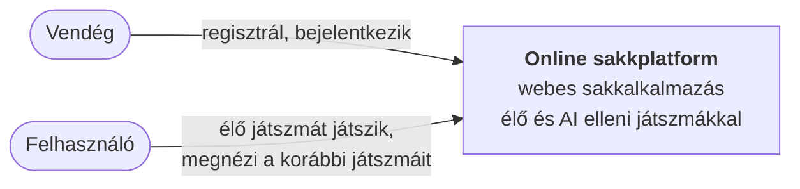
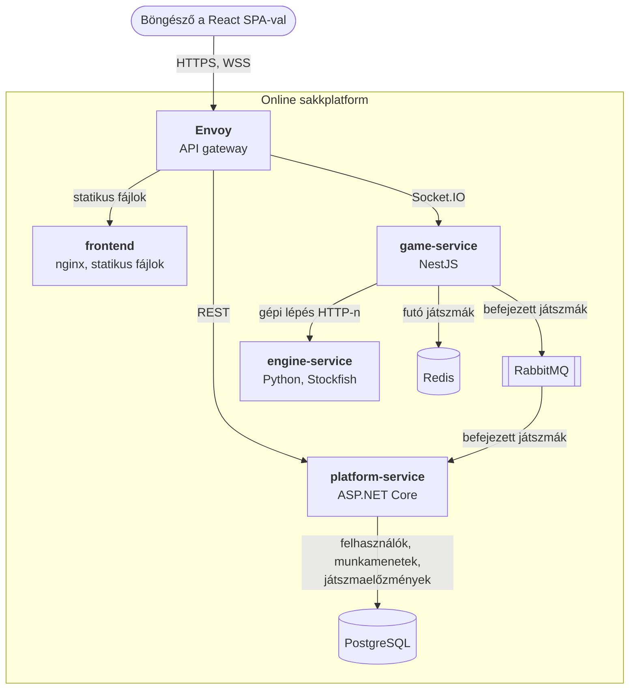
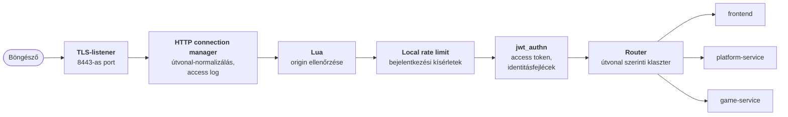
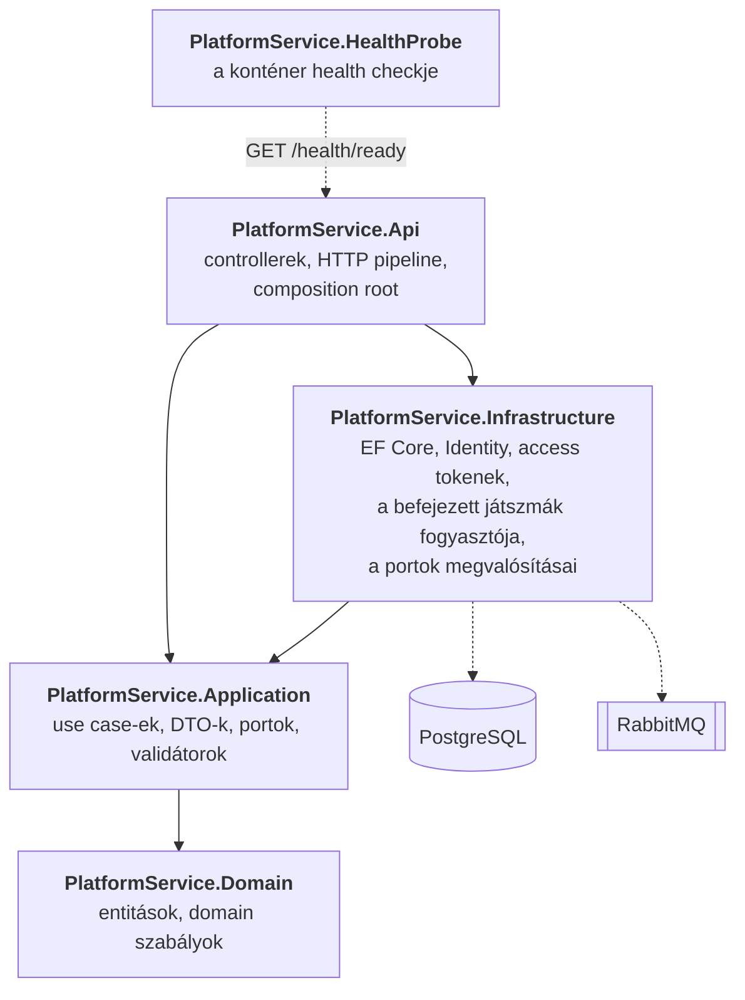
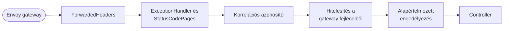
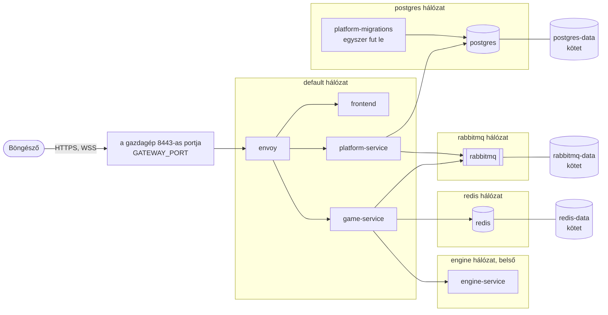
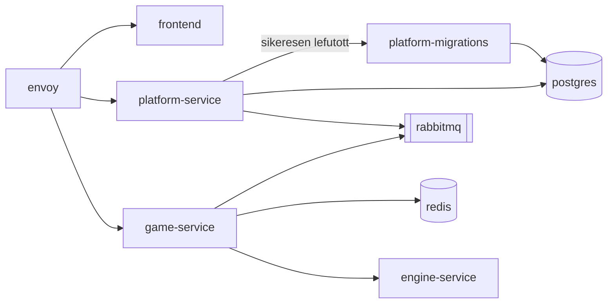
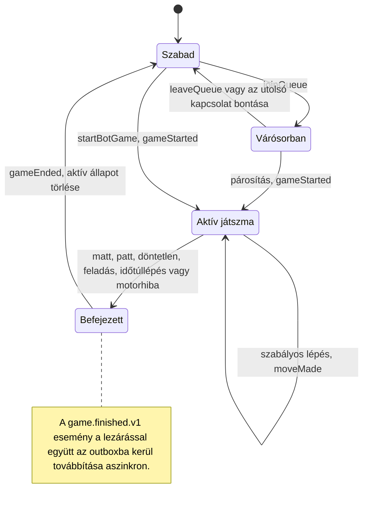
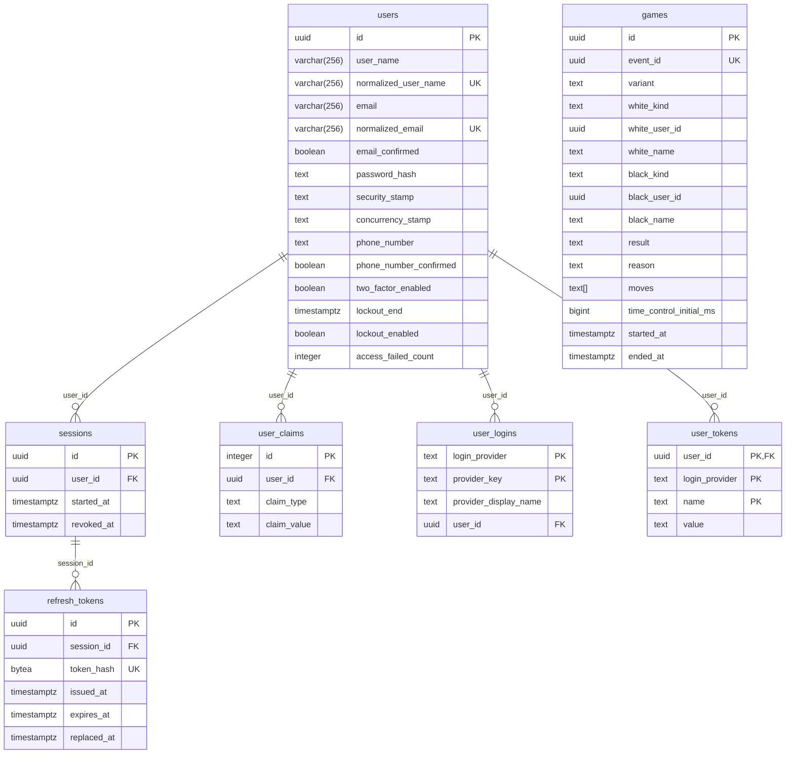
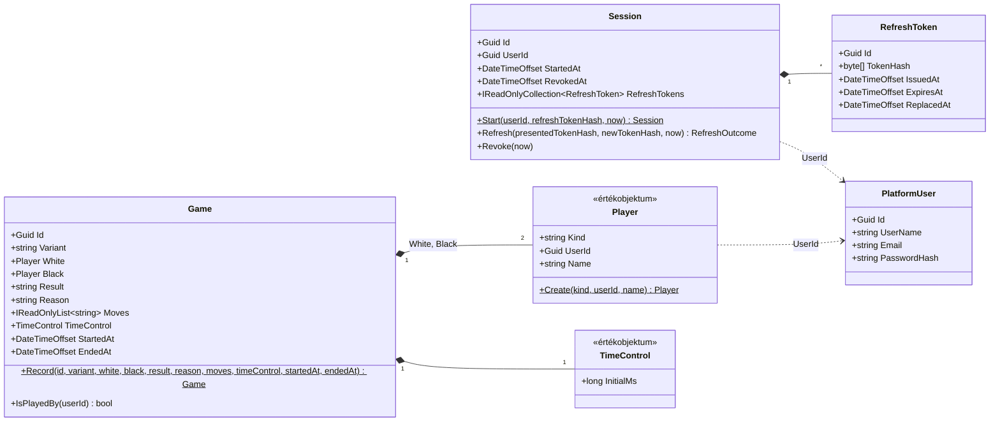

# Online sakkplatform – Rendszerterv (dokumentációváz)

> Ez a fájl a dokumentáció váza. A `> Kifejtendő:` blokkok azt jelzik, mit kell az adott pontba írni,
> a `> Forrás:` blokkok azt, honnan vehető át a tartalom (a repók ADR-jei és architektúra-leírásai angolul vannak,
> ezeket kell magyarra átültetni). A **[ÚJ]** jelölésű pontok a második körben kerültek be,
> az **[AZURE]** jelölésűek a tervezett Azure-telepítés miatt.
> A végleges dokumentumból ezek a blokkok és jelölések törlendők.
>
> **Felelősök:** minden fejezet alatt egy `> **Felelős:`** sor jelzi, ki írja. Az `infra` az `infra` repó
> (Envoy, Docker Compose, adattárolók) gazdáját jelenti; ha nincs ilyen, ki kell jelölni valakit.
> A `közös` fejezeteket egy ember szerkeszti, a többiek a saját részükkel adnak hozzá.
>
> | Felelős | Önálló fejezetek | Rész a közös fejezetekből |
> |---|---|---|
> | frontend | 2.2.2, 2.9 | 2.5, 2.6, 2.10–2.13, 2.15, 4 |
> | platform-service | 2.2.3, 2.8.1, 2.8.2 | 2.3, 2.5, 2.6, 2.10–2.13, 2.15, 4 |
> | game-service | 2.2.4, 2.7, 2.8.3 | 2.3, 2.6, 2.10–2.13, 2.15, 4 |
> | engine-service | 2.2.5 | 2.3, 2.6, 2.10–2.13, 2.15, 4 |
> | infra | 2.2.1, 2.2.6–2.2.8, 2.4 (benne az Azure-környezet), 3 | 2.5, 2.12, 2.13, 4 |
> | közös | 1, 2.1, 2.14, 5–7 | – |

---

## Címlap - anna

- Rendszerterv
- Online sakkplatform fejlesztése
- Szoftverarchitektúrák tárgy házi feladat
- Készítették: Borsik Balázs, Fehér Anna, Sipos Bence, Személyi Balázs András
- Dátum

---

## Tartalom

1. [Követelményspecifikáció (kész)](#0-követelményspecifikáció-kész)
2. [A rendszer célja és funkciói](#1-a-rendszer-célja-és-funkciói)
   1. Feladatkiírás
   2. A rendszer által biztosítandó tipikus funkciók
3. [Megvalósítás](#2-megvalósítás)
   1. Architektúra
   2. Komponensek
   3. Szolgáltatások közötti kommunikáció és interfészek
   4. Telepítési diagram **[ÚJ]**
      1. Helyi futtatás (Docker Compose)
      2. Éles környezet (Azure) **[AZURE]**
   5. Hitelesítés és biztonság
   6. Fő folyamatok
   7. A játszma állapotai **[ÚJ]**
   8. Adat- és adatbázisterv
   9. GUI-terv
   10. A use case-ek leképezése a komponensekre **[ÚJ]**
   11. Hibakezelés és hibatűrés **[ÚJ]**
   12. Skálázhatóság **[ÚJ]**
   13. Naplózás és monitorozás **[ÚJ]**
   14. A nem funkcionális követelmények teljesítése
   15. Tesztelés
4. [Telepítési leírás](#3-telepítési-leírás)
   1. Helyi futtatás
   2. Telepítés Azure-ba **[AZURE]**
5. [A program készítése során felhasznált eszközök](#4-a-program-készítése-során-felhasznált-eszközök)
6. [Összefoglalás](#5-összefoglalás)
7. [Továbbfejlesztési lehetőségek](#6-továbbfejlesztési-lehetőségek)
8. [Hivatkozások](#7-hivatkozások)

---

## 0. Követelményspecifikáció - (kész, nem tesszük bele)

A `Szoft Arch Sakkplatform Specifikáció.pdf` tartalma, változatlanul:

- Feladatkiírás (alapfunkciók, extra funkciók)
- A fejlesztő csapat
- Részletes feladatleírás
- Funkcionális követelmények (alapfunkciók, extra funkciók)
- Nem funkcionális követelmények (funkcionalitás, használhatóság, megbízhatóság, teljesítmény, támogathatóság)
- Technikai paraméterek
- Szótár
- Use-case-ek (alapfunkciók, extra funkciók)

---

## 1. A rendszer célja és funkciói

### 1.1 Feladatkiírás - becopyzni a kiírást (anna)

> **Felelős:** közös

> Kifejtendő: a feladatkiírás rövid megismétlése (1–2 bekezdés): webes sakkplatform élő és AI ellenfél elleni
> játszmákkal, játszmaelőzményekkel. Hivatkozás a követelményspecifikációra.

### 1.2 A rendszer által biztosítandó funkciók (anna)

> **Felelős:** közös

> Kifejtendő: a ténylegesen megvalósított funkciók listája (a mintában ez a dokumentum-életciklus).
> Javasolt bontás a felhasználó útja szerint:
>
> - fiókkezelés: regisztráció, bejelentkezés, kijelentkezés, munkamenet frissítése
> - játszma indítása: párosítás véletlen ellenféllel (várósor), játék AI ellen
> - játszma lebonyolítása: interaktív tábla, szabályos lépések kiemelése, speciális lépések
> (sáncolás, en passant, gyalogátváltoztatás), sakkóra, játszma vége (matt, patt, feladás, idő stb.)
> - játszmaelőzmények: lapozható lista, játszma visszajátszása lépésenként
> - a megvalósított extra funkciók megjelölése (pl. sakkóra), a meg nem valósítottak a 6. fejezetbe kerülnek

---

## 2. Megvalósítás

### 2.1 Architektúra - Sz.B.

A rendszer környezetét a C4 modell [1] rendszerkörnyezet-szintjén az alábbi ábra mutatja. A Vendég regisztrálhat és bejelentkezhet, a bejelentkezett Felhasználó pedig élő játszmát játszhat egy másik felhasználó vagy az AI ellenfél ellen, és megnézheti a korábbi játszmáit.



*A rendszer környezete a C4 modell rendszerkörnyezet-szintjén*

A rendszert mikroszolgáltatás-architektúrában valósítottuk meg. A szerver egyetlen belépési pontja egy API gateway, a webes klienstől érkező kérések mindegyike ezen keresztül megy. A felbontás fő célja, hogy a valós idejű játékot és a nagy gépigényű sakkmotort leválasszuk a kevésbé kritikus funkcióktól, például a felhasználókezeléstől és a játszmaelőzményektől. Így a gépi ellenfél a többi szolgáltatástól függetlenül skálázható, és a futó játszmák akkor is folytatódnak, ha a felhasználókat kezelő szolgáltatás éppen nem érhető el. A komponensek technológiáját a feladatukhoz választottuk. A rendszer futás közben egyetlen külső szolgáltatástól sem függ, és minden futó komponense ingyenes, nyílt forráskódú szoftver.

A webes kliens egy TypeScriptben írt React [2] alkalmazás, amely egyoldalas alkalmazásként fut a böngészőben. A React komponensekből építi fel a felületet, így a sakktábla, a sakkóra és a játszmalista önálló, újrahasznosítható részek, és a sakktáblához kész React-komponens is elérhető. Egyoldalas alkalmazásként az oldalak közötti váltás nem tölti újra az oldalt, és a felület a szervertől érkező eseményekre azonnal frissül.

A folyamatban lévő játszmákat a game-service kezeli, amely NestJS [3] keretrendszerben, Node.js-en fut. A Node.js eseményvezérelt, nem blokkoló I/O-modellje sok egyidejű, hosszan élő kapcsolatot kevés erőforrással szolgál ki, egy élő játszma pedig szinte csak ilyen munkából áll, vagyis a kliensek, a Redis és a sakkmotor válaszára való várakozásból. A NestJS beépítve támogatja a Socket.IO-alapú WebSocket-kapcsolatokat, és modulokba szervezi a kódot. Mivel a frontend és a game-service is TypeScriptben készül, mindkettő ugyanazt a sakkszabály-könyvtárat, a chess.js-t [4] használja. Így a kliensen kiemelt szabályos lépések pontosan azok, amelyeket a szerver elfogad, a lépés szabályosságáról viszont mindig a game-service dönt. A folyamatban lévő játszmák állapotát Redisben tárolja el, a befejezett játszmákat pedig RabbitMQ üzenetsorba rakja be.

A gépi ellenfelet az engine-service adja, amely Pythonban készült. A python-chess [5] könyvtár ellenőrzi a kapott állást, és a Stockfish [6] sakkmotort a szabványos UCI protokollon keresztül, mélységi és időkorláttal futtatja, így ehhez a szolgáltatásnak nincs saját kódja. A Stockfish a legerősebb nyílt forráskódú sakkmotor, és ugyanabban a konténerben fut, mint a szolgáltatás. A HTTP API-t a FastAPI [7] keretrendszer adja, amely a kéréseket a modelljük alapján validálja.

A nem folyamatban lévő játékkal kapcsolatos funkciókat, vagyis a felhasználókezelést, a munkameneteket és a játszmák hosszú távú eltárolását a platform-service látja el, amely ASP.NET Core [8] alapú. Az ASP.NET Core Identity kész megoldást ad a felhasználói fiókok tárolására és a jelszavak biztonságos hashelésére, az Entity Framework Core pedig paraméterezett lekérdezésekkel éri el az adatbázist, és migrációkkal kezeli a sémát. A C# erős típusossága és a keretrendszer beépített OpenAPI-támogatása pontosan leírt REST API-t ad. A játszmákat ez a mikroszolgáltatás veszi le a RabbitMQ üzenetsorból és teszi be a PostgreSQL adatbázisba, ahonnan elő is tudja venni a játszmaelőzmények lekérdezésekor.

A rendszer konténereit és a köztük lévő kapcsolatokat a C4 modell konténerszintjén a következő ábra mutatja.



*A rendszer konténerei a C4 modell konténerszintjén*

- Az **Envoy gateway** az egyetlen belépési pont a webes klienstől. Lezárja a TLS-kapcsolatot, ellenőrzi az access tokent, és az útvonal alapján továbbítja a kérést a megfelelő szolgáltatásnak.
- A **frontend** a React alkalmazás statikus fájljait szolgálja ki egy nginx-konténerből, maga az alkalmazás a böngészőben fut.
- A **platform-service** kezeli a felhasználói fiókokat és a munkameneteket, kiadja az access tokeneket, és tárolja a játszmaelőzményeket.
- A **game-service** vezeti a folyamatban lévő játszmákat, párosítja a játékosokat, ellenőrzi a lépéseket és méri az időt. A klienssel Socket.IO-kapcsolaton keresztül kommunikál.
- Az **engine-service** egy adott állásra kiszámítja az AI ellenfél lépését a Stockfish motorral.
- A **PostgreSQL** a platform-service hosszú távú adatait tárolja.
- A **Redis** a folyamatban lévő játszmák állapotát, a párosítási sort és a még el nem küldött eseményeket tárolja.
- A **RabbitMQ** a befejezett játszmákat juttatja el a game-service-től a platform-service-hez.

A konténerek csak az ábrán látható utakon érik el egymást, mert mindegyik csak azokhoz a Docker-hálózatokhoz csatlakozik, amelyekre szüksége van.

Az architektúra ára, hogy a szolgáltatások közötti kommunikációt is meg kellett tervezni. A game-service szinkron HTTP-kéréssel kéri el a gépi lépést, mert a játszma a válasz nélkül nem folytatódhat. A befejezett játszmát viszont aszinkron üzenettel adja át, hogy az akkor is megmaradjon, ha a platform-service éppen nem fut. A szolgáltatások három nyelven készülnek, ezért a köztük lévő interfészeket gépileg olvasható szerződések írják le, a REST interfészeket OpenAPI, a WebSocket-eseményeket és az üzeneteket AsyncAPI formátumban.

A kódtárak a polyrepo elvet követik, vagyis minden telepítési egységnek saját Git-repója van a szoftarch-chess-platform GitHub-szervezetben.

| Repó | Tartalom |
|---|---|
| frontend | a React alkalmazás |
| game-service | a NestJS játékszolgáltatás |
| engine-service | a Python AI szolgáltatás |
| platform-service | az ASP.NET Core platformszolgáltatás |
| infra | a Docker Compose fájlok, a gateway konfigurációja, a szkriptek, a szolgáltatások közötti szerződések és a rendszer dokumentációja |

Minden szolgáltatás a saját repójának CI-folyamatában építi a konténerképét, és egy verziócímkénél feltölti a GitHub Container Registrybe. Az infra repó Compose fájljai ezekre a képekre hivatkoznak, fejlesztéskor pedig a szomszédos mappákba klónozott repókból is építhetnek. Így egy verzió képét egyszer építjük, és mindenhol ugyanazt futtatjuk, ahogy a Twelve-Factor App [9] a build, a kiadás és a futtatás szétválasztásáról írja. A szerződések egy helyen és verziózva vannak, ezért a három nyelven írt szolgáltatás ugyanabból a forrásból dolgozik, és egy szerződés változását az érintett szolgáltatások gazdái is látják.

Egy monolit egyszerűbb lett volna, mert nem kellene hozzá gateway, üzenetközvetítő és szolgáltatások közötti szerződés. A sakkmotor és a valós idejű kapcsolatok azonban ugyanazokon az erőforrásokon osztoznának a felhasználókezeléssel, és a rendszert csak egészében lehetne skálázni. A szerződéseket a szolgáltatók saját repójában is tarthattuk volna, de akkor minden fogyasztónak egy másik szolgáltatás repójában kellene keresnie őket, ezért kerültek a közös infra repóba.

### 2.2 Komponensek - S.B. 

> **Felelős:** lásd az alfejezeteket

> Minden komponensnél a mintához hasonló szerkezet: **Célja**, **Felelősségei**, **Technológia és indoklás**,
> **Belső felépítése** (ha van), **ábra** (ha van).

#### 2.2.1 API gateway (Envoy) - Sz.B

Célja, hogy a böngésző egyetlen címen érje el a rendszer minden részét, vagyis a frontend statikus fájljait, a platform-service REST API-ját és a game-service WebSocket-kapcsolatait. Mivel minden egy originről érkezik, CORS-ra nincs szükség. A gateway az access tokeneket is ellenőrzi, így ezt a logikát nem kell C#-ban és TypeScriptben is megírni, és egy érvénytelen kérés el sem jut a szolgáltatásokig. Ez a gateway offloading minta [10].

Az első felelőssége az útvonalak szerinti továbbítás. Az Envoy a sorrendben első illeszkedő útvonalat választja.

| Útvonal | Cél | Access token |
|---|---|---|
| `POST /api/auth/login` | platform-service, bejelentkezés | nem kell, a kísérletek száma címenként korlátozott |
| az `/api/auth` többi végpontja | platform-service, regisztráció, frissítés és kijelentkezés | nem kell |
| az `/api` többi végpontja | platform-service | kötelező |
| `/ws/game` | game-service, élő játszma | kötelező |
| minden más útvonal | frontend | nem kell |

A game-service-nek nincs REST útvonala. Egy élő játszma minden művelete Socket.IO-esemény a `/ws/game` útvonalon, így az `/api` teljes egészében a platform-service-hez tartozik.

A gateway zárja le a TLS-kapcsolatot. Csak HTTPS-en figyel, HTTP/2-t és HTTP/1.1-et is elfogad, a WebSocket-kapcsolatok pedig WSS-en épülnek fel. Mögötte a konténerek a Docker-hálózatokon titkosítatlan HTTP-n kommunikálnak, ezek a hálózatok nem hagyják el a gépet.

Az access tokent az Envoy `jwt_authn` szűrője [11] ellenőrzi. A tokent a `__Host-access-token` cookie-ból vagy az `Authorization` fejlécből olvassa, és ellenőrzi az ES256 aláírást, a kiállítót, a célközönséget és a lejáratot. A nyilvános kulcsot egy helyi fájlból olvassa, így indításkor sem függ a platform-service-től. Érvényes token esetén a token `sub` claimjét az `x-user-id`, a `preferred_username` claimjét pedig az `x-user-name` fejlécbe teszi, és a szolgáltatások ebből a két fejlécből tudják meg, ki a felhasználó. Ezeket a fejléceket a gateway minden beérkező kérésből eltávolítja, ezért a kliens nem tudja hamisítani őket.

Két rövid Lua-szkript ellenőrzi a kérések originjét. Egy másik originről érkező WebSocket-kézfogást és adatot módosító API-kérést a gateway 403-as válasszal elutasít. Ehhez a böngésző által beállított `Sec-Fetch-Site` és `Origin` fejlécet vizsgálja, amelyet egy weboldal nem tud megváltoztatni. Ez véd a CSRF-támadások ellen, amelyekben egy idegen oldal a felhasználó cookie-jaival küldene kérést.

A bejelentkezési kísérleteket a gateway token bucket algoritmussal [12] korlátozza, amelyben minden kliens IP-címnek saját vödre van. Egy vödörben legfeljebb 30 token fér el, és 2 másodpercenként egy új token kerül bele, így egy címről egyszerre 30 kísérlet lehetséges, utána 2 másodpercenként egy. A korlátot túllépő kérés 429-es választ kap, és nem jut el a platform-service-hez. Az értékek a Supabase jelszavas bejelentkezésének alapértelmezéseit követik [13], így egy elgépelt jelszó vagy több, egy NAT mögötti felhasználó sem ütközik a korlátba. A korlátozás az origin ellenőrzése után következik, így egy idegen oldal a látogatói böngészőjéből küldött kérésekkel sem tudja elhasználni a látogatók kísérleteit. Felhasználónkénti korlát szándékosan nincs, mert a rendszerben nincs fiók-helyreállítás, így egy zárolás véglegesen kizárná a felhasználót, és bárki kizárhatna bárkit.

A gateway a Docker szolgáltatásnevét a szolgáltatás minden példányának címére feloldja, így a felskálázott példányok között is elosztja a kéréseket. A WebSocket-útvonalakon a kérés időkorlátja ki van kapcsolva, a tétlenségi időkorlát pedig az alapértelmezett 5 perc helyett egy óra, így egy hosszú játszma kapcsolata sem szakad meg. Végül minden kérésről egy naplósort ír a konténer standard kimenetére.

A választott technológia az Envoy Proxy 1.40 a hivatalos konténerképből, statikus YAML-konfigurációval. Azért választottuk, mert ingyenesen és beépítve tudja mindazt, amire szükségünk van. A JWT-ellenőrző szűrője cookie-ból is olvassa a tokent, helyi kulcsfájllal is működik, útvonalanként beállítható, és a claimeket fejlécekbe tudja tenni. Emellett IP-címenkénti rate limitinget, terheléselosztást, hibatűrési eszközöket, például circuit breakert és újrapróbálkozást, valamint részletes statisztikákat kínál. Csak konfigurációból áll, így nincs saját kódja, és aktív CNCF-projekt.

A legtöbb népszerű alternatívánál a JWT-ellenőrzés fizetős. A Traefik JWT-middleware-e csak a fizetős Traefik Hubban, az NGINX JWT-modulja csak a kereskedelmi NGINX Plusban érhető el, a Kong nyílt forrású változata pedig a 3.10-es verzió óta licenc nélkül nem használható. A .NET-alapú YARP technikailag megfelelő lett volna, de saját C#-kódot és külön projektet igényelt volna, és kevesebb beépített hibatűrést ad.

A belső felépítését tekintve az Envoy egy kérést egymás után következő szűrőkön vezet át, ezt mutatja az alábbi ábra. Minden szűrő csak azokon az útvonalakon fut, amelyek bekapcsolják, így a rate limit csak a bejelentkezésen, a JWT-ellenőrzés pedig csak a kötelező tokenes útvonalakon működik.



*Az Envoy szűrőlánca egy kérés útján*

Megjelenése a kódban az infra repó `envoy/envoy.yaml` fájlja. A konfigurációt, a TLS-tanúsítványt és a tokenek nyilvános kulcsát a Compose csak olvashatóan csatolja a konténerbe, a tokeneket aláíró titkos kulcs pedig nem kerül a gatewayhez. Az Envoy adminisztrációs felülete csak a konténeren belül figyel, és csak a health check használja.

#### 2.2.2 Webes kliens (frontend) - Anna

> **Felelős:** frontend

> Kifejtendő:
>
> - React + TypeScript + Vite SPA, nginx szolgálja ki
> - mappaszerkezet / modulok (auth, lobby, game, api, routing, theme)
> - állapotkezelés (TanStack Query a szerveradatokhoz, élő játszma állapota)
> - sakktábla-komponens és lépésellenőrzés a kliensen
> - útvonalak és oldalak (részletesen a 2.9-ben)
> - kommunikáció: REST a platform-service felé, Socket.IO a game-service felé

#### 2.2.3 platform-service (ASP.NET Core) - Sz.B.

Célja, hogy kiszolgálja a rendszer hosszú távú, nem valós idejű funkcióit. A felelősségei a következők.

- Regisztrációkor létrehozza a felhasználói fiókot, bejelentkezéskor ellenőrzi a felhasználónevet és a jelszót.
- Kiadja az access tokeneket és a refresh tokeneket, és kezeli a munkameneteket. Frissítéskor lecseréli a refresh tokent, kijelentkezéskor visszavonja a munkamenetet.
- Visszaadja a bejelentkezett felhasználó azonosítóját és nevét, mert a kliens a HttpOnly cookie-ban lévő tokenből ezt nem tudja kiolvasni.
- Fogadja a befejezett játszmák eseményeit a RabbitMQ-ból, és elmenti a játszmákat.
- Lapozva listázza a bejelentkezett felhasználó játszmáit, és visszaad egy játszmát a lépéseivel.

Az access tokeneket maga nem ellenőrzi. A felhasználót a gateway által beállított `x-user-id` és `x-user-name` fejlécekből ismeri meg, és csak a gatewayen keresztül érhető el.

A választott technológia a .NET 10 és az ASP.NET Core. A szolgáltatás fő könyvtárait és a szerepüket az alábbi táblázat mutatja.

| Könyvtár | Felhasználás |
|---|---|
| ASP.NET Core | a webes keretrendszer, controller alapú API |
| Entity Framework Core 10 az Npgsql szolgáltatóval | az adatbázis elérése és a migrációk |
| ASP.NET Core Identity | a felhasználói fiókok tárolása és a jelszavak hashelése |
| FluentValidation | a bemenetek validálása |
| Microsoft.IdentityModel.JsonWebTokens | az access tokenek aláírása |
| RabbitMQ.Client | a befejezett játszmák fogadása |
| a beépített OpenAPI és a Scalar | az API kipróbálható leírása fejlesztői módban |

Az ASP.NET Core Identity [14] normalizálja a felhasználóneveket és az e-mail-címeket, így a kis- és nagybetűtől független egyediség vele együtt jár, a jelszavakat pedig PBKDF2-vel hasheli HMAC-SHA512 függvénnyel, 128 bites sóval és 100 000 iterációval. Az Identity végpontjait és cookie-jait nem használjuk, mert a tokeneket a szolgáltatás maga adja ki. Az EF Core minden lekérdezést paraméterezve küld, ez véd az SQL injection ellen. A JWT-könyvtár ES256 aláírást ír, és kiszámítja a kulcs ujjlenyomatát, így a szolgáltatásnak nincs saját kriptográfiai kódja. A RabbitMQ-t a hivatalos kliensen keresztül, üzenetkezelő könyvtár nélkül használjuk, mert az üzenetek borítékát a szerződés rögzíti, egy olyan könyvtár pedig, mint a MassTransit, a saját borítékát és elnevezéseit hozná.

A konténerkép a Microsoft shell és csomagkezelő nélküli, úgynevezett chiseled képére épül, és a szolgáltatás nem root felhasználóként fut. Mivel a képben curl sincs, a health checket egy kis .NET konzolalkalmazás végzi, amely a kép része, ahogy a .NET csapata is javasolja [15].

A belső felépítése a Clean Architecture [16] elvét követi négy projektben. A belső rétegek nem ismerik a külsőket, ezt a projektreferenciák biztosítják, így a fordító ellenőrzi a függőségi szabályt. Az Application réteg portokat, vagyis interfészeket definiál, a külső rétegek pedig ezeket valósítják meg, és a függőséginjektálás köti össze őket. A rétegeket és a kapcsolataikat az alábbi ábra mutatja.



*A platform-service rétegei. A folytonos nyilak projektreferenciák, a szaggatott nyilak hálózati kapcsolatok.*

A Domain réteg tartalmazza az entitásokat és a domain szabályokat. Ide tartozik a befejezett játszma a játékosaival és az időkontrolljával, valamint a munkamenet a refresh tokenjeivel. A munkamenet `Refresh` metódusa valósítja meg a refresh tokenek cseréjének, türelmi idejének és újrafelhasználás-felismerésének szabályait, így ezek adatbázis nélkül, unit tesztekkel ellenőrizhetők. A réteg semmilyen projektre és NuGet-csomagra nem hivatkozik. Megjelenése a kódban a `PlatformService.Domain` projekt.

Az Application réteg tartalmazza a use case-eket, egy-egy interfésszel és megvalósítással. Az `IAuthService` regisztrál és beléptet, az `ISessionService` frissít és kiléptet, az `IUserService` visszaadja az aktuális felhasználót, az `IGameHistoryService` listázza és lekéri a játszmákat, az `IFinishedGameService` pedig rögzíti a befejezett játszmát. A use case-ek portokon keresztül érik el a külvilágot. Ezek az `IUserAccounts` a fiókokhoz, az `ISessionRepository` és az `IGameRepository` a két aggregátumhoz, az `IUnitOfWork` a mentéshez, az `IAccessTokenIssuer` a tokenekhez és az `ICurrentUser` a bejelentkezett felhasználóhoz. Itt vannak a validátorok, a DTO-k és azok a kivételek is, amelyekből hibaválasz lesz. A réteg nem függ az ASP.NET Core-tól és az EF Core-tól. Megjelenése a kódban a `PlatformService.Application` projekt.

Az Infrastructure réteg valósítja meg a portokat. Itt van a `PlatformDbContext`, amely egyben a Unit of Work, a két repository, az entitáskonfigurációk és a migrációk, az Identity felhasználótípusa és tárolója, valamint az access tokeneket aláíró osztály. Itt fut két háttérfolyamat is. A `GameFinishedConsumer` a RabbitMQ-ból fogadja a befejezett játszmákat, az `ExpiredSessionCleanup` pedig rendszeresen törli a lejárt refresh tokeneket és munkameneteket. Megjelenése a kódban a `PlatformService.Infrastructure` projekt.

Az Api réteg tartalmazza a controllereket, a gateway fejléceiből dolgozó hitelesítést, a hibakezelést és a kérésfeldolgozási láncot. A `Program.cs` a composition root, amely csak a rétegek egy-egy regisztráló metódusát hívja, és beállítja a middleware-ek sorrendjét. Megjelenése a kódban a `PlatformService.Api` projekt.

A health probe a rétegeken kívül álló kis konzolalkalmazás, amely semmilyen projektre nem hivatkozik. Egyetlen HTTP-kérést küld a szolgáltatás `/health/ready` végpontjára, és a válasz alapján lép ki. Megjelenése a kódban a `PlatformService.HealthProbe` projekt.

A rétegek a minta N-rétegű bontásának az alábbiak szerint felelnek meg. A lényeges különbség, hogy az N-rétegű felépítésben az üzleti logika függ az adathozzáférési rétegtől, itt viszont az Infrastructure függ az Application rétegtől, és az üzleti logika csak a saját portjait ismeri.

| Clean Architecture réteg | Az N-rétegű megfelelője |
|---|---|
| Domain | az adatdefiníciók és az üzleti szabályok |
| Application | az üzleti logikai réteg |
| Infrastructure | az adathozzáférési réteg és a külső rendszerek elérése |
| Api | a felhasználói felület helyett a HTTP API |

Egy kérés a szolgáltatáson belül az alábbi middleware-eken halad át, ebben a sorrendben.



*A platform-service middleware-láncának sorrendje*

Az első lépés a kliens IP-címét és a sémát csak a beállított belső hálózatokról érkező továbbítási fejlécekből veszi át. HTTPS-átirányítás, HSTS, CORS és rate limiting itt nincs, mert ezeket a gateway végzi. A következő lépés a kivételeket és a törzs nélküli hibaválaszokat egységes hibaválasszá alakítja. Ezután a gateway `x-request-id` fejléce korrelációs azonosítóként a naplózás hatókörébe kerül, így egy kérés naplósorai összekapcsolhatók. A hitelesítés az `x-user-id` és az `x-user-name` fejlécből állítja össze a felhasználót, és sikertelen, ha az azonosító nem UUID, vagy a név üres. Az alapértelmezett engedélyezés minden végponton bejelentkezett felhasználót kér, kivéve a regisztrációt, a bejelentkezést, a frissítést, a kijelentkezést, a health checkeket és fejlesztői módban az API leírását. Végül a controller továbbadja a kérést egy use case-nek, és visszaadja az eredményt.

A bemeneteket a FluentValidation [17] ellenőrzi az Application rétegben, minden kérés- és parancstípushoz saját validátor tartozik, és egy use case első lépése mindig a validálás. A fiókok szabályai és a hibaüzenetek szövege ugyanazok, mint a frontenden. A jelszó és az e-mail-cím hosszát a frontend és a szolgáltatás is Unicode kódpontokban számolja, így ugyanarra a szövegre ugyanazt a hosszt kapják. A befejezett játszma eseményének validátora a szerződés szabályait ellenőrzi, például hogy minden lépés UCI-jelölésű.

Minden hiba RFC 9457 szerinti ProblemDetails [18] formában, `application/problem+json` tartalomtípussal érkezik a kliensnek. A kivételeket egyetlen kivételkezelő alakítja át, és minden hibaválasz tartalmaz egy `traceId` és egy `correlationId` mezőt. A fő esetek a következők.

| Ok | Állapotkód |
|---|---|
| a validátor elutasítja a bemenetet | 400, mezőnkénti hibákkal |
| hibás JSON vagy rossz típusú paraméter, például nem UUID játszmaazonosító | 400 |
| hiányzó vagy érvénytelen identitásfejlécek, rossz felhasználónév vagy jelszó, véget ért munkamenet | 401 |
| tiltott hozzáférés | 403 |
| nem létező játszma vagy más felhasználók játszmája | 404, mindkét esetben ugyanazzal a szöveggel |
| foglalt felhasználónév vagy e-mail-cím | 409, a foglalt mezők megnevezésével |
| minden más hiba | 500, részletek nélkül |

A szolgáltatás a beállításait az `appsettings.json` fájlból és környezeti változókból olvassa. A kötelező beállításokat az alábbi táblázat sorolja fel. Ha valamelyik hiányzik vagy hibás, a szolgáltatás indításkor egy hibaüzenettel leáll, amely megnevezi a beállítást.

| Beállítás | Tartalma |
|---|---|
| `ConnectionStrings:Platform` | a PostgreSQL-adatbázis kapcsolati karakterlánca |
| `ConnectionStrings:RabbitMq` | a RabbitMQ AMQP URI-ja a szolgáltatás saját felhasználójával |
| `Jwt:SigningKeyPath` | az access tokeneket aláíró titkos kulcs PEM-fájljának útvonala |
| `ForwardedHeaders:KnownNetworks` | azok a hálózatok, amelyekről a továbbítási fejlécek elfogadhatók |

A naplózás a beépített `ILogger` segítségével történik. Fejlesztői módon kívül a konzolra JSON-formátumú sorok kerülnek, a hatókörökkel és UTC időbélyeggel. Az alapértelmezett szint az Information, az EF Core SQL-parancsai viszont csak hiba esetén kerülnek a naplóba. Az időtől függő logika egy `TimeProvider` példányt kap, így a tesztek a saját órájukkal futtathatják. A szolgáltatásnak két health check végpontja van. A `/health/live` csak azt jelzi, hogy a folyamat fut, a `/health/ready` pedig az adatbázist is ellenőrzi. Egyik sincs az `/api` alatt, így a gateway nem teszi elérhetővé őket.

A `GameFinishedConsumer` egyszerre egy üzenetet dolgoz fel a befejezett játszmák sorából. Egy játszmát csak az adatbázis-tranzakció véglegesítése után nyugtáz, egy már feldolgozott eseményt pedig változtatás nélkül nyugtáz, így az ismételt kézbesítés nem hoz létre második játszmát. Egy érvénytelen üzenet azonnal a hibás üzenetek sorába kerül. Átmeneti adatbázishiba esetén az üzenet visszakerül a sorba, és nem számít bele a kézbesítési korlátba. Ha a kapcsolat megszakad, vagy a RabbitMQ induláskor nem érhető el, a szolgáltatás rendszeresen újra kapcsolódik, és közben az API tovább működik.

#### 2.2.4 game-service (NestJS) B.B.

> **Felelős:** game-service

> Kifejtendő:
>
> - felelősség: folyamatban lévő játszmák, párosítás, lépések ellenőrzése, sakkóra, játszma vége
> - Socket.IO események (kliens → szerver, szerver → kliens)
> - a játszmaállapot tárolása Redisben
> - egy felhasználó egyszerre egy játszmában; több kapcsolat (fül) kezelése
> - a befejezett játszma átadása (outbox + RabbitMQ)
> - sakkszabályok ellenőrzése külső könyvtárral

#### 2.2.5 engine-service (Python) S.B.

> **Felelős:** engine-service

> Kifejtendő:
>
> - felelősség: gépi lépés számítása egy adott állásra
> - a választott sakkmotor és indoklása, nehézségi szint(ek)
> - webes keretrendszer, HTTP API
> - állapotmentesség → külön skálázható

#### 2.2.6 PostgreSQL (relációs adatbázis) - Sz.B.

Célja a rendszer hosszú távon megőrzendő adatainak tárolása. Ezek a felhasználói fiókok a jelszavak hashével, a munkamenetek a refresh tokenek hashével és a befejezett játszmák a lépéstörténetükkel.

Az adatbázis egyetlen használója a platform-service. Minden SQL-t használó szolgáltatás saját adatbázist és saját adatbázis-felhasználót kap, és csak a sajátjához fér hozzá, ez a database per service minta [19]. Jelenleg egy ilyen adatbázis van, a platform nevű, amelynek tulajdonosa az azonos nevű felhasználó. Hálózati szinten is csak a platform-service és a migrációit futtató konténer éri el a szervert. Szolgáltatások közötti SQL-lekérdezés nincs, egy ilyen igényt API-n vagy eseményen keresztül kell kiszolgálni.

A választott technológia a PostgreSQL 18 a hivatalos Alpine-alapú konténerképből, egyetlen példányban. Ingyenes és nyílt forráskódú, a hivatalos képe amd64 és arm64 architektúrán is fut, és kevés erőforrást igényel, ami a helyi futtatásnál számít, hiszen mellette a rendszer összes többi konténere is fut. Az EF Core támogatása kiforrott, az Npgsql szolgáltató [20] kiadásai követik az EF Core főverzióit, és az ASP.NET Core Identity is működik vele. A 18-as a döntés idején a legújabb stabil főverzió volt, és 2030 novemberéig kap javításokat [21]. Széles körben használt, a Stack Overflow 2025-ös felmérésében 55,6%-kal a leggyakrabban használt adatbázis [22], így sok hozzá a dokumentáció és a példa. A replikáció és a particionálás a későbbi skálázást is lehetővé teszi.

Az elvetett alternatívák közül a Microsoft SQL Servernek saját EF Core szolgáltatója van, de nem nyílt forráskódú, az ingyenes Express kiadása erősen korlátozott, és a konténere csak x86-64 architektúrán támogatott. A MySQL és a MariaDB legelterjedtebb EF Core szolgáltatója a döntés idején még csak az EF Core 9-et támogatta. A MongoDB egy befejezett játszmát dokumentumként is jól tárolna, de az ASP.NET Core Identity relációs modellt használ, és a szerver licence az OSI szerint nem nyílt forráskódú.

A konfigurációja a következő.

- Az adatok a postgres-data nevű Docker-kötetben vannak, így a konténer újralétrehozása után is megmaradnak.
- Egy üres adatkönyvtár első indításakor a `postgres/init/create-platform-database.sql` szkript létrehozza a platform-service adatbázisát és felhasználóját, majd megvonja a többi felhasználótól a kapcsolódás jogát. A szuperfelhasználó és a platform-service jelszava a `POSTGRES_ADMIN_PASSWORD` és a `POSTGRES_PLATFORM_PASSWORD` környezeti változóból jön.
- A migrációkat a platform-service képében lévő migrációs csomag futtatja egy egyszer lefutó konténerben, mielőtt a szolgáltatás elindul. A Microsoft is azt javasolja, hogy az EF Core migrációi a telepítés egy lépéseként fussanak, ne minden példány indulásakor [23]. Így több példány esetén is egyszer futnak le, és maga a szolgáltatás akkor is elindul, ha az adatbázis éppen nem érhető el.
- A health check a `pg_isready` paranccsal kérdezi a szervert a konténeren belül.
- A platform-service a `ConnectionStrings__Platform` környezeti változóból kapja a kapcsolati karakterláncot, amelyet a Compose állít be.
- Fejlesztéshez a szerver a 127.0.0.1:5432 címen is elérhető, így a gépen futó platform-service és az adatbázis-kezelő eszközök is ugyanahhoz az adatbázishoz kapcsolódhatnak. Ezt a címet csak ugyanaz a gép éri el.

Az éles környezetben a platform-service-nek csak egy kapcsolati karakterláncra van szüksége, ezért egy menedzselt PostgreSQL-szolgáltatással, például az Azure Database for PostgreSQL Flexible Serverrel és egy konténerben futó szerverrel is kódváltozás nélkül működik. Menedzselt szerveren az inicializáló szkript nem fut le, ezért az adatbázist és a felhasználót a telepítés részeként kell létrehozni.

#### 2.2.7 Redis (a futó játszmák tárolója) - B.B.

> **Felelős:** infra (+ game-service)

> Kifejtendő:
>
> - célja: a folyamatban lévő játszmák állapotának gyors tárolása (állás, óra, várósor, outbox)
> - ki használja: csak a game-service
> - miért ezt választottuk (gyors, memóriában tárol, a game-service több példánya közösen használhatja),
> elvetett alternatívák (pl. memóriában a szolgáltatáson belül, relációs adatbázis)
> - konfiguráció: tartósság (mi marad meg újraindítás után), memóriakorlát
> - **[AZURE]** éles környezetben: Azure Managed Redis vagy konténer (lásd 2.4.2)
> - a kulcsok szerkezete a 2.8.3-ban

#### 2.2.8 RabbitMQ (üzenetközvetítő) - B.B.

> **Felelős:** infra (+ game-service, platform-service)

> Kifejtendő:
>
> - célja: a befejezett játszmák aszinkron átadása a game-service-től a platform-service-nek
> - ki használja: a game-service küldi, a platform-service fogadja az üzeneteket
> - miért aszinkron üzenet és nem közvetlen hívás (a platform-service kiesése nem akasztja meg a játékot),
> miért RabbitMQ, elvetett alternatívák (pl. közvetlen HTTP hívás, Kafka, Redis Streams)
> - a sorok és exchange-ek felépítése, kézbesítési garanciák (megerősítés, újraküldés, hibás üzenetek sora)
> - konfiguráció: tartós sorok, kötet, hozzáférési adatok
> - **[AZURE]** éles környezetben: konténer vagy Azure Service Bus (lásd 2.4.2)

### 2.3 Szolgáltatások közötti kommunikáció és interfészek - Anna

> **Felelős:** közös (áttekintő táblázat, konvenciók) + a saját interfészét minden szolgáltatás: platform-service (REST végpontok), game-service (Socket.IO események, „befejezett játszma” esemény), engine-service (HTTP API)

> Kifejtendő:
>
> - kommunikációs módok táblázatban: ki kivel, milyen protokollon, szinkron/aszinkron
> (REST, Socket.IO/WSS, HTTP az engine felé, AMQP). A dokumentumban csak itt szerepel ez a táblázat,
> a 2.4 telepítési diagramjai erre hivatkoznak.
> - szerződésalapú fejlesztés: OpenAPI és AsyncAPI leírások az `infra/contracts` mappában, konvenciók
> - a fő REST végpontok rövid táblázata (útvonal, metódus, leírás)
> - a fő Socket.IO események táblázata
> - a „befejezett játszma” esemény szerkezete

### 2.4 Telepítési diagram **[ÚJ] - Sz.B.**

Ez a fejezet a rendszer fizikai nézetét mutatja be, vagyis azt, hogy az egyes komponensek hol futnak, és hálózati szinten mit érnek el. A szolgáltatások mindenhol konténerként futnak. A diagramok nyilai csak azt mutatják, melyik konténer melyiket éri el.

#### 2.4.1 Helyi futtatás (Docker Compose) Sz.B

A teljes rendszert az infra repó `compose.yaml` fájlja írja le egyetlen Docker Compose projektként. Minden komponens egy konténer a saját képéből. A négy alkalmazáskomponens képe a GitHub Container Registryben van, a címkéjét az `.env` fájl adja meg, a gateway és az adattárolók pedig a hivatalos képekből futnak.

| Konténer | Kép | Port a konténerben |
|---|---|---|
| envoy | `envoyproxy/envoy:v1.40-latest` | 8443 |
| frontend | `ghcr.io/szoftarch-chess-platform/frontend` | 8080 |
| platform-service | `ghcr.io/szoftarch-chess-platform/platform-service` | 8080 |
| platform-migrations | a platform-service képe, a migrációs csomag a belépési pontja | nincs, egyszer fut le |
| game-service | `ghcr.io/szoftarch-chess-platform/game-service` | 3001 |
| engine-service | `ghcr.io/szoftarch-chess-platform/engine-service` | 8000 |
| postgres | `postgres:18-alpine` | 5432 |
| redis | `redis:8.8-alpine` | 6379 |
| rabbitmq | `rabbitmq:4.4-management-alpine` | 5672 és a webes felügyeleti felület 15672 |

A konténereket, a Docker-hálózatokat és a köteteket az alábbi ábra mutatja. A böngészőn kívül minden a Docker-gazdagépen fut, és a keretek egy-egy Docker-hálózatot jelölnek. Az adattárolók és az engine-service a saját hálózatukon vannak, és azok a szolgáltatások, amelyek nyila egy ilyen keretbe mutat, maguk is csatlakoznak az adott hálózathoz.



*A Compose projekt konténerei, hálózatai és kötetei*

A gazdagépen csak a gateway nyit portot. A `GATEWAY_PORT` változóban megadott port, alapértelmezés szerint a 8443-as, a gateway konténerére mutat, így a rendszer helyben a https://localhost:8443 címen érhető el. A 8443-as port nem ütközik egy gépen már futó webszerverrel, és a rootless Docker is meg tudja nyitni, amely az 1024 alatti portokat alapértelmezés szerint nem.

A konténerek csak azokhoz a Docker-hálózatokhoz csatlakoznak, amelyekre szükségük van [24].

| Hálózat | Tagjai | Belső |
|---|---|---|
| default | envoy, frontend, platform-service, game-service | nem |
| postgres | postgres, platform-service, platform-migrations | nem |
| rabbitmq | rabbitmq, platform-service, game-service | nem |
| redis | redis, game-service | nem |
| engine | engine-service, game-service | igen |

A szétválasztás a legkisebb jogosultság elvét követi. A peremen álló gateway és a frontend egyik adattárolót sem éri el, így egy hiba bennük nem teszi elérhetővé az adatokat. Egy adattárolót csak az azt használó szolgáltatások érnek el, így a szolgáltatásonkénti adatbázis elve hálózati szinten is érvényesül. Az engine-service egy belső hálózaton van, amelyből nincs kijárat a külvilág felé, és csak a game-service éri el. Az adattárolók hálózatai azért nem belsők, mert belső hálózatról a fejlesztői Compose fájl nem tudna portot megnyitni.

Az adattárolók az adataikat névvel ellátott Docker-kötetekben tartják, így azok a konténerek újralétrehozása után is megmaradnak. A konfigurációs fájlokat és a kulcsokat a Compose csak olvashatóan csatolja az infra repóból.

| Konténer | Csatolás | Tartalom |
|---|---|---|
| postgres | postgres-data kötet | az adatbázis adatai |
| postgres | `postgres/init` | az adatbázist és a felhasználót létrehozó szkript |
| redis | redis-data kötet | a futó játszmák és a még el nem küldött események |
| rabbitmq | rabbitmq-data kötet | a sorok, az üzenetek és a felhasználók |
| rabbitmq | `rabbitmq/rabbitmq.conf` és `rabbitmq/definitions.json` | a felhasználók, a jogosultságok és a sorok házirendjei |
| envoy | `envoy/envoy.yaml`, `secrets/tls` és `secrets/jwt/jwks.json` | a konfiguráció, a TLS-tanúsítvány és a tokenek nyilvános kulcsa |
| platform-service | `secrets/jwt/private-key.pem` | az access tokeneket aláíró titkos kulcs, csak ez a konténer kapja meg |

A `secrets` mappa nincs verziókezelés alatt, a tartalmát a fejlesztői beállító szkript hozza létre.

A Compose egy konténert csak akkor indít el, amikor azok a konténerek, amelyektől függ, már egészségesek. Az indulási sorrendet az alábbi ábra mutatja.



*Az indulási sorrend. A nyíl a várakozó konténertől indul, és arra mutat, amelyet megvár. A felirat nélküli nyíl az egészséges állapotot várja meg.*

Elsőként az adattárolók, az engine-service és a frontend indulnak el. A platform-migrations konténer megvárja, hogy a PostgreSQL egészséges legyen, lefuttatja a hiányzó migrációkat, majd kilép. A platform-service csak ennek sikeres lefutása után indul el, a game-service pedig akkor, amikor a Redis, a RabbitMQ és az engine-service egészséges. Utoljára a gateway indul el, amikor a mögötte lévő három szolgáltatás egészséges, így már az első kérést is ki tudja szolgálni.

Minden konténernek van health checkje [25], amely a konténeren belül fut.

| Konténer | Az ellenőrzés |
|---|---|
| envoy | a bash egy TCP-kapcsolaton lekéri az adminisztrációs felület `/ready` végpontját, mert a képben nincs curl és wget |
| frontend | a `wget` lekéri a kezdőoldalt |
| platform-service | a kép saját health probe programja lekéri a `/health/ready` végpontot, amely az adatbázist is ellenőrzi |
| game-service | a `wget` lekéri a `/health` végpontot |
| engine-service | egy Python-parancs lekéri a `/health` végpontot |
| postgres | a `pg_isready` a konténeren belül, így csak az inicializáló szkriptek után sikeres |
| redis | a `redis-cli` a game-service felhasználójával küld egy `PING` parancsot |
| rabbitmq | az `nc` ellenőrzi, hogy az AMQP port fogad-e kapcsolatot |

Indulás közben a Docker 2 másodpercenként ellenőriz, így a Compose azonnal észreveszi, ha egy konténer egészséges lett, utána pedig 30 másodpercenként. Egy ellenőrzés legfeljebb 5 másodpercig tarthat, és három egymás utáni sikertelen ellenőrzés után a konténer egészségtelennek számít.

A `.env` fájl `COMPOSE_FILE` változója adja meg, hogy a `docker compose` parancsok melyik Compose fájlokat töltsék be. Alapértelmezés szerint ez a `compose.yaml` és a fejlesztői `compose.dev.yaml`. A fejlesztői fájl a szolgáltatások képét a szomszédos mappákba klónozott repókból építi, és megnyit néhány portot a 127.0.0.1 címen, amelyet csak a saját gép ér el.

| Cím | Szolgáltatás |
|---|---|
| 127.0.0.1:5432 | PostgreSQL |
| 127.0.0.1:5672 | a RabbitMQ AMQP portja |
| 127.0.0.1:15672 | a RabbitMQ webes felügyeleti felülete |
| 127.0.0.1:6379 | Redis |
| 127.0.0.1:8000 | engine-service |

#### 2.4.2 Éles környezet (Azure) **[AZURE] - B.B**

> **Felelős:** infra (+ minden szolgáltatás a saját konfigurációját és erőforrásigényét)

> Kifejtendő:
>
> - **ábra:** Azure telepítési diagram: erőforráscsoport, a szolgáltatások futtatókörnyezete, az adattárolók,
> a hálózat (mi érhető el kívülről, mi csak belső hálózaton), a domain és a tanúsítvány
> - a választott Azure-szolgáltatások komponensenként, indoklással és az elvetett alternatívával.
> **Döntendő** (javasolt rögzíteni egy új ADR-ben az `infra` repóban):
>   - **futtatókörnyezet:** Azure Container Apps (a Compose-hoz legközelebbi, WebSocketet és
>   skálázást támogat) / Azure Kubernetes Service (rugalmasabb, de jóval több üzemeltetés) / App Service
>   - **konténerképek:** Azure Container Registry vagy GitHub Container Registry
>   - **PostgreSQL:** Azure Database for PostgreSQL (Flexible Server) vagy konténer saját tárral
>   - **Redis:** Azure Managed Redis vagy konténer
>   - **RabbitMQ:** az Azure nem kínál menedzselt RabbitMQ-t → konténer tartós tárral, vagy Azure Service Bus
>   (ez kódváltozást jelent a game-service-ben és a platform-service-ben)
>   - **gateway:** az Envoy konténerként marad, vagy a platform bejövő forgalomkezelője / Application Gateway
>   váltja ki (ha kikerül, a tokenellenőrzés és a rate limiting helye változik, lásd 2.5)
>   - **frontend:** nginx-konténer az Envoy mögött, vagy Azure Static Web Apps
>   (ha más domainre kerül, a cookie-alapú hitelesítést újra kell gondolni)
> - titkok és konfiguráció: környezeti változók, Azure Key Vault vagy a futtatókörnyezet titokkezelése
> - domain és TLS-tanúsítvány (menedzselt tanúsítvány)
> - a helyi és az Azure-környezet különbségei táblázatban (komponens – helyben – Azure-ban)
> - költségek: a választott díjcsomagok, becsült havi költség, hallgatói kredit (pl. Azure for Students)

### 2.5 Hitelesítés és biztonság - S.B.

> **Felelős:** platform-service (tokenek, jelszavak, validáció) + infra (Envoy: tokenellenőrzés, rate limiting) + frontend (cookie-k, frissítés, kliensoldali validáció)

> Kifejtendő:
>
> - access és refresh token, tárolás cookie-ban, frissítés, kijelentkezés
> - a tokenek ellenőrzése a gatewayben, identitásfejlécek a szolgáltatások felé
> - jelszavak hashelése (ASP.NET Identity)
> - bemenetek validálása kliens- és szerveroldalon, paraméterezett lekérdezések (EF Core)
> - HTTPS/WSS, rate limiting
> - **[AZURE]** az éles környezet biztonsága: titkok tárolása (Key Vault), az adattárolók csak belső
> hálózatról érhetők el, nyilvános tanúsítvány, a gateway helye az Azure-ban (lásd 2.4.2)
> - kapcsolat a specifikáció „Biztonság” követelményével

### 2.6 Fő folyamatok - Anna

> **Felelős:** folyamatonként, lásd a listát

> Kifejtendő: szekvenciadiagramok és rövid magyarázat az alábbiakhoz:
>
> 1. Regisztráció és bejelentkezés, hitelesített kérés – *platform-service* (+ infra, frontend)
> 2. Párosítás és élő játszma két játékos között – *game-service* (+ frontend)
> 3. Élő játszma AI ellen – *game-service* + *engine-service*
> 4. Befejezett játszma átadása és mentése (outbox, sor, idempotens feldolgozás) – *game-service* + *platform-service*
> 5. Játszmaelőzmények lekérdezése és visszajátszás – *platform-service* + *frontend*
>
> `id emég be lehetne rakni egy usecase-t?`

### 2.7 A játszma állapotai **[ÚJ] - Sipos Bence**

> **Felelős:** game-service

A game-service kezeli a felhasználók várakozási és aktív játszmaállapotát, valamint a játszmák teljes életciklusát. Egy felhasználó egyszerre vagy szabad, vagy a párosításra vár, vagy egy játszmában vesz részt. A várósorba lépéskor, illetve AI-ellenfél indításakor a szolgáltatás ellenőrzi ezt az állapotot; a már várakozó vagy játszó felhasználó újabb ilyen kérést nem indíthat. Ha van várakozó ellenfél, a párosítás azonnal megtörténik, és mindkét játékos `gameStarted` eseményt kap. AI elleni játék is azonnal létrejön. A játékosok színe véletlenszerű.



Az aktív játszmában a game-service ellenőrzi a lépések szabályosságát és a soron következő játékost. Érvényes lépés után frissíti a pozíciót és az órát, majd `moveMade` eseményt küld a játékosok minden aktív kapcsolatának. AI ellen a game-service kéri a motor lépését; a motor válasza ugyanúgy a játszma állapotát módosító lépés. Újracsatlakozáskor a kliens a `getState` eseménnyel kérheti le, hogy várósorban van-e, illetve a folyamatban lévő játszma állapotát. A kapcsolat megszakadása önmagában nem fejezi be az aktív játszmát: a játékos visszacsatlakozhat, az órája pedig tovább fut. Ha a várakozó felhasználó utolsó kapcsolata is megszűnik, kikerül a sorból. Az aktív játszmából feladással lehet kilépni.

A játszma mattal, pattal, háromszori ismétlés, az 50 lépéses szabály vagy elégtelen anyag miatt döntetlennel, feladással vagy időtúllépéssel érhet véget. Ha a sakkmotor ismételt kérése is sikertelen, a játszma `aborted` eredménnyel, `engineFailure` okkal zárul. Időtúllépéskor a soron lévő játékos veszít; kivétel, ha az ellenfélnek csak királya, vagy királya és egy futója vagy huszárja maradt, mert ekkor döntetlen az eredmény. A platform automatikusan alkalmazza a háromszori ismétlés és az 50 lépés szabályát, külön játékosi igénylés nélkül. A lezárás oka a `gameEnded` eseményben jelenik meg: `checkmate`, `stalemate`, `threefoldRepetition`, `fiftyMoveRule`, `insufficientMaterial`, `resignation`, `timeout` vagy `engineFailure`.

A játszma szerveroldali sakkórája játékosonként 10 perc, lépésenkénti többletidő nélkül. A fehér órája indul el a kezdéskor, kivéve, ha a fehér a motor: ilyenkor az első motorlépés után indul a felhasználó órája. Két emberi játékos esetén minden lépés után a másik játékos órája fut. AI ellen a motor gondolkodási ideje alatt a felhasználó órája megáll, majd a motor lépésének rögzítésekor újraindul. A game-service számolja az eltelt időt, Redisben tárolja az óra állapotát és határidejét, és lejáratkor akkor is lezárja a játszmát, ha nem érkezik új kliensesemény. A lezáráskor a szolgáltatás értesíti a játékosokat `gameEnded` eseménnyel, és a `game.finished.v1` eseményt a játszma lezárásával együtt az outboxba írja; az outbox RabbitMQ-n keresztül továbbítja az eredményt a platform-service-nek, amely elmenti a játszmaelőzménybe. Az átadás részleteit a 2.6. fejezet ismerteti.

### 2.8 Adat- és adatbázisterv - Sz. B.

Ebben a fejezetben a rendszer által tárolt adatokat és azok adatbázisra történő leképzését ismertetjük. A hosszú távon megőrzendő adatok, vagyis a felhasználói fiókok, a munkamenetek és a befejezett játszmák a platform-service PostgreSQL-adatbázisában vannak. A folyamatban lévő játszmák állapota a game-service Redis-tárolójában van. A két tároló között nincs közvetlen kapcsolat, egy játszma a befejezésekor egy üzenettel kerül át a PostgreSQL-be.

#### 2.8.1 Az adatbázis entitás-relációs diagramja - Sz. B.

A platform-service az adatbázist az Entity Framework Core 10 objektum-relációs leképezőn és az Npgsql szolgáltatón keresztül éri el. A sémát a C#-osztályokból és az entitáskonfigurációkból az EF Core migrációi hozzák létre. A konténerképben a migrációk egy önállóan futtatható migrációs csomagban vannak, amelyet egy külön konténer futtat le a szolgáltatás indulása előtt.

Az entitások leírása előtt érdemes áttekinteni, milyen leképzéseket használunk.

- Egy **entitástípus** egy táblának felel meg, és minden példánya egy sor. Az elsődleges kulcs mindenhol UUID, amelyet nem az adatbázis, hanem az alkalmazás állít elő 7-es verziójú UUID-ként [26]. Ez egy időbélyeggel kezdődik, így időrendben növekszik, az indexben jobb a lokalitása, mint egy véletlen UUID-nak, és már a beszúrás előtt ismert. A játszmák azonosítóját a game-service állítja elő a játszma kezdetekor.
- Egy **egy-több kapcsolat** az N oldalon lévő idegen kulccsal valósul meg. A munkamenet és a refresh tokenjei között a munkamenet oldalán egy gyűjtemény is van. A felhasználó és a munkamenetei között viszont csak az azonosító, mert a Domain nem ismeri az Identity felhasználótípusát. Mindkét kapcsolat kaszkádoltan töröl.
- Egy **árnyéktulajdonság** szerepel az EF Core modelljében és az adatbázisban, de a C#-osztályban nem. Ilyen a refresh token `session_id` idegen kulcsa és a játszmát jelentő esemény `event_id` azonosítója, így ezek nem terhelik a Domain osztályait.
- Egy **komplex típus** [27] kulcs és identitás nélküli értékobjektum, amelyet az EF Core a tulajdonos táblájának oszlopaiba képez le. Ilyen a játszma két játékosa és az időkontrollja, így egy játszma egyetlen sor marad.
- Egy **primitív gyűjtemény** szövegek listáját egyetlen PostgreSQL-tömboszlopba képezi le. Így tárolódnak egy játszma lépései egy `text[]` oszlopban, a lépések sorrendjében.
- Egy **konkurenciatoken** olyan oszlop, amelynek a betöltött értékét az EF Core a módosítás feltételébe is beleírja. A refresh token `replaced_at` oszlopa ilyen, így két egyidejű frissítés közül csak az egyik tudja lecserélni ugyanazt a tokent.
- Az **elnevezési konvenció** minden táblát és oszlopot snake_case formában nevez el, például a `StartedAt` tulajdonságból `started_at` oszlop lesz.
- Az **időpontok** `timestamptz`, vagyis `timestamp with time zone` oszlopokba kerülnek, mindig UTC szerint.

Minden use case a végén egyetlen mentéssel véglegesíti a módosításait, így azok egy tranzakcióban kerülnek az adatbázisba, vagy egyáltalán nem. Egy regisztráció például a felhasználót, az első munkamenetét és annak refresh tokenjét egyszerre menti. Az EF Core minden lekérdezést paraméterezve küld, így az adathozzáférési kódban nincs kézzel összefűzött SQL.

A teljes sémát az alábbi ábra mutatja. A PK az elsődleges kulcsot, az FK az idegen kulcsot, az UK az egyedi indexet jelöli.



*Az adatbázis sémája*

A `games` táblának nincs idegen kulcsa a `users` táblára, pedig a `white_user_id` és a `black_user_id` egy felhasználóra mutat. Ez szándékos, mert egy idegen kulcs egy ismeretlen felhasználói azonosítóval érkező játszmát egészében elutasítana, így az a másik játékos előzményeiből is hiányozna.

Az indexek és a céljuk a következők. Ezeken kívül az Identity technikai tábláinak `user_id` oszlopán is van egy-egy index.

| Index | Oszlop | Egyedi | Célja |
|---|---|---|---|
| `ix_users_normalized_user_name` | `users.normalized_user_name` | igen | a felhasználónév egyedisége és a bejelentkezés keresése |
| `ix_users_normalized_email` | `users.normalized_email` | igen | az e-mail-cím egyedisége |
| `ix_sessions_user_id` | `sessions.user_id` | nem | egy felhasználó munkamenetei |
| `ix_refresh_tokens_token_hash` | `refresh_tokens.token_hash` | igen | a token megkeresése frissítéskor |
| `ix_refresh_tokens_session_id` | `refresh_tokens.session_id` | nem | egy munkamenet tokenjei |
| `ix_refresh_tokens_expires_at` | `refresh_tokens.expires_at` | nem | a lejárt tokenek törlése |
| `ix_games_event_id` | `games.event_id` | igen | az ismételten kézbesített esemény felismerése |
| `ix_games_white_user_id` | `games.white_user_id` | nem | a felhasználó világossal játszott játszmái |
| `ix_games_black_user_id` | `games.black_user_id` | nem | a felhasználó sötéttel játszott játszmái |

A két utolsó indexet egy migráció SQL-paranccsal hozza létre, mert az EF Core 10 egy komplex típus tulajdonságára nem tud indexet tenni. A játszmalista a `white_user_id = @user OR black_user_id = @user` feltétellel kérdez, amelyet a PostgreSQL a két index bitmapjének egyesítésével válaszol meg [28]. Egy felhasználónak kevés játszmája van ahhoz, hogy az `ended_at` szerinti rendezés a memóriában is gyors legyen.

#### 2.8.2 Entitások Sz.B.

A következő alfejezetek az egyes entitásokat írják le. Az adatmodell osztálydiagramját az alábbi ábra mutatja. A `PlatformUser` osztály az Infrastructure rétegben van, a többi a Domainben. A felhasználóra a munkamenet és a játékos is csak az azonosítójával hivatkozik.



*Az adatmodell osztálydiagramja. Az aláhúzott metódusok statikusak.*

##### Felhasználó entitás

Célja egy felhasználói fiók adatainak tárolása, vagyis a felhasználónévé, az e-mail-címé és a jelszó hashéé.

**Leképzése a kódban** a `PlatformUser` osztály az Infrastructure rétegben. Az ASP.NET Core Identity `IdentityUser<Guid>` osztályából származik, és saját mezője nincs. A Domainben nincs felhasználó entitás, mert a felhasználóknak nincs a fiókjukon túli üzleti adata.

**Leképzése az adatbázisban** a `users` tábla egy-egy sora.

A **tulajdonságait** az alábbi táblázat sorolja fel.

| C# mezőnév | C# típus | PostgreSQL típus |
|---|---|---|
| `Id` | `Guid` | `uuid`, elsődleges kulcs |
| `UserName` | `string?` | `varchar(256)` |
| `NormalizedUserName` | `string?` | `varchar(256)`, egyedi index |
| `Email` | `string?` | `varchar(256)` |
| `NormalizedEmail` | `string?` | `varchar(256)`, egyedi index |
| `PasswordHash` | `string?` | `text` |
| `SecurityStamp` | `string?` | `text` |
| `ConcurrencyStamp` | `string?` | `text`, konkurenciatoken |
| `EmailConfirmed` | `bool` | `boolean` |
| `PhoneNumber` | `string?` | `text` |
| `PhoneNumberConfirmed` | `bool` | `boolean` |
| `TwoFactorEnabled` | `bool` | `boolean` |
| `LockoutEnd` | `DateTimeOffset?` | `timestamptz` |
| `LockoutEnabled` | `bool` | `boolean` |
| `AccessFailedCount` | `int` | `integer` |

- Az `Id` mező a felhasználó egyedi azonosítója, egy 7-es verziójú UUID, amelyet a platform-service a regisztrációkor oszt ki. Minden szolgáltatás ezzel hivatkozik a felhasználóra, ez kerül az access token `sub` claimjébe és a játszmák játékosaihoz is.
- A `UserName` mező a felhasználónév, amellyel a felhasználó bejelentkezik, és amely a játszmákban megjelenik. Az oszlop hossza az Identity alapértelmezése, a szűkebb szabályt a validátor ellenőrzi.
- A `NormalizedUserName` mező a felhasználónév nagybetűs alakja, amelyet az Identity állít elő. Az egyedi indexe miatt két felhasználónév a kis- és nagybetűktől függetlenül sem egyezhet, és a bejelentkezés is ezen keres.
- Az `Email` mező az e-mail-cím, amely regisztrációkor kötelező. A rendszer nem ellenőrzi, mert nem küld e-mailt.
- A `NormalizedEmail` mező az e-mail-cím nagybetűs alakja. Az Identity alapértelmezés szerint nem egyedi indexet tesz rá, ezt az entitáskonfiguráció teszi egyedivé, így két egyidejű regisztráció sem kaphatja meg ugyanazt a címet.
- A `PasswordHash` mező a jelszó sózott PBKDF2-hashe az Identity formátumában. A hash a saját paramétereit is tárolja, így a paraméterek későbbi szigorítása után a régi hashek is ellenőrizhetők maradnak.
- A `SecurityStamp` és a `ConcurrencyStamp` mezőt az Identity kezeli. Az utóbbi az EF Core konkurenciatokenje a felhasználó módosításaihoz.
- Az `EmailConfirmed`, a `PhoneNumber`, a `PhoneNumberConfirmed`, a `TwoFactorEnabled`, a `LockoutEnd`, a `LockoutEnabled` és az `AccessFailedCount` mező az Identity része, a rendszer nem használja őket. Az e-mail-címet nem ellenőrizzük, telefonszám és kétlépcsős azonosítás nincs, a fiókok zárolása pedig ki van kapcsolva, mert különben bárki kizárhatna egy felhasználót a nevére beírt hibás jelszavakkal.

##### Munkamenet entitás

Célja egy regisztráció vagy bejelentkezés és az abból frissítésekkel származó refresh tokenek összefogása. Egy munkamenet egyetlen sor módosításával visszavonható, és a visszavont munkamenet egyik tokenje sem fogadható el többé.

**Leképzése a kódban** a `Session` osztály a Domain rétegben. Egy új munkamenetet a `Start` metódus hoz létre az első refresh tokenjével. A `Refresh` metódus egy frissítésre ebben a sorrendben alkalmazza a szabályokat. Egy visszavont munkamenet és egy lejárt token nem ad új tokent. Egy még le nem cserélt tokent egy új token vált fel. Egy olyan token mellé, amelyet a rövid türelmi időn belül cseréltek le, szintén új token kerül, így két párhuzamos frissítés, például két böngészőfülről, nem zárja le a munkamenetet. Egy ennél régebben lecserélt token visszatérése lopásra utal, ezért visszavonja a munkamenetet. A `Revoke` metódust a kijelentkezés hívja.

**Leképzése az adatbázisban** a `sessions` tábla egy-egy sora.

A **tulajdonságait** az alábbi táblázat sorolja fel.

| C# mezőnév | C# típus | PostgreSQL típus |
|---|---|---|
| `Id` | `Guid` | `uuid`, elsődleges kulcs |
| `UserId` | `Guid` | `uuid`, idegen kulcs a `users` táblára |
| `StartedAt` | `DateTimeOffset` | `timestamptz` |
| `RevokedAt` | `DateTimeOffset?` | `timestamptz` |
| `RefreshTokens` | `RefreshToken` gyűjtemény | nincs oszlopa |

- Az `Id` mező a munkamenet egyedi azonosítója, egy 7-es verziójú UUID, amelyet a Domain állít elő.
- A `UserId` mező tárolja, hogy melyik felhasználóhoz tartozik a munkamenet. A felhasználó törlése a munkameneteit is törli.
- A `StartedAt` mező a regisztráció vagy a bejelentkezés időpontja.
- A `RevokedAt` mező a visszavonás időpontja, amelyet a kijelentkezés vagy egy észlelt újrafelhasználás állít be. Amíg üres, a munkamenet érvényes.
- A `RefreshTokens` mező a munkamenet refresh tokenjeinek gyűjteménye. Frissítéskor a szolgáltatás csak a bemutatott tokent tölti be a munkamenettel, mert egy aktív munkamenet sok tokent gyűjt össze.

##### Refresh token entitás

Célja egy munkamenet egy refresh tokenjének tárolása a token hashével.

**Leképzése a kódban** a `RefreshToken` osztály a Domain rétegben, amelyet csak a `Session` osztály hoz létre és cserél le.

**Leképzése az adatbázisban** a `refresh_tokens` tábla egy-egy sora.

A **tulajdonságait** az alábbi táblázat sorolja fel.

| C# mezőnév | C# típus | PostgreSQL típus |
|---|---|---|
| `Id` | `Guid` | `uuid`, elsődleges kulcs |
| `SessionId` | nincs a C#-osztályban | `uuid`, idegen kulcs a `sessions` táblára |
| `TokenHash` | `byte[]` | `bytea`, egyedi index |
| `IssuedAt` | `DateTimeOffset` | `timestamptz` |
| `ExpiresAt` | `DateTimeOffset` | `timestamptz`, index |
| `ReplacedAt` | `DateTimeOffset?` | `timestamptz`, konkurenciatoken |

- Az `Id` mező a token sorának egyedi azonosítója, egy 7-es verziójú UUID.
- A `SessionId` árnyéktulajdonság tárolja, hogy melyik munkamenethez tartozik a token. A munkamenet törlése a tokenjeit is törli.
- A `TokenHash` mező a token SHA-256 hashe. Maga a token egy hosszú véletlen érték, amely a böngésző egy HttpOnly cookie-jába kerül, így az adatbázis egy másolatából sem lehet érvényes tokent szerezni. Egy hosszú véletlen értéket nem lehet kitalálni, ezért elég egy gyors, só nélküli hash, és a szolgáltatás a tokent az egyedi index alapján találja meg.
- Az `IssuedAt` mező a kiadás időpontja.
- Az `ExpiresAt` mező a lejárat időpontja. Az indexét a háttérben rendszeresen futó takarítás használja, amely törli a lejárt tokeneket és azokat a munkameneteket, amelyeknek nem maradt érvényes tokenje.
- A `ReplacedAt` mező azt az időpontot tárolja, amikor egy frissítés új tokenre cserélte a tokent. Amíg üres, ez a munkamenet legújabb tokenje. Konkurenciatoken, ezért a csere `UPDATE` utasítása a `replaced_at IS NULL` feltételt is tartalmazza, és két egyidejű frissítés közül csak az egyik sikerül. A másik egyszer újrapróbálkozik, és ekkor már a türelmi időbe esik.

##### Játszma entitás

Célja egy befejezett játszma tárolása az eredményével és a lépéstörténetével, hogy a játékosai később visszanézhessék.

**Leképzése a kódban** a `Game` osztály a Domain rétegben. Egy játszmát a `Record` metódus hoz létre, amely az időpontokat UTC-re alakítja, az `IsPlayedBy` metódus pedig megmondja, hogy egy felhasználó bármelyik színnel játszott-e benne. A két játékos a `Player`, az időkontroll a `TimeControl` értékobjektum. A változat, az eredmény, az ok és a játékos fajtája szöveg, nem C# enum, így egy szerződés későbbi verziójának új értéke változás nélkül átmegy, és az esemény nem kerül a hibás üzenetek sorába.

**Leképzése az adatbázisban** a `games` tábla egy-egy sora. A játékosoknak és az időkontrollnak nincs saját táblájuk, mert komplex típusok, így a mezőik a `games` tábla `white_`, `black_` és `time_control_` előtagú oszlopaiba kerülnek.

A **tulajdonságait** az alábbi táblázat sorolja fel, a játékos és az időkontroll mezőivel együtt.

| C# mezőnév | C# típus | PostgreSQL típus |
|---|---|---|
| `Id` | `Guid` | `uuid`, elsődleges kulcs |
| `EventId` | nincs a C#-osztályban | `uuid`, egyedi index |
| `Variant` | `string` | `text` |
| `White.Kind`, `Black.Kind` | `string` | `text` |
| `White.UserId`, `Black.UserId` | `Guid?` | `uuid`, index |
| `White.Name`, `Black.Name` | `string` | `text` |
| `Result` | `string` | `text` |
| `Reason` | `string` | `text` |
| `Moves` | `IReadOnlyList<string>` | `text[]` |
| `TimeControl.InitialMs` | `long` | `bigint` |
| `StartedAt` | `DateTimeOffset` | `timestamptz` |
| `EndedAt` | `DateTimeOffset` | `timestamptz` |

- Az `Id` mező a játszma azonosítója, egy 7-es verziójú UUID, amelyet a game-service a játszma kezdetekor állít elő, így a platform-service-nek nem kell sajátot adnia.
- Az `EventId` árnyéktulajdonság annak az eseménynek az azonosítója, amely a játszmát jelentette. Az egyedi indexe és az elsődleges kulcs együtt biztosítja, hogy egy ismételten kézbesített esemény ne hozzon létre második játszmát, így nincs szükség külön táblára a feldolgozott üzeneteknek. A repository állítja be, így a Domain semmit sem tud az üzenetekről.
- A `Variant` mező a játékváltozat, amelynek értéke jelenleg csak `standard` lehet.
- A `Kind` mező a játékos fajtája, amely `user` vagy `bot` lehet. A `Player.Create` metódus csak a `user` fajtájú játékosnál tartja meg a felhasználói azonosítót, így a gépi ellenfél sosem tesz egy játszmát egy felhasználó előzményei közé.
- A `UserId` mező a felhasználó azonosítója, a gépi ellenfélnél üres. Mindkét színnek saját indexe van, ezek adják egy felhasználó játszmalistáját.
- A `Name` mező a felhasználónév, a gépi ellenfélnél pedig `Stockfish bot`.
- A `Result` mező az eredmény, amely `whiteWon`, `blackWon`, `draw` vagy `aborted` lehet. Egy megszakított játszmának nincs győztese.
- A `Reason` mező a befejezés oka, amely `checkmate`, `resignation`, `timeout`, `stalemate`, `threefoldRepetition`, `fiftyMoveRule`, `insufficientMaterial` vagy `engineFailure` lehet.
- A `Moves` mező a lépéstörténet, vagyis a játszma összes lépése UCI-jelöléssel és időrendben, például `e2e4`, gyalogátváltoztatáskor pedig `e7e8q`. Üres, ha a játszma az első lépés előtt ért véget. A lépéseknek nincs külön táblájuk, mert a szolgáltatás egy játszma lépéseit mindig egyben olvassa, és a tömb megtartja a sorrendjüket.
- Az `InitialMs` mező minden felhasználó teljes játékideje ezredmásodpercben.
- A `StartedAt` és az `EndedAt` mező a játszma kezdete és vége. A játszmalista a vég szerint csökkenő sorrendben mutatja a játszmákat, az azonos időben véget ért játszmákat pedig az azonosítójuk szerint rendezi.

A szolgáltatás egyetlen játszmát sem töröl, így a specifikáció által előírt, felhasználónként utolsó 100 játszmánál többet is megőriz. Egy játszma néhány száz bájtos sor, és mindkét játékosé, ezért a régi játszmák törlése a másik játékos előzményeiből is eltüntetné őket.

##### Az Identity technikai entitásai

Az ASP.NET Core Identity tárolói a felhasználókon kívül három további táblát is igényelnek a modellben. A rendszer ezeket nem használja, mert nincs külső szolgáltatón keresztüli bejelentkezés, a felhasználókhoz nem tartoznak további claimek, és az Identity saját tokenjeit sem tároljuk. Mindhárom tábla `user_id` oszlopa idegen kulcs a `users` táblára, kaszkádolt törléssel.

| Tábla | Osztály | Kulcs | További oszlopok |
|---|---|---|---|
| `user_claims` | `IdentityUserClaim<Guid>` | `id` | `user_id`, `claim_type`, `claim_value` |
| `user_logins` | `IdentityUserLogin<Guid>` | `login_provider` és `provider_key` | `provider_display_name`, `user_id` |
| `user_tokens` | `IdentityUserToken<Guid>` | `user_id`, `login_provider` és `name` | `value` |

#### 2.8.3 A futó játszmák adatmodellje (Redis) - B.B.

> **Felelős:** game-service

> Kifejtendő: a Redis kulcsok és értékek szerkezete (játszmaállapot, FEN, óra, várósor, outbox),
> lejárati idők, miért nem relációs adatbázis.

### 2.9 GUI-terv - Anna

> **Felelős:** frontend

> Kifejtendő: az oldalak listája útvonallal és jogosultsággal, mindegyikhez képernyőkép vagy drótváz és rövid leírás:
>
> - `/login` – Bejelentkezés
> - `/register` – Regisztráció
> - `/` – Lobby (játszma indítása: párosítás vagy AI)
> - `/game` – Játszma (tábla, sakkóra, ellenfél, eredmény)
> - `/history` – Játszmaelőzmények (lapozható lista)
> - `/history/:gameId` – Visszajátszás (lépésenkénti léptetés, lépéslista)
> - Navigáció az oldalak között (ábra), átirányítási szabályok (vendég / bejelentkezett)

### 2.10 Hibakezelés és hibatűrés **[ÚJ]** -> "vagy lesz vagy nem" - B. B.

> **Felelős:** esetenként, lásd a listát

> Kifejtendő: mi történik az alábbi esetekben, és melyik tervezési döntés kezeli:
>
> - a kliens kapcsolata megszakad, újracsatlakozik, vagy újratölti az oldalt (`getState` visszaállítja a játszmát)
> – *game-service* + *frontend*
> - a felhasználó több fülön van bejelentkezve – *game-service* + *frontend*
> - az engine-service nem válaszol vagy lassú – *game-service* + *engine-service*
> - a RabbitMQ vagy a platform-service nem elérhető a játszma végén (outbox, újraküldés, idempotens fogadás)
> – *game-service* + *platform-service*
> - a game-service vagy a Redis újraindul (mi marad meg a futó játszmákból) – *game-service*
> - lejárt access token játszma közben (frissítés) – *frontend* + *platform-service*
> - hibaválaszok egységes formátuma a REST API-ban, hibák megjelenítése a kliensen – *platform-service* + *frontend*

### 2.11 Skálázhatóság **[ÚJ]** -> legyen benne, max 1-2 mondat - B. B.

> **Felelős:** minden szolgáltatás a sajátját; közös összegzés

> Kifejtendő:
>
> - melyik szolgáltatás futtatható több példányban és milyen feltétellel
> (engine-service: állapotmentes; platform-service: állapotmentes, a tokenek ellenőrzése a gatewayben;
> game-service: közös Redis, Socket.IO események szétosztása a példányok között)
> - a szűk keresztmetszetek (pl. a motor CPU-igénye, Redis, egy PostgreSQL példány)
> - becslés vagy mérés a specifikáció számaihoz (1 000 felhasználó, 100 párhuzamos játszma)
> - **[AZURE]** skálázás az Azure-ban: példányszámok és automatikus skálázási szabályok szolgáltatásonként,
> több game-service példánynál a Socket.IO kapcsolatok kezelése (sticky session vagy Redis adapter),
> a menedzselt adattárolók díjcsomagjainak korlátai

### 2.12 Naplózás és monitorozás **[ÚJ]** -> lehetséges fejlesztéshez. 

> **Felelős:** minden szolgáltatás a sajátját + infra (health checkek)

> Kifejtendő: a naplózás módja szolgáltatásonként (formátum, szintek, hova ír), konfiguráció környezeti
> változókkal, health checkek, (ha van) korrelációs azonosító a kérések követésére, monitorozási lehetőségek.
> **[AZURE]** Az éles környezetben: a naplók gyűjtése (Azure Monitor, Log Analytics), metrikák,
> esetleg Application Insights, riasztások, a health checkek használata a futtatókörnyezetben.

### 2.13 A nem funkcionális követelmények teljesítése - B.B.

> **Felelős:** közös

> Kifejtendő: táblázat a specifikáció nem funkcionális követelményeiről és arról, mely tervezési döntés
> teljesíti őket (pl. válaszidő, 500 ms-os késleltetés → WebSocket; 100 aktív játszma → 2.12;
> utolsó 100 játszma tárolása - kéne seed az adatbázisba (100-200 játszma); Docker → hordozhatóság;).

### 2.14 Tesztelés

A projekt automatizált tesztjei a szolgáltatások saját repóiban találhatók. A gyors, külső infrastruktúrát nem igénylő unit- és komponens-tesztek a belső logikát vizsgálják; az integrációs tesztek ott használnak valódi adatbázist, Redis-példányt vagy üzenetközvetítőt, ahol ezek viselkedése a szolgáltatás működésének része. A CI minden szolgáltatásnál futtatja a hozzá tartozó automatizált ellenőrzéseket és buildet. A következő bontás a jelenlegi teszteket, majd külön jelölve a továbbfejlesztési lehetőségeket mutatja be.

#### 2.14.1 Webes kliens (frontend)

- **Unit- és komponens-tesztek:** Vitest, React Testing Library és jsdom segítségével ellenőrzik a kliensoldali logikát és a felületi komponenseket. A lefedett területek közé tartozik többek között a játékszabályok és az óra kezelése, a játékállapot és a kapcsolat állapota, a lobby-műveletek, az űrlapok szabályai, az útvonalvédelem, valamint a játék-, előzmény- és visszajátszásoldal. A böngészőben elérhető, de jsdomból hiányzó funkciókhoz a tesztkörnyezet helyettesítőket használ.
- **API- és fake-tesztek:** a valódi HTTP-kliens, a Socket.IO-kliens és a hibakezelés külön teszteket kap. A fake Auth API, Games API és game socket tesztjei a kliens backend nélküli működését ellenőrzik. A `dev:fake` mód a böngészőben is elindítható, így a felület a szolgáltatások nélkül kipróbálható; a fake implementációk a szerződések példáihoz igazodnak.
- **Jelenlegi korlát és továbbfejlesztés:** ezek a tesztek nem egy telepített teljes rendszert vagy valódi böngészőket automatizálnak. A frontend ADR Playwright-alapú, több böngésző-kontextust használó végponttól végpontig tartó teszteket jelöl meg későbbi lehetőségként; a Playwright jelenleg nincs beállítva.
- **Kézi ellenőrzés:** a felhasználói folyamatokat a böngészőben, lehetőség szerint a fake módban és a gateway-en keresztül futó teljes rendszerrel is érdemes kipróbálni.

#### 2.14.2 Platform-service

- **Unit-tesztek:** xUnit v3-mal vizsgálják a domain- és alkalmazási réteg üzleti logikáját, például a regisztrációt, bejelentkezést, munkameneteket, tokeneket, felhasználói szolgáltatásokat, játszmaelózmény-feldolgozást és validátorokat. Kézzel készített fake repository-k és szolgáltatások, illetve szabályozható tesztóra segítségével a tesztek Docker nélkül futnak.
- **Integrációs tesztek:** a teljes ASP.NET Core alkalmazást memóriában indítják `WebApplicationFactory` segítségével. Ellenőrzik a HTTP-végpontokat, a hitelesítést és cookie-kat, a JSON-konvenciókat, a hibák ProblemDetails-válaszokká alakítását, az API-dokumentumot, az adatbázis-műveleteket és a RabbitMQ-fogyasztót. A PostgreSQL-t és RabbitMQ-t Testcontainers indítja valódi konténerben, az adatbázisra a migrációk is lefutnak; a RabbitMQ-tesztek izolált virtuális hosttal és jogosultságokkal dolgoznak. Ezek futtatásához Docker szükséges.
- **Kézi ellenőrzés:** ellenőrizhető a fejlesztői Scalar API-felület, a regisztráció/bejelentkezés/kijelentkezés, a munkamenet-frissítés és a játszmaelózmények lekérése. A sikeres és hibás kéréseket, valamint a lejárt token és munkamenet eseteit is érdemes kipróbálni.

#### 2.14.3 Game-service

- **Unit-tesztek:** Vitesttel ellenőrzik a sakk-szabályokat, az órát, a konfigurációt, a motor-kliens viselkedését, az outbox publikálási logikáját, a játék- és Socket.IO gateway-műveleteket, valamint a hibás események nyugtázását. A külső komponensek egy részét a tesztek helyettesítik, így a szolgáltatás üzleti szabályai gyorsan vizsgálhatók.
- **Redis-integrációs tesztek:** a RedisService tesztjei nem mockolt Redis-klienssel, hanem Testcontainers által indított valódi Redisben futnak. Ezzel az atomi Lua-szkriptek, a több kulcsot érintő állapotváltozások, a párosítás, az órák határideje és az outbox adattárolása is ellenőrizhető. Ezekhez Docker szükséges.
- **Kézi ellenőrzés:** a frontenddel együtt kipróbálható a várólistába lépés és kilépés, két felhasználó párosítása, AI-játszma, szabálytalan és szabályos lépések, feladás, időtúllépés, újracsatlakozás, valamint az eredmény platform-service felé történő továbbítása.

#### 2.14.4 Engine-service

- **Unit- és API-szerződés-tesztek:** pytesttel vizsgálják az egészségügyi végpontot, a bemeneti FEN és a variáns ellenőrzését, a végállás és hibás kérés kezelését, illetve a válasz szerkezetét. A motorfolyamat újraindítását vizsgáló teszt helyettesített folyamatot használ, így a hibakezelés és a korlátok külön is tesztelhetők.
- **Valódi motorral végzett integrációs teszt:** a `test_engine_real.py` tényleges Stockfish-példányt indít, és ellenőrzi, hogy a kezdőállásra adott ajánlott lépés legális. Ez a teszt csak akkor futtatható, ha a Stockfish elérhető, és a `STOCKFISH_PATH` be van állítva; a CI telepíti a motort.
- **Konténeres smoke teszt:** a CI felépíti és elindítja a Docker-képet, megvárja az egészséges állapotot, majd HTTP-kéréssel ellenőrzi, hogy a motor-végpont használható és szabályos lépést ad vissza.
- **Kézi ellenőrzés:** különféle érvényes és érvénytelen FEN-állásokkal tesztelhető a végpont, valamint a motor hibás vagy nem elérhető állapotának kezelése.

#### 2.14.5 Teljes rendszer és manuális tesztelés

Az `infra/scripts/smoke-test.mjs` a Docker Compose-szal elindított teljes rendszert a gateway-en keresztül vizsgálja. Többek között ellenőrzi, hogy betöltődik-e a webes kliens, működnek-e a tokenes védett útvonalak, elérhető-e a platform API, helyesek-e a WebSocket/gateway-hozzáférések, érvényesül-e a rate limit, illetve a RabbitMQ-n publikált befejezett játszma megjelenik-e a felhasználó előzményeiben. Ez rendszerintegrációs smoke teszt, nem helyettesíti a részletes unit- és integrációs teszteket.

A teljes rendszer manuális átvételekor legalább az alábbi forgatókönyvek javasoltak:

1. Regisztráció, bejelentkezés, oldalfrissítés utáni munkamenet-helyreállítás és kijelentkezés.
2. Két külön böngészőben vagy privát munkamenetben belépő felhasználó párosítása, lépések küldése és a másik kliensen megjelenő frissítés ellenőrzése.
3. AI elleni játék, beleértve azt az esetet is, amikor a motor kezd, továbbá több egymást követő lépés ellenőrzése.
4. Matt, patt, döntetlen, feladás és időtúllépés ellenőrzése; annak vizsgálata, hogy a végeredmény mindkét kliensen és a játék előzményeiben is helyesen jelenik-e meg.
5. Böngészőkapcsolat megszakítása és visszaállítása: aktív játszma folytatása, illetve a várakozóból való kikerülés, ha a felhasználó utolsó kapcsolata bontódik.
6. Szolgáltatás- vagy adattároló-hiba esetén a felhasználónak adott visszajelzés, naplók és helyreállás ellenőrzése.
7. A felület ellenőrzése a specifikációban megjelölt böngészőkben: Chrome, Firefox és Edge; eltérő méretű ablakokban és hibás/üres állapotoknál is.

A kézi és böngészőautomatizálási tesztek eredményét, a tesztelt verziót és az esetleges hibákat érdemes a kiadás előtti ellenőrzőlistában rögzíteni. A kézi tesztelés nem váltja ki az automatizált regressziós teszteket.

**A tesztfuttatás fő parancsai:** frontend: `npm test`; game-service: `npm test`; engine-service: `python -m pytest tests -q`; platform-service: `dotnet test`. A game-service Redis-tesztjei, valamint a platform-service integrációs tesztjei Docker-környezetet igényelnek.

---

## 3. Telepítési leírás

> **Felelős:** lásd az alfejezeteket

### 3.1 Helyi futtatás - Sz. B.

A rendszer helyben Docker Compose-zal fut. A rendszerkövetelmények a következők.

- Windowson és macOS-en Docker Desktop, Linuxon Docker Engine, legalább 5.7.0-s Docker Compose-zal.
- Node.js 22.19 vagy újabb a szkriptekhez, valamint Git.
- Szabad 8443-as port a gatewaynek, és a fejlesztői beállítások miatt szabad 5432-es, 5672-es, 6379-es, 8000-es és 15672-es port.
- A konténerek nyugalmi állapotban együtt kb. 650 MB memóriát használnak. A Docker Desktop Windowson 8 GB [29], macOS-en legalább 4 GB memóriát ír elő [30].
- Kb. 2,3 GB szabad lemezterület a képeknek.

A webes kliens a Google Chrome legfrissebb asztali verziójában teljes funkcionalitással, a Mozilla Firefox és a Microsoft Edge asztali változatában pedig kielégítően működik.

Az öt repót egy üres mappába, egymás mellé kell klónozni, mert a fejlesztői Compose fájl a szomszédos mappákból építi a képeket. A repók letöltése és a dev ágra váltás:

```bash
for repo in frontend game-service engine-service platform-service infra; do
  git clone "https://github.com/szoftarch-chess-platform/$repo.git"
  git -C "$repo" switch dev
done
```

A további parancsokat az infra mappában kell futtatni, miután a Docker elindult. A beállítások létrehozása:

```bash
node scripts/dev-setup.mjs
```

A szkript csak azt hozza létre, ami még hiányzik.

- Az `.env` fájlt az `.env.example` alapján, véletlen jelszavakkal. Ez tartalmazza a képcímkéket, a gateway portját és az adattárolók jelszavait. Egy meglévő `.env` fájlhoz csak a hiányzó változókat adja hozzá.
- Az access tokenek aláíró kulcspárját és a gateway számára a nyilvános kulcsot.
- Egy fejlesztői tanúsítványkiadót és egy általa aláírt localhost tanúsítványt a gatewaynek. Ezeket egy konténerben futó OpenSSL készíti, ezért kell már futnia a Dockernek. A kiadó titkos kulcsát a szkript nem menti el, így azzal más tanúsítvány nem írható alá.

Egy kulcs, a tanúsítvány vagy az `.env` fájl megújításához elég törölni a fájlt, és újra lefuttatni a szkriptet.

A böngésző addig figyelmeztet a tanúsítványra, amíg a gép nem bízik a fejlesztői kiadóban. A kiadó felvétele a megbízható kiadók közé Windowson, PowerShellben:

```powershell
Import-Certificate -FilePath secrets\tls\ca.crt -CertStoreLocation Cert:\CurrentUser\Root
```

Ugyanez macOS-en:

```bash
security add-trusted-cert -r trustRoot -k ~/Library/Keychains/login.keychain-db secrets/tls/ca.crt
```

Linuxon a `secrets/tls/ca.crt` fájlt a böngésző tanúsítványbeállításaiban kell tanúsítványkiadóként importálni.

Konténerek építése:

```bash
docker compose build
```

Indítás, amely megvárja, hogy minden konténer egészséges legyen:

```bash
docker compose up -d --wait
```

A rendszer fő útjainak ellenőrzése a gatewayen keresztül:

```bash
node scripts/smoke-test.mjs
```

Ezután a rendszer a https://localhost:8443 címen érhető el. Regisztráció után a felhasználó játszmát indíthat az AI ellenfél ellen, vagy beléphet a párosítási sorba. Két felhasználó közötti játszmához a második felhasználónak egy másik böngészőben vagy egy privát ablakban kell bejelentkeznie, mert egy böngésző fülei ugyanazokat a cookie-kat használják. A befejezett játszma megjelenik az előzmények között, és lépésenként visszajátszható.

Egy szolgáltatás kiadott verziójának futtatásához az `.env` fájlban a szolgáltatás képcímkéjét a verziószámra kell állítani, ekkor a Compose a képet a GitHub Container Registryből tölti le.

Leállítás az adatok megtartásával:

```bash
docker compose down
```

Leállítás az adatok törlésével:

```bash
docker compose down --volumes
```

### 3.2 Telepítés Azure-ba **[AZURE] - B.B.**

> **Felelős:** infra

> Kifejtendő:
>
> - előfeltételek: Azure-előfizetés, jogosultságok, Azure CLI (és ha használjuk: Bicep vagy Terraform)
> - az erőforrások létrehozása lépésenként vagy szkripttel/sablonnal (infrastruktúra kódként, ha van)
> - a konténerképek buildelése és feltöltése a registrybe
> - konfiguráció és titkok beállítása, adatbázis-migráció az első indításkor
> - telepítés és frissítés (kézzel vagy CD pipeline-nal)
> - az éles alkalmazás címe, ellenőrzés (health checkek, próbajátszma)
> - az erőforrások leállítása vagy törlése a költségek elkerülésére

---

## 4. A program készítése során felhasznált eszközök


- **React, React DOM, TypeScript, Vite és React Router**  \
  Felhasználás: a böngészőben futó kliens felületének és útvonalainak megvalósítása, fejlesztése és buildelése.
- **Chakra UI, Emotion, TanStack Query, Zustand, react-chessboard, chess.js és Socket.IO Client** \
  Felhasználás: a felhasználói felület és a sakktábla megjelenítése, a szerveradatok és kliensállapot kezelése, a sakk szabályainak kliensoldali támogatása, valamint a game-service-szel való valós idejű kommunikáció.
- **.NET 10, ASP.NET Core és ASP.NET Core Identity**  \
  Felhasználás: a platform-service HTTP API-jának és felhasználói fiókkezelésének megvalósítása.
- **Entity Framework Core, Npgsql, FluentValidation, JSON Web Token (JWT) és Scalar**  \
  Felhasználás: adatbázis-hozzáférés és migrációk, kérésvalidáció, tokenkezelés, valamint a fejlesztői API-dokumentáció és kipróbálható API-felület biztosítása.
- **Node.js, TypeScript, NestJS, NestJS Config, Express-adapter, Socket.IO, RxJS és reflect-metadata**  \
  Felhasználás: a game-service futtatása és konfigurálása, moduláris felépítése, valamint a játékosok valós idejű eseményeinek kezelése.
- **node-redis (`@redis/client`), Lua, `amqplib` és chess.js**  \
  Felhasználás: az aktív játszmák Redis-állapotának kezelése és atomi Lua-szkriptek futtatása, a RabbitMQ-val történő eseményközvetítés és a sakk szabályainak ellenőrzése.
- **Python, FastAPI, Uvicorn, python-chess és Stockfish**  \
  Felhasználás: az engine-service HTTP API-ja, a sakkállások kezelése és a számítógépes ellenfél lépéseinek kiszámítása.
- **PostgreSQL, Redis és RabbitMQ**  \
  Felhasználás: a felhasználói és játszmaelőzmény-adatok tartós tárolása, az aktív játszmák állapotának kezelése, valamint a szolgáltatások közötti aszinkron eseményközvetítés.
- **Envoy és nginx**  \
  Felhasználás: az Envoy a bejövő forgalom továbbítására és gateway-feladatokra, az nginx a frontend statikus fájljainak kiszolgálására szolgál.
- **Docker, Docker Compose és Docker Buildx**  
  Felhasználás: a szolgáltatások és adattárolók konténerizálása, a helyi rendszer összehangolt futtatása, valamint több processzor-architektúrára készülő képek buildelése.
- **OpenSSL**  
  Felhasználás: a helyi fejlesztői HTTPS-kapcsolathoz szükséges tanúsítványok előállítása egy konténerben.
- **HTTP, WebSocket, AMQP és TLS**  \
  Felhasználás: a szolgáltatások szinkron HTTP-kommunikációja, a valós idejű játékmenet, az üzenetközvetítő elérése és a gateway titkosított elérése.
- **OpenAPI, AsyncAPI és Redocly CLI**  \
  Felhasználás: a HTTP- és eseményalapú szolgáltatási szerződések leírása és lintelése.
- **Mermaid és Markdown**  \
  Felhasználás: a rendszer- és állapotdiagramok, illetve a műszaki dokumentáció elkészítése.
- **Vitest, React Testing Library, Testing Library DOM, jest-dom, user-event, jsdom, pytest, HTTPX és xUnit v3**  \
  Felhasználás: a frontend, a game-service, az engine-service és a platform-service automatizált egység-, komponens- és integrációs tesztelése.
- **Testcontainers és Microsoft Testing Platform** \
  Felhasználás: tesztekhez szükséges Redis-, PostgreSQL- és RabbitMQ-példányok konténeres indítása, illetve a .NET-tesztek futtatása.
- **ESLint, Prettier, TypeScript compiler, .NET SDK, EF Core CLI, pip és npm** \
  Felhasználás: statikus kódellenőrzés, formázás, fordítás/buildelés, adatbázis-migrációk kezelése és függőségek telepítése.
- **GitHub Actions és GitHub Container Registry (GHCR)**  
  Felhasználás: a repók CI-folyamatainak futtatása, valamint a konténerképek buildelése és közzététele.
- **Git és GitHub** \
  Felhasználás: forráskód-verziókezelés, a különálló repók együttműködésének, a pull requesteknek és a CI-folyamatoknak a támogatása.
- **Visual Studio és Visual Studio Code**  \
  Felhasználás: a .NET-es platform-service, a többi szolgáltatás és a dokumentáció fejlesztése, szerkesztése és tesztelése.
- **Notepad és Notepad++**  \
  Felhasználás: egyszerű szöveges fájlok, jegyzetek és konfigurációk megtekintése, illetve szerkesztése.
- **Microsoft Word és Adobe Acrobat (PDF)**  \
  Felhasználás: dokumentumok szerkesztése, illetve PDF-formátumú anyagok megtekintése és kezelése.
- **Google Chrome és Brave**  \
  Felhasználás: a webes kliens és a helyben futó rendszer elérése, valamint a felület böngészőben történő ellenőrzése. A specifikáció Chrome-ra, Firefoxra és Edge-re vonatkozó támogatási elvárásait a 3.1. fejezet ismerteti.
- **GitHub Copilot, Microsoft Copilot, Claude és Gemini** \
  Felhasználás: a fejlesztési és dokumentációs munka támogatása; az előállított kód és szöveg helyességét a fejlesztők ellenőrzik.

  **Az Azure és a Playwright** \
  Felhasználás:  
---

## 5. Összefoglalás - Anna

> **Felelős:** közös

> Kifejtendő: 1–2 bekezdés: mit valósítottunk meg a specifikációból, mely alap- és extra funkciók készültek el,
> milyen tapasztalatokat szereztünk az architektúrával (mikroszolgáltatások, szerződésalapú fejlesztés).

---

## 6. Továbbfejlesztési lehetőségek - Anna

> **Felelős:** közös

> Kifejtendő: a meg nem valósított extra funkciók és egyéb ötletek, pl.:
>
> - Élő-pontrendszer és ranglétra, pontszám alapú párosítás
> - barátok, felhasználókeresés, kihívás
> - aszinkron játszmák
> - megfigyelői link
> - több tábla- és bábustílus
> - új játékmódok (Chess960)
> - AI nehézségi szintek
> - **[AZURE]** az éles környezet bővítése: automatikus skálázás, több régió, mentések, külön teszt- és éles környezet
>
> Zárómondat: mely tervezési döntések segítik ezek későbbi megvalósítását.

---

## 7. Hivatkozások - közös

> **Felelős:** közös (mindenki adja a saját forrásait)

> Kifejtendő: számozott lista ([1], [2], …) a felhasznált technológiák honlapjaival és egyéb forrásokkal
> (pl. Élő-pontrendszer Wikipedia, C4 modell, sakkszabályok). A szövegben `[n]` formában hivatkozunk rájuk.

> Sz.B. forrásai a saját fejezeteiből, a megjelenésük sorrendjében.
> A többi fejezet forrásaival együtt a végén újra kell számozni őket.

[1] A C4 modell honlapja\
<https://c4model.com/>

[2] A React honlapja\
<https://react.dev/>

[3] A NestJS dokumentációja, WebSocket gatewayek\
<https://docs.nestjs.com/websockets/gateways>

[4] A chess.js könyvtár\
<https://github.com/jhlywa/chess.js>

[5] A python-chess könyvtár dokumentációja\
<https://python-chess.readthedocs.io/>

[6] A Stockfish sakkmotor honlapja\
<https://stockfishchess.org/>

[7] A FastAPI dokumentációja\
<https://fastapi.tiangolo.com/>

[8] Az ASP.NET Core dokumentációja\
<https://learn.microsoft.com/aspnet/core/>

[9] The Twelve-Factor App, a build, a kiadás és a futtatás szétválasztása\
<https://www.12factor.net/build-release-run>

[10] Microsoft Azure Architecture Center, a gateway offloading minta\
<https://learn.microsoft.com/azure/architecture/patterns/gateway-offloading>

[11] Az Envoy jwt_authn szűrőjének dokumentációja\
<https://www.envoyproxy.io/docs/envoy/latest/configuration/http/http_filters/jwt_authn_filter>

[12] Az Envoy local rate limit szűrőjének dokumentációja\
<https://www.envoyproxy.io/docs/envoy/latest/configuration/http/http_filters/local_rate_limit_filter>

[13] A Supabase Auth rate limitjei\
<https://supabase.com/docs/guides/auth/rate-limits>

[14] Az ASP.NET Core Identity beállításai\
<https://learn.microsoft.com/aspnet/core/security/authentication/identity-configuration?view=aspnetcore-10.0>

[15] dotnet/dotnet-docker 4300-as issue, health check a shell nélküli képekben\
<https://github.com/dotnet/dotnet-docker/issues/4300>

[16] Robert C. Martin, The Clean Architecture\
<https://blog.cleancoder.com/uncle-bob/2012/08/13/the-clean-architecture.html>

[17] A FluentValidation dokumentációja\
<https://docs.fluentvalidation.net/>

[18] RFC 9457, Problem Details for HTTP APIs\
<https://www.rfc-editor.org/rfc/rfc9457>

[19] microservices.io, a database per service minta\
<https://microservices.io/patterns/data/database-per-service>

[20] Az Npgsql EF Core szolgáltató dokumentációja\
<https://www.npgsql.org/efcore/>

[21] A PostgreSQL verziózási szabályai\
<https://www.postgresql.org/support/versioning/>

[22] Stack Overflow Developer Survey 2025, technológiák\
<https://survey.stackoverflow.co/2025/technology>

[23] Az EF Core migrációinak alkalmazása\
<https://learn.microsoft.com/ef/core/managing-schemas/migrations/applying>

[24] Hálózatok a Docker Compose-ban\
<https://docs.docker.com/compose/how-tos/networking/>

[25] A Compose fájl referenciája, a szolgáltatások beállításai\
<https://docs.docker.com/reference/compose-file/services/>

[26] RFC 9562, Universally Unique IDentifiers\
<https://www.rfc-editor.org/rfc/rfc9562>

[27] Az EF Core 8 újdonságai, értékobjektumok komplex típusokkal\
<https://learn.microsoft.com/ef/core/what-is-new/ef-core-8.0/whatsnew#value-objects-using-complex-types>

[28] PostgreSQL 18, több index kombinálása\
<https://www.postgresql.org/docs/18/indexes-bitmap-scans.html>

[29] A Docker Desktop telepítése Windowsra\
<https://docs.docker.com/desktop/setup/install/windows-install/>

[30] A Docker Desktop telepítése macOS-re\
<https://docs.docker.com/desktop/setup/install/mac-install/>
