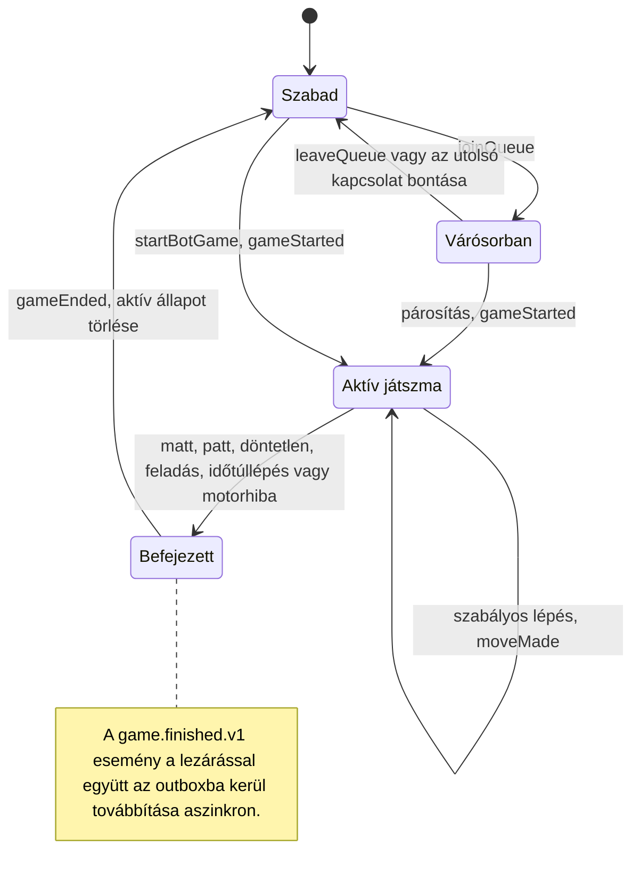

# Online sakkplatform – Rendszerterv (dokumentációváz)

> Ez a fájl a dokumentáció váza. A `> Kifejtendő:` blokkok azt jelzik, mit kell az adott pontba írni,
> a `> Forrás:` blokkok azt, honnan vehető át a tartalom (a repók ADR-jei és architektúra-leírásai angolul vannak,
> ezeket kell magyarra átültetni). A **[ÚJ]** jelölésű pontok a második körben kerültek be,
> az **[AZURE]** jelölésűek a tervezett Azure-telepítés miatt.
> A végleges dokumentumból ezek a blokkok és jelölések törlendők.
>
> **Felelősök:** minden fejezet alatt egy `> **Felelős:`** sor jelzi, ki írja. Az `infra` az `infra` repó
> (Envoy, Docker Compose, adattárolók) gazdáját jelenti; ha nincs ilyen, ki kell jelölni valakit.
> A `közös` fejezeteket egy ember szerkeszti, a többiek a saját részükkel adnak hozzá.
>
> | Felelős | Önálló fejezetek | Rész a közös fejezetekből |
> |---|---|---|
> | frontend | 2.2.2, 2.9 | 2.5, 2.6, 2.10–2.13, 2.15, 4 |
> | platform-service | 2.2.3, 2.8.1, 2.8.2 | 2.3, 2.5, 2.6, 2.10–2.13, 2.15, 4 |
> | game-service | 2.2.4, 2.7, 2.8.3 | 2.3, 2.6, 2.10–2.13, 2.15, 4 |
> | engine-service | 2.2.5 | 2.3, 2.6, 2.10–2.13, 2.15, 4 |
> | infra | 2.2.1, 2.2.6–2.2.8, 2.4 (benne az Azure-környezet), 3 | 2.5, 2.12, 2.13, 4 |
> | közös | 1, 2.1, 2.14, 5–7 | – |

---

## Címlap - anna

- Rendszerterv
- Online sakkplatform fejlesztése
- Szoftverarchitektúrák tárgy házi feladat
- Készítették: Borsik Balázs, Fehér Anna, Sipos Bence, Személyi Balázs András
- Dátum

---

## Tartalom

1. [Követelményspecifikáció (kész)](#0-követelményspecifikáció-kész)
2. [A rendszer célja és funkciói](#1-a-rendszer-célja-és-funkciói)
   1. Feladatkiírás
   2. A rendszer által biztosítandó tipikus funkciók
3. [Megvalósítás](#2-megvalósítás)
   1. Architektúra
   2. Komponensek
   3. Szolgáltatások közötti kommunikáció és interfészek
   4. Telepítési diagram **[ÚJ]**
      1. Helyi futtatás (Docker Compose)
      2. Éles környezet (Azure) **[AZURE]**
   5. Hitelesítés és biztonság
   6. Fő folyamatok
   7. A játszma állapotai **[ÚJ]**
   8. Adat- és adatbázisterv
   9. GUI-terv
   10. A use case-ek leképezése a komponensekre **[ÚJ]**
   11. Hibakezelés és hibatűrés **[ÚJ]**
   12. Skálázhatóság **[ÚJ]**
   13. Naplózás és monitorozás **[ÚJ]**
   14. A nem funkcionális követelmények teljesítése
   15. Tesztelés
4. [Telepítési leírás](#3-telepítési-leírás)
   1. Helyi futtatás
   2. Telepítés Azure-ba **[AZURE]**
5. [A program készítése során felhasznált eszközök](#4-a-program-készítése-során-felhasznált-eszközök)
6. [Összefoglalás](#5-összefoglalás)
7. [Továbbfejlesztési lehetőségek](#6-továbbfejlesztési-lehetőségek)
8. [Hivatkozások](#7-hivatkozások)

---

## 0. Követelményspecifikáció - (kész, nem tesszük bele)

A `Szoft Arch Sakkplatform Specifikáció.pdf` tartalma, változatlanul:

- Feladatkiírás (alapfunkciók, extra funkciók)
- A fejlesztő csapat
- Részletes feladatleírás
- Funkcionális követelmények (alapfunkciók, extra funkciók)
- Nem funkcionális követelmények (funkcionalitás, használhatóság, megbízhatóság, teljesítmény, támogathatóság)
- Technikai paraméterek
- Szótár
- Use-case-ek (alapfunkciók, extra funkciók)

---

## 1. A rendszer célja és funkciói

### 1.1 Feladatkiírás - becopyzni a kiírást (anna)

> **Felelős:** közös

> Kifejtendő: a feladatkiírás rövid megismétlése (1–2 bekezdés): webes sakkplatform élő és AI ellenfél elleni
> játszmákkal, játszmaelőzményekkel. Hivatkozás a követelményspecifikációra.

### 1.2 A rendszer által biztosítandó funkciók (anna)

> **Felelős:** közös

> Kifejtendő: a ténylegesen megvalósított funkciók listája (a mintában ez a dokumentum-életciklus).
> Javasolt bontás a felhasználó útja szerint:
>
> - fiókkezelés: regisztráció, bejelentkezés, kijelentkezés, munkamenet frissítése
> - játszma indítása: párosítás véletlen ellenféllel (várósor), játék AI ellen
> - játszma lebonyolítása: interaktív tábla, szabályos lépések kiemelése, speciális lépések
> (sáncolás, en passant, gyalogátváltoztatás), sakkóra, játszma vége (matt, patt, feladás, idő stb.)
> - játszmaelőzmények: lapozható lista, játszma visszajátszása lépésenként
> - a megvalósított extra funkciók megjelölése (pl. sakkóra), a meg nem valósítottak a 6. fejezetbe kerülnek

---

## 2. Megvalósítás

### 2.1 Architektúra - Sz.B.

> **Felelős:** közös

> Kifejtendő:
>
> - a választott architektúra: mikroszolgáltatások + API gateway, polyrepo
> - indoklás: a valós idejű játék és a nagy gépigényű motor leválasztása, külön skálázhatóság
> - **ábra:** C4 rendszerkörnyezet-diagram (szereplők: Vendég, Felhasználó, Néző); futás közben nincs
> külső rendszerfüggőség (a sakkszabályok és a motor könyvtárként vannak beépítve)
> - **ábra:** C4 konténerdiagram (böngésző → Envoy → frontend / platform-service / game-service;
> game-service → engine-service, Redis, RabbitMQ → platform-service → PostgreSQL)
> - az ábra után egy-egy mondat minden konténerről, részletesen a 2.2-ban
> - elvetett alternatívák röviden (pl. monolit)
>
> Forrás: `infra/docs/architecture.md` (System context, Containers), `infra/docs/adr/microservices.md`, `infra/docs/adr/polyrepo.md`

### 2.2 Komponensek - S.B. 

> **Felelős:** lásd az alfejezeteket

> Minden komponensnél a mintához hasonló szerkezet: **Célja**, **Felelősségei**, **Technológia és indoklás**,
> **Belső felépítése** (ha van), **ábra** (ha van).

#### 2.2.1 API gateway (Envoy) - Sz.B

> **Felelős:** infra

> Kifejtendő: egyetlen belépési pont, útvonalak szerinti továbbítás (statikus fájlok, REST, Socket.IO),
> TLS lezárás, access token ellenőrzése és identitásfejlécek továbbítása, bejelentkezési kísérletek korlátozása.
>
> Forrás: `infra/docs/adr/api-gateway.md`, `infra/envoy/`

#### 2.2.2 Webes kliens (frontend) - Anna

> **Felelős:** frontend

> Kifejtendő:
>
> - React + TypeScript + Vite SPA, nginx szolgálja ki
> - mappaszerkezet / modulok (auth, lobby, game, api, routing, theme)
> - állapotkezelés (TanStack Query a szerveradatokhoz, élő játszma állapota)
> - sakktábla-komponens és lépésellenőrzés a kliensen
> - útvonalak és oldalak (részletesen a 2.9-ben)
> - kommunikáció: REST a platform-service felé, Socket.IO a game-service felé
>
> Forrás: `frontend/docs/adr/` (stack, state-management, chessboard, pages-and-routing, styling, gateway-access)

#### 2.2.3 platform-service (ASP.NET Core) - Sz.B.

> **Felelős:** platform-service

> Kifejtendő:
>
> - felelősség: felhasználókezelés, tokenek és munkamenetek, játszmaelőzmények tárolása és lekérdezése
> - **rétegek (Clean Architecture)**, a mintában az N-rétegű bontás megfelelője, ábrával:
>   - Domain: entitások, domain szabályok
>   - Application: use case-ek, portok
>   - Infrastructure: EF Core, Identity, access tokenek, a befejezett játszmák fogyasztója
>   - API: HTTP végpontok, middleware-ek, request pipeline
> - validáció, hibakezelés, konfiguráció
>
> Forrás: `platform-service/docs/architecture.md`, `platform-service/docs/adr/`

#### 2.2.4 game-service (NestJS) B.B.

> **Felelős:** game-service

> Kifejtendő:
>
> - felelősség: folyamatban lévő játszmák, párosítás, lépések ellenőrzése, sakkóra, játszma vége
> - Socket.IO események (kliens → szerver, szerver → kliens)
> - a játszmaállapot tárolása Redisben
> - egy felhasználó egyszerre egy játszmában; több kapcsolat (fül) kezelése
> - a befejezett játszma átadása (outbox + RabbitMQ)
> - sakkszabályok ellenőrzése külső könyvtárral
>
> Forrás: `game-service/docs/`, `infra/docs/adr/live-game.md`, `infra/docs/adr/chess-rules.md`

#### 2.2.5 engine-service (Python) S.B.

> **Felelős:** engine-service

> Kifejtendő:
>
> - felelősség: gépi lépés számítása egy adott állásra
> - a választott sakkmotor és indoklása, nehézségi szint(ek)
> - webes keretrendszer, HTTP API
> - állapotmentesség → külön skálázható
>
> Forrás: `engine-service/docs/architecture.md`, `engine-service/docs/integration.md`, `engine-service/docs/adr/`

#### 2.2.6 PostgreSQL (relációs adatbázis) - Sz.B.

> **Felelős:** infra (+ platform-service)

> Kifejtendő:
>
> - célja: a hosszú távú adatok tárolása (felhasználók, munkamenetek, befejezett játszmák)
> - ki használja: csak a platform-service, más szolgáltatás nem éri el
> - miért ezt választottuk, elvetett alternatívák (pl. más SQL vagy NoSQL adatbázis)
> - konfiguráció: verzió, tartós tár (kötet), migrációk futtatása, hozzáférési adatok
> - **[AZURE]** éles környezetben: Azure Database for PostgreSQL vagy konténer (lásd 2.4.2)
> - a séma részletei a 2.8.1–2.8.2-ben
>
> Forrás: `infra/docs/adr/database.md`, `infra/postgres/`, `platform-service/docs/adr/persistence.md`

#### 2.2.7 Redis (a futó játszmák tárolója) - B.B.

> **Felelős:** infra (+ game-service)

> Kifejtendő:
>
> - célja: a folyamatban lévő játszmák állapotának gyors tárolása (állás, óra, várósor, outbox)
> - ki használja: csak a game-service
> - miért ezt választottuk (gyors, memóriában tárol, a game-service több példánya közösen használhatja),
> elvetett alternatívák (pl. memóriában a szolgáltatáson belül, relációs adatbázis)
> - konfiguráció: tartósság (mi marad meg újraindítás után), memóriakorlát
> - **[AZURE]** éles környezetben: Azure Managed Redis vagy konténer (lásd 2.4.2)
> - a kulcsok szerkezete a 2.8.3-ban
>
> Forrás: `infra/docs/adr/database.md`, `infra/docs/adr/live-game.md`

#### 2.2.8 RabbitMQ (üzenetközvetítő) - B.B.

> **Felelős:** infra (+ game-service, platform-service)

> Kifejtendő:
>
> - célja: a befejezett játszmák aszinkron átadása a game-service-től a platform-service-nek
> - ki használja: a game-service küldi, a platform-service fogadja az üzeneteket
> - miért aszinkron üzenet és nem közvetlen hívás (a platform-service kiesése nem akasztja meg a játékot),
> miért RabbitMQ, elvetett alternatívák (pl. közvetlen HTTP hívás, Kafka, Redis Streams)
> - a sorok és exchange-ek felépítése, kézbesítési garanciák (megerősítés, újraküldés, hibás üzenetek sora)
> - konfiguráció: tartós sorok, kötet, hozzáférési adatok
> - **[AZURE]** éles környezetben: konténer vagy Azure Service Bus (lásd 2.4.2)
>
> Forrás: `infra/docs/adr/service-communication.md`, `infra/rabbitmq/`, `platform-service/docs/adr/messaging.md`

### 2.3 Szolgáltatások közötti kommunikáció és interfészek - Anna

> **Felelős:** közös (áttekintő táblázat, konvenciók) + a saját interfészét minden szolgáltatás: platform-service (REST végpontok), game-service (Socket.IO események, „befejezett játszma” esemény), engine-service (HTTP API)

> Kifejtendő:
>
> - kommunikációs módok táblázatban: ki kivel, milyen protokollon, szinkron/aszinkron
> (REST, Socket.IO/WSS, HTTP az engine felé, AMQP). A dokumentumban csak itt szerepel ez a táblázat,
> a 2.4 telepítési diagramjai erre hivatkoznak.
> - szerződésalapú fejlesztés: OpenAPI és AsyncAPI leírások az `infra/contracts` mappában, konvenciók
> - a fő REST végpontok rövid táblázata (útvonal, metódus, leírás)
> - a fő Socket.IO események táblázata
> - a „befejezett játszma” esemény szerkezete
>
> Forrás: `infra/contracts/*.yaml`, `infra/docs/adr/contracts.md`, `infra/docs/adr/contract-conventions.md`,
> `infra/docs/conventions.md`

### 2.4 Telepítési diagram **[ÚJ] - Sz.B.**

> **Felelős:** lásd az alfejezeteket

> A fizikai nézet: hol fut az egyes komponens, és mi mit ér el hálózati szinten. A diagramok nyilai
> csak az elérhetőséget mutatják; a protokollokat és az üzenetek tartalmát a 2.3 írja le, itt nem ismételjük.

#### 2.4.1 Helyi futtatás (Docker Compose) Sz.B

> **Felelős:** infra

> Kifejtendő:
>
> - **ábra:** UML telepítési diagram vagy Compose-topológia: a konténerek, a Docker hálózatok
> (melyik szolgáltatás melyik hálózaton lát melyik adattárolót), a kívülről elérhető portok
> (csak az Envoy), a kötetek (PostgreSQL, Redis, RabbitMQ adatai, tanúsítvány)
> - health checkek és az indulási sorrend (`depends_on`), adatbázis-migráció indításkor
> - a fejlesztői változatok eltérései röviden (melyik szolgáltatás fut a gépen a konténer helyett)
>
> Forrás: `infra/compose.yaml`, `infra/compose.*.yaml`, `infra/envoy/`, `infra/README.md`

#### 2.4.2 Éles környezet (Azure) **[AZURE] - B.B**

> **Felelős:** infra (+ minden szolgáltatás a saját konfigurációját és erőforrásigényét)

> Kifejtendő:
>
> - **ábra:** Azure telepítési diagram: erőforráscsoport, a szolgáltatások futtatókörnyezete, az adattárolók,
> a hálózat (mi érhető el kívülről, mi csak belső hálózaton), a domain és a tanúsítvány
> - a választott Azure-szolgáltatások komponensenként, indoklással és az elvetett alternatívával.
> **Döntendő** (javasolt rögzíteni egy új ADR-ben az `infra` repóban):
>   - **futtatókörnyezet:** Azure Container Apps (a Compose-hoz legközelebbi, WebSocketet és
>   skálázást támogat) / Azure Kubernetes Service (rugalmasabb, de jóval több üzemeltetés) / App Service
>   - **konténerképek:** Azure Container Registry vagy GitHub Container Registry
>   - **PostgreSQL:** Azure Database for PostgreSQL (Flexible Server) vagy konténer saját tárral
>   - **Redis:** Azure Managed Redis vagy konténer
>   - **RabbitMQ:** az Azure nem kínál menedzselt RabbitMQ-t → konténer tartós tárral, vagy Azure Service Bus
>   (ez kódváltozást jelent a game-service-ben és a platform-service-ben)
>   - **gateway:** az Envoy konténerként marad, vagy a platform bejövő forgalomkezelője / Application Gateway
>   váltja ki (ha kikerül, a tokenellenőrzés és a rate limiting helye változik, lásd 2.5)
>   - **frontend:** nginx-konténer az Envoy mögött, vagy Azure Static Web Apps
>   (ha más domainre kerül, a cookie-alapú hitelesítést újra kell gondolni)
> - titkok és konfiguráció: környezeti változók, Azure Key Vault vagy a futtatókörnyezet titokkezelése
> - domain és TLS-tanúsítvány (menedzselt tanúsítvány)
> - a helyi és az Azure-környezet különbségei táblázatban (komponens – helyben – Azure-ban)
> - költségek: a választott díjcsomagok, becsült havi költség, hallgatói kredit (pl. Azure for Students)
>
> Forrás: `infra/compose.yaml` (a jelenlegi topológia), az Azure-dokumentáció

### 2.5 Hitelesítés és biztonság - S.B.

> **Felelős:** platform-service (tokenek, jelszavak, validáció) + infra (Envoy: tokenellenőrzés, rate limiting) + frontend (cookie-k, frissítés, kliensoldali validáció)

> Kifejtendő:
>
> - access és refresh token, tárolás cookie-ban, frissítés, kijelentkezés
> - a tokenek ellenőrzése a gatewayben, identitásfejlécek a szolgáltatások felé
> - jelszavak hashelése (ASP.NET Identity)
> - bemenetek validálása kliens- és szerveroldalon, paraméterezett lekérdezések (EF Core)
> - HTTPS/WSS, rate limiting
> - **[AZURE]** az éles környezet biztonsága: titkok tárolása (Key Vault), az adattárolók csak belső
> hálózatról érhetők el, nyilvános tanúsítvány, a gateway helye az Azure-ban (lásd 2.4.2)
> - kapcsolat a specifikáció „Biztonság” követelményével
>
> Forrás: `infra/docs/adr/authentication.md`, `platform-service/docs/adr/tokens-and-sessions.md`,
> `platform-service/docs/adr/gateway-authentication.md`, `platform-service/docs/adr/accounts.md`

### 2.6 Fő folyamatok - Anna

> **Felelős:** folyamatonként, lásd a listát

> Kifejtendő: szekvenciadiagramok és rövid magyarázat az alábbiakhoz:
>
> 1. Regisztráció és bejelentkezés, hitelesített kérés – *platform-service* (+ infra, frontend)
> 2. Párosítás és élő játszma két játékos között – *game-service* (+ frontend)
> 3. Élő játszma AI ellen – *game-service* + *engine-service*
> 4. Befejezett játszma átadása és mentése (outbox, sor, idempotens feldolgozás) – *game-service* + *platform-service*
> 5. Játszmaelőzmények lekérdezése és visszajátszás – *platform-service* + *frontend*
>
> Forrás: `infra/docs/architecture.md` (Flows), `platform-service/docs/architecture.md`
>
> `id emég be lehetne rakni egy usecase-t?`

### 2.7 A játszma állapotai **[ÚJ] - Sipos Bence**

> **Felelős:** game-service

A game-service kezeli a felhasználók várakozási és aktív játszmaállapotát, valamint a játszmák teljes életciklusát. Egy felhasználó egyszerre vagy szabad, vagy a párosításra vár, vagy egy játszmában vesz részt. A várósorba lépéskor, illetve AI-ellenfél indításakor a szolgáltatás ellenőrzi ezt az állapotot; a már várakozó vagy játszó felhasználó újabb ilyen kérést nem indíthat. Ha van várakozó ellenfél, a párosítás azonnal megtörténik, és mindkét játékos `gameStarted` eseményt kap. AI elleni játék is azonnal létrejön. A játékosok színe véletlenszerű.

Az aktív játszmában a game-service ellenőrzi a lépések szabályosságát és a soron következő játékost. Érvényes lépés után frissíti a pozíciót és az órát, majd `moveMade` eseményt küld a játékosok minden aktív kapcsolatának. AI ellen a game-service kéri a motor lépését; a motor válasza ugyanúgy a játszma állapotát módosító lépés. Újracsatlakozáskor a kliens a `getState` eseménnyel kérheti le, hogy várósorban van-e, illetve a folyamatban lévő játszma állapotát. A kapcsolat megszakadása önmagában nem fejezi be az aktív játszmát: a játékos visszacsatlakozhat, az órája pedig tovább fut. Ha a várakozó felhasználó utolsó kapcsolata is megszűnik, kikerül a sorból. Az aktív játszmából feladással lehet kilépni.

A játszma mattal, pattal, háromszori ismétlés, az 50 lépéses szabály vagy elégtelen anyag miatt döntetlennel, feladással vagy időtúllépéssel érhet véget. Ha a sakkmotor ismételt kérése is sikertelen, a játszma `aborted` eredménnyel, `engineFailure` okkal zárul. Időtúllépéskor a soron lévő játékos veszít; kivétel, ha az ellenfélnek csak királya, vagy királya és egy futója vagy huszárja maradt, mert ekkor döntetlen az eredmény. A platform automatikusan alkalmazza a háromszori ismétlés és az 50 lépés szabályát, külön játékosi igénylés nélkül. A lezárás oka a `gameEnded` eseményben jelenik meg: `checkmate`, `stalemate`, `threefoldRepetition`, `fiftyMoveRule`, `insufficientMaterial`, `resignation`, `timeout` vagy `engineFailure`.

A játszma szerveroldali sakkórája játékosonként 10 perc, lépésenkénti többletidő nélkül. A fehér órája indul el a kezdéskor, kivéve, ha a fehér a motor: ilyenkor az első motorlépés után indul a felhasználó órája. Két emberi játékos esetén minden lépés után a másik játékos órája fut. AI ellen a motor gondolkodási ideje alatt a felhasználó órája megáll, majd a motor lépésének rögzítésekor újraindul. A game-service számolja az eltelt időt, Redisben tárolja az óra állapotát és határidejét, és lejáratkor akkor is lezárja a játszmát, ha nem érkezik új kliensesemény. A lezáráskor a szolgáltatás értesíti a játékosokat `gameEnded` eseménnyel, és a `game.finished.v1` eseményt a játszma lezárásával együtt az outboxba írja; az outbox RabbitMQ-n keresztül továbbítja az eredményt a platform-service-nek, amely elmenti a játszmaelőzménybe. Az átadás részleteit a 2.6. fejezet ismerteti.

Forrás: `game-service/src`, `game-service/docs/adr/game-state.md`, `infra/docs/adr/live-game.md`,
`infra/docs/adr/chess-rules.md`, `infra/contracts/game-service.asyncapi.yaml`

### 2.8 Adat- és adatbázisterv - Sz. B.

> **Felelős:** lásd az alfejezeteket

#### 2.8.1 Az adatbázis entitás-relációs diagramja - Sz. B.

> **Felelős:** platform-service

> Kifejtendő: ER-diagram a PostgreSQL sémáról (felhasználó, refresh token, játszma, lépések,
> feldolgozott üzenetek stb.), az ORM (EF Core) és a migrációk rövid bemutatása.
>
> Forrás: `platform-service/src/PlatformService.Domain`, `PlatformService.Infrastructure` (EF konfiguráció, migrációk),
> `platform-service/docs/adr/persistence.md`, `game-history.md`

#### 2.8.2 Entitások Sz.B.

> **Felelős:** platform-service

> Minden entitásnál a mintához hasonlóan: **Célja**, **Leképzése a kódban** (osztály),
> **Leképzése az adatbázisban** (tábla), **Tulajdonságai** (mezők listája rövid leírással).

- Felhasználó entitás
- Refresh token / munkamenet entitás
- Játszma entitás
- Lépés / lépéstörténet (ha külön tábla, különben a Játszma része)
- Egyéb technikai entitások (pl. feldolgozott üzenetek)

#### 2.8.3 A futó játszmák adatmodellje (Redis) - B.B.

> **Felelős:** game-service

> Kifejtendő: a Redis kulcsok és értékek szerkezete (játszmaállapot, FEN, óra, várósor, outbox),
> lejárati idők, miért nem relációs adatbázis.

### 2.9 GUI-terv - Anna

> **Felelős:** frontend

> Kifejtendő: az oldalak listája útvonallal és jogosultsággal, mindegyikhez képernyőkép vagy drótváz és rövid leírás:
>
> - `/login` – Bejelentkezés
> - `/register` – Regisztráció
> - `/` – Lobby (játszma indítása: párosítás vagy AI)
> - `/game` – Játszma (tábla, sakkóra, ellenfél, eredmény)
> - `/history` – Játszmaelőzmények (lapozható lista)
> - `/history/:gameId` – Visszajátszás (lépésenkénti léptetés, lépéslista)
> - Navigáció az oldalak között (ábra), átirányítási szabályok (vendég / bejelentkezett)
>
> Forrás: `frontend/docs/adr/pages-and-routing.md`, `frontend/docs/adr/styling.md`

### 2.10 Hibakezelés és hibatűrés **[ÚJ]** -> "vagy lesz vagy nem" - B. B.

> **Felelős:** esetenként, lásd a listát

> Kifejtendő: mi történik az alábbi esetekben, és melyik tervezési döntés kezeli:
>
> - a kliens kapcsolata megszakad, újracsatlakozik, vagy újratölti az oldalt (`getState` visszaállítja a játszmát)
> – *game-service* + *frontend*
> - a felhasználó több fülön van bejelentkezve – *game-service* + *frontend*
> - az engine-service nem válaszol vagy lassú – *game-service* + *engine-service*
> - a RabbitMQ vagy a platform-service nem elérhető a játszma végén (outbox, újraküldés, idempotens fogadás)
> – *game-service* + *platform-service*
> - a game-service vagy a Redis újraindul (mi marad meg a futó játszmákból) – *game-service*
> - lejárt access token játszma közben (frissítés) – *frontend* + *platform-service*
> - hibaválaszok egységes formátuma a REST API-ban, hibák megjelenítése a kliensen – *platform-service* + *frontend*
>
> Forrás: `infra/docs/adr/service-communication.md`, `infra/docs/adr/live-game.md`,
> `platform-service/docs/adr/error-handling.md`, `platform-service/docs/adr/messaging.md`

### 2.11 Skálázhatóság **[ÚJ]** -> legyen benne, max 1-2 mondat - B. B.

> **Felelős:** minden szolgáltatás a sajátját; közös összegzés

> Kifejtendő:
>
> - melyik szolgáltatás futtatható több példányban és milyen feltétellel
> (engine-service: állapotmentes; platform-service: állapotmentes, a tokenek ellenőrzése a gatewayben;
> game-service: közös Redis, Socket.IO események szétosztása a példányok között)
> - a szűk keresztmetszetek (pl. a motor CPU-igénye, Redis, egy PostgreSQL példány)
> - becslés vagy mérés a specifikáció számaihoz (1 000 felhasználó, 100 párhuzamos játszma)
> - **[AZURE]** skálázás az Azure-ban: példányszámok és automatikus skálázási szabályok szolgáltatásonként,
> több game-service példánynál a Socket.IO kapcsolatok kezelése (sticky session vagy Redis adapter),
> a menedzselt adattárolók díjcsomagjainak korlátai

### 2.12 Naplózás és monitorozás **[ÚJ]** -> lehetséges fejlesztéshez. 

> **Felelős:** minden szolgáltatás a sajátját + infra (health checkek)

> Kifejtendő: a naplózás módja szolgáltatásonként (formátum, szintek, hova ír), konfiguráció környezeti
> változókkal, health checkek, (ha van) korrelációs azonosító a kérések követésére, monitorozási lehetőségek.
> **[AZURE]** Az éles környezetben: a naplók gyűjtése (Azure Monitor, Log Analytics), metrikák,
> esetleg Application Insights, riasztások, a health checkek használata a futtatókörnyezetben.
>
> Forrás: `platform-service/docs/adr/configuration-and-logging.md`, `infra/compose.yaml` (healthcheck)

### 2.13 A nem funkcionális követelmények teljesítése - B.B.

> **Felelős:** közös

> Kifejtendő: táblázat a specifikáció nem funkcionális követelményeiről és arról, mely tervezési döntés
> teljesíti őket (pl. válaszidő, 500 ms-os késleltetés → WebSocket; 100 aktív játszma → 2.12;
> utolsó 100 játszma tárolása - kéne seed az adatbázisba (100-200 játszma); Docker → hordozhatóság;).

### 2.14 Tesztelés

A projekt automatizált tesztjei a szolgáltatások saját repóiban találhatók. A gyors, külső infrastruktúrát nem igénylő unit- és komponens-tesztek a belső logikát vizsgálják; az integrációs tesztek ott használnak valódi adatbázist, Redis-példányt vagy üzenetközvetítőt, ahol ezek viselkedése a szolgáltatás működésének része. A CI minden szolgáltatásnál futtatja a hozzá tartozó automatizált ellenőrzéseket és buildet. A következő bontás a jelenlegi teszteket, majd külön jelölve a továbbfejlesztési lehetőségeket mutatja be.

#### 2.14.1 Webes kliens (frontend)

- **Unit- és komponens-tesztek:** Vitest, React Testing Library és jsdom segítségével ellenőrzik a kliensoldali logikát és a felületi komponenseket. A lefedett területek közé tartozik többek között a játékszabályok és az óra kezelése, a játékállapot és a kapcsolat állapota, a lobby-műveletek, az űrlapok szabályai, az útvonalvédelem, valamint a játék-, előzmény- és visszajátszásoldal. A böngészőben elérhető, de jsdomból hiányzó funkciókhoz a tesztkörnyezet helyettesítőket használ.
- **API- és fake-tesztek:** a valódi HTTP-kliens, a Socket.IO-kliens és a hibakezelés külön teszteket kap. A fake Auth API, Games API és game socket tesztjei a kliens backend nélküli működését ellenőrzik. A `dev:fake` mód a böngészőben is elindítható, így a felület a szolgáltatások nélkül kipróbálható; a fake implementációk a szerződések példáihoz igazodnak.
- **Jelenlegi korlát és továbbfejlesztés:** ezek a tesztek nem egy telepített teljes rendszert vagy valódi böngészőket automatizálnak. A frontend ADR Playwright-alapú, több böngésző-kontextust használó végponttól végpontig tartó teszteket jelöl meg későbbi lehetőségként; a Playwright jelenleg nincs beállítva.
- **Kézi ellenőrzés:** a felhasználói folyamatokat a böngészőben, lehetőség szerint a fake módban és a gateway-en keresztül futó teljes rendszerrel is érdemes kipróbálni.

#### 2.14.2 Platform-service

- **Unit-tesztek:** xUnit v3-mal vizsgálják a domain- és alkalmazási réteg üzleti logikáját, például a regisztrációt, bejelentkezést, munkameneteket, tokeneket, felhasználói szolgáltatásokat, játszmaelózmény-feldolgozást és validátorokat. Kézzel készített fake repository-k és szolgáltatások, illetve szabályozható tesztóra segítségével a tesztek Docker nélkül futnak.
- **Integrációs tesztek:** a teljes ASP.NET Core alkalmazást memóriában indítják `WebApplicationFactory` segítségével. Ellenőrzik a HTTP-végpontokat, a hitelesítést és cookie-kat, a JSON-konvenciókat, a hibák ProblemDetails-válaszokká alakítását, az API-dokumentumot, az adatbázis-műveleteket és a RabbitMQ-fogyasztót. A PostgreSQL-t és RabbitMQ-t Testcontainers indítja valódi konténerben, az adatbázisra a migrációk is lefutnak; a RabbitMQ-tesztek izolált virtuális hosttal és jogosultságokkal dolgoznak. Ezek futtatásához Docker szükséges.
- **Kézi ellenőrzés:** ellenőrizhető a fejlesztői Scalar API-felület, a regisztráció/bejelentkezés/kijelentkezés, a munkamenet-frissítés és a játszmaelózmények lekérése. A sikeres és hibás kéréseket, valamint a lejárt token és munkamenet eseteit is érdemes kipróbálni.

#### 2.14.3 Game-service

- **Unit-tesztek:** Vitesttel ellenőrzik a sakk-szabályokat, az órát, a konfigurációt, a motor-kliens viselkedését, az outbox publikálási logikáját, a játék- és Socket.IO gateway-műveleteket, valamint a hibás események nyugtázását. A külső komponensek egy részét a tesztek helyettesítik, így a szolgáltatás üzleti szabályai gyorsan vizsgálhatók.
- **Redis-integrációs tesztek:** a RedisService tesztjei nem mockolt Redis-klienssel, hanem Testcontainers által indított valódi Redisben futnak. Ezzel az atomi Lua-szkriptek, a több kulcsot érintő állapotváltozások, a párosítás, az órák határideje és az outbox adattárolása is ellenőrizhető. Ezekhez Docker szükséges.
- **Kézi ellenőrzés:** a frontenddel együtt kipróbálható a várólistába lépés és kilépés, két felhasználó párosítása, AI-játszma, szabálytalan és szabályos lépések, feladás, időtúllépés, újracsatlakozás, valamint az eredmény platform-service felé történő továbbítása.

#### 2.14.4 Engine-service

- **Unit- és API-szerződés-tesztek:** pytesttel vizsgálják az egészségügyi végpontot, a bemeneti FEN és a variáns ellenőrzését, a végállás és hibás kérés kezelését, illetve a válasz szerkezetét. A motorfolyamat újraindítását vizsgáló teszt helyettesített folyamatot használ, így a hibakezelés és a korlátok külön is tesztelhetők.
- **Valódi motorral végzett integrációs teszt:** a `test_engine_real.py` tényleges Stockfish-példányt indít, és ellenőrzi, hogy a kezdőállásra adott ajánlott lépés legális. Ez a teszt csak akkor futtatható, ha a Stockfish elérhető, és a `STOCKFISH_PATH` be van állítva; a CI telepíti a motort.
- **Konténeres smoke teszt:** a CI felépíti és elindítja a Docker-képet, megvárja az egészséges állapotot, majd HTTP-kéréssel ellenőrzi, hogy a motor-végpont használható és szabályos lépést ad vissza.
- **Kézi ellenőrzés:** különféle érvényes és érvénytelen FEN-állásokkal tesztelhető a végpont, valamint a motor hibás vagy nem elérhető állapotának kezelése.

#### 2.14.5 Teljes rendszer és manuális tesztelés

Az `infra/scripts/smoke-test.mjs` a Docker Compose-szal elindított teljes rendszert a gateway-en keresztül vizsgálja. Többek között ellenőrzi, hogy betöltődik-e a webes kliens, működnek-e a tokenes védett útvonalak, elérhető-e a platform API, helyesek-e a WebSocket/gateway-hozzáférések, érvényesül-e a rate limit, illetve a RabbitMQ-n publikált befejezett játszma megjelenik-e a felhasználó előzményeiben. Ez rendszerintegrációs smoke teszt, nem helyettesíti a részletes unit- és integrációs teszteket.

A teljes rendszer manuális átvételekor legalább az alábbi forgatókönyvek javasoltak:

1. Regisztráció, bejelentkezés, oldalfrissítés utáni munkamenet-helyreállítás és kijelentkezés.
2. Két külön böngészőben vagy privát munkamenetben belépő felhasználó párosítása, lépések küldése és a másik kliensen megjelenő frissítés ellenőrzése.
3. AI elleni játék, beleértve azt az esetet is, amikor a motor kezd, továbbá több egymást követő lépés ellenőrzése.
4. Matt, patt, döntetlen, feladás és időtúllépés ellenőrzése; annak vizsgálata, hogy a végeredmény mindkét kliensen és a játék előzményeiben is helyesen jelenik-e meg.
5. Böngészőkapcsolat megszakítása és visszaállítása: aktív játszma folytatása, illetve a várakozóból való kikerülés, ha a felhasználó utolsó kapcsolata bontódik.
6. Szolgáltatás- vagy adattároló-hiba esetén a felhasználónak adott visszajelzés, naplók és helyreállás ellenőrzése.
7. A felület ellenőrzése a specifikációban megjelölt böngészőkben: Chrome, Firefox és Edge; eltérő méretű ablakokban és hibás/üres állapotoknál is.

A kézi és böngészőautomatizálási tesztek eredményét, a tesztelt verziót és az esetleges hibákat érdemes a kiadás előtti ellenőrzőlistában rögzíteni. A kézi tesztelés nem váltja ki az automatizált regressziós teszteket.

**A tesztfuttatás fő parancsai:** frontend: `npm test`; game-service: `npm test`; engine-service: `python -m pytest tests -q`; platform-service: `dotnet test`. A game-service Redis-tesztjei, valamint a platform-service integrációs tesztjei Docker-környezetet igényelnek.

**Források:** `frontend/docs/adr/testing.md`, `frontend/docs/adr/fake-backends.md`, `game-service/docs/adr/game-state.md`, `platform-service/docs/adr/testing.md`, az egyes repók tesztfájljai és CI-workflow-i, valamint `infra/scripts/smoke-test.mjs`.

---

## 3. Telepítési leírás

> **Felelős:** lásd az alfejezeteket

### 3.1 Helyi futtatás - Sz. B.

> **Felelős:** infra

> Kifejtendő:
>
> - rendszerkövetelmények (Docker, Docker Compose, szabad portok, memória)
> - támogatott böngészők: Chrome legfrissebb asztali verziója teljes, Firefox és Edge kielégítő funkcionalitással
> - a repók letöltése (polyrepo: melyik repó hova kerüljön)
> - konfiguráció (környezeti változók, tanúsítvány)
> - indítás: `docker compose` parancsok az `infra` repóból
> - fejlesztői változatok (`compose.dev.yaml`, `compose.game-on-host.yaml`, `compose.platform-on-host.yaml`)
> - az alkalmazás elérése a böngészőből, kipróbálás
>
> Forrás: `infra/README.md`, `infra/compose*.yaml`, a szolgáltatások `README.md` fájljai

### 3.2 Telepítés Azure-ba **[AZURE] - B.B.**

> **Felelős:** infra

> Kifejtendő:
>
> - előfeltételek: Azure-előfizetés, jogosultságok, Azure CLI (és ha használjuk: Bicep vagy Terraform)
> - az erőforrások létrehozása lépésenként vagy szkripttel/sablonnal (infrastruktúra kódként, ha van)
> - a konténerképek buildelése és feltöltése a registrybe
> - konfiguráció és titkok beállítása, adatbázis-migráció az első indításkor
> - telepítés és frissítés (kézzel vagy CD pipeline-nal)
> - az éles alkalmazás címe, ellenőrzés (health checkek, próbajátszma)
> - az erőforrások leállítása vagy törlése a költségek elkerülésére

---

## 4. A program készítése során felhasznált eszközök

Az alábbi felsorolás az öt repó konfigurációja, függőségei, build- és tesztbeállításai, valamint a fejlesztés során használt eszközök alapján készült. A csomagok közül a rendszerterv szempontjából fontos közvetlen függőségeket emeli ki.

- **React, React DOM, TypeScript, Vite és React Router**  
  Felhasználás: a böngészőben futó kliens felületének és útvonalainak megvalósítása, fejlesztése és buildelése.
- **Chakra UI, Emotion, TanStack Query, Zustand, react-chessboard, chess.js és Socket.IO Client**
  Felhasználás: a felhasználói felület és a sakktábla megjelenítése, a szerveradatok és kliensállapot kezelése, a sakk szabályainak kliensoldali támogatása, valamint a game-service-szel való valós idejű kommunikáció.
- **.NET 10, ASP.NET Core és ASP.NET Core Identity**  
  Felhasználás: a platform-service HTTP API-jának és felhasználói fiókkezelésének megvalósítása.
- **Entity Framework Core, Npgsql, FluentValidation, JSON Web Token (JWT) és Scalar**  
  Felhasználás: adatbázis-hozzáférés és migrációk, kérésvalidáció, tokenkezelés, valamint a fejlesztői API-dokumentáció és kipróbálható API-felület biztosítása.
- **Node.js, TypeScript, NestJS, NestJS Config, Express-adapter, Socket.IO, RxJS és reflect-metadata**  
  Felhasználás: a game-service futtatása és konfigurálása, moduláris felépítése, valamint a játékosok valós idejű eseményeinek kezelése.
- **node-redis (`@redis/client`), Lua, `amqplib` és chess.js**  
  Felhasználás: az aktív játszmák Redis-állapotának kezelése és atomi Lua-szkriptek futtatása, a RabbitMQ-val történő eseményközvetítés és a sakk szabályainak ellenőrzése.
- **Python, FastAPI, Uvicorn, python-chess és Stockfish**  
  Felhasználás: az engine-service HTTP API-ja, a sakkállások kezelése és a számítógépes ellenfél lépéseinek kiszámítása.
- **PostgreSQL, Redis és RabbitMQ**  
  Felhasználás: a felhasználói és játszmaelőzmény-adatok tartós tárolása, az aktív játszmák állapotának kezelése, valamint a szolgáltatások közötti aszinkron eseményközvetítés.
- **Envoy és nginx**  
  Felhasználás: az Envoy a bejövő forgalom továbbítására és gateway-feladatokra, az nginx a frontend statikus fájljainak kiszolgálására szolgál.
- **Docker, Docker Compose és Docker Buildx**  
  Felhasználás: a szolgáltatások és adattárolók konténerizálása, a helyi rendszer összehangolt futtatása, valamint több processzor-architektúrára készülő képek buildelése.
- **OpenSSL**  
  Felhasználás: a helyi fejlesztői HTTPS-kapcsolathoz szükséges tanúsítványok előállítása egy konténerben.
- **HTTP, WebSocket, AMQP és TLS**  
  Felhasználás: a szolgáltatások szinkron HTTP-kommunikációja, a valós idejű játékmenet, az üzenetközvetítő elérése és a gateway titkosított elérése.
- **OpenAPI, AsyncAPI és Redocly CLI**  
  Felhasználás: a HTTP- és eseményalapú szolgáltatási szerződések leírása és lintelése.
- **Mermaid és Markdown**  
  Felhasználás: a rendszer- és állapotdiagramok, illetve a műszaki dokumentáció elkészítése.
- **Vitest, React Testing Library, Testing Library DOM, jest-dom, user-event, jsdom, pytest, HTTPX és xUnit v3**  
  Felhasználás: a frontend, a game-service, az engine-service és a platform-service automatizált egység-, komponens- és integrációs tesztelése.
- **Testcontainers és Microsoft Testing Platform**
  Felhasználás: tesztekhez szükséges Redis-, PostgreSQL- és RabbitMQ-példányok konténeres indítása, illetve a .NET-tesztek futtatása.
- **ESLint, Prettier, TypeScript compiler, .NET SDK, EF Core CLI, pip és npm**  
  Felhasználás: statikus kódellenőrzés, formázás, fordítás/buildelés, adatbázis-migrációk kezelése és függőségek telepítése.
- **GitHub Actions és GitHub Container Registry (GHCR)**  
  Felhasználás: a repók CI-folyamatainak futtatása, valamint a konténerképek buildelése és közzététele.
- **Git és GitHub**  
  Felhasználás: forráskód-verziókezelés, a különálló repók együttműködésének, a pull requesteknek és a CI-folyamatoknak a támogatása.
- **Visual Studio és Visual Studio Code**  
  Felhasználás: a .NET-es platform-service, a többi szolgáltatás és a dokumentáció fejlesztése, szerkesztése és tesztelése.
- **Notepad és Notepad++**  
  Felhasználás: egyszerű szöveges fájlok, jegyzetek és konfigurációk megtekintése, illetve szerkesztése.
- **Microsoft Word és Adobe Acrobat (PDF)**  
  Felhasználás: dokumentumok szerkesztése, illetve PDF-formátumú anyagok megtekintése és kezelése.
- **Google Chrome és Brave**  
  Felhasználás: a webes kliens és a helyben futó rendszer elérése, valamint a felület böngészőben történő ellenőrzése. A specifikáció Chrome-ra, Firefoxra és Edge-re vonatkozó támogatási elvárásait a 3.1. fejezet ismerteti.
- **GitHub Copilot, Microsoft Copilot, Claude és Gemini**
  Felhasználás: a fejlesztési és dokumentációs munka támogatása; az előállított kód és szöveg helyességét a fejlesztők ellenőrzik.

Az Azure és a Playwright a dokumentáció készítésekor tervezett, de még nem megvalósított elemek, ezért nem szerepelnek a ténylegesen használt eszközök között.

---

## 5. Összefoglalás - Anna

> **Felelős:** közös

> Kifejtendő: 1–2 bekezdés: mit valósítottunk meg a specifikációból, mely alap- és extra funkciók készültek el,
> milyen tapasztalatokat szereztünk az architektúrával (mikroszolgáltatások, szerződésalapú fejlesztés).

---

## 6. Továbbfejlesztési lehetőségek - Anna

> **Felelős:** közös

> Kifejtendő: a meg nem valósított extra funkciók és egyéb ötletek, pl.:
>
> - Élő-pontrendszer és ranglétra, pontszám alapú párosítás
> - barátok, felhasználókeresés, kihívás
> - aszinkron játszmák
> - megfigyelői link
> - több tábla- és bábustílus
> - új játékmódok (Chess960)
> - AI nehézségi szintek
> - **[AZURE]** az éles környezet bővítése: automatikus skálázás, több régió, mentések, külön teszt- és éles környezet
>
> Zárómondat: mely tervezési döntések segítik ezek későbbi megvalósítását.

---

## 7. Hivatkozások - közös

> **Felelős:** közös (mindenki adja a saját forrásait)

> Kifejtendő: számozott lista ([1], [2], …) a felhasznált technológiák honlapjaival és egyéb forrásokkal
> (pl. Élő-pontrendszer Wikipedia, C4 modell, sakkszabályok). A szövegben `[n]` formában hivatkozunk rájuk.

